# LAPORAN PRAKTIKUM BAB 4
## Web Service Container: Apache, Nginx, Reverse Proxy, dan TLS

**Nama**: Putra Yanuar Rasyid  
**NIM**: 3126640058  
**Kelas**: B  
**Tanggal pelaksanaan**: 3 Oktober 2026  

---

## 1. Tujuan Praktikum

Praktikum Bab 4 bertujuan memahami perancangan boundary aplikasi web menggunakan arsitektur container, penerapan reverse proxy, terminasi TLS/HTTPS, serta orkestrasi multi-service yang aman. Mahasiswa dilatih untuk:
1. Menjalankan web server Apache (`httpd`) dan Nginx dalam container dengan konfigurasi kustom dan bind mount volume.
2. Mengonfigurasi Nginx sebagai reverse proxy yang mengarahkan lalu lintas web statis ke backend Apache dan lalu lintas API ke backend Flask (WSGI Gunicorn).
3. Mengimplementasikan pengalihan otomatis (*HTTP to HTTPS redirection*) menggunakan kode status `301 Moved Permanently`.
4. Menerapkan sertifikat TLS *self-signed* yang dilengkapi *Subject Alternative Name* (SAN) untuk simulasi komunikasi terenkripsi HTTPS (TLSv1.2 dan TLSv1.3).
5. Membangun container backend Python Flask dengan prinsip *least privilege* (menjalankan aplikasi di bawah user non-root `appuser`).
6. Menerapkan isolasi jaringan (*network isolation*) sehingga hanya service proxy yang mengekspos port ke host, sementara backend terlindungi di jaringan privat internal.
7. Memverifikasi kesiapan layanan (*service readiness*) menggunakan mekanisme Docker Compose `healthcheck` dan memeriksa pencatatan log akses/error melalui bind mount log.

---

## 2. Dasar Teori Singkat

Web service pada arsitektur modern berfungsi sebagai *boundary* (batas pertahanan terluar) antara jaringan publik dan komponen backend internal. Mengoperasikan web server di dalam container menawarkan portabilitas tinggi, isolasi dependensi, dan reproduktibilitas lingkungan antar-fase deployment.

### 2.1 Reverse Proxy dan Boundary Isolasi
Reverse proxy bertindak sebagai perantara tunggal yang menerima request dari client luar dan mendistribusikannya ke layanan-layanan upstream (origin server). Keuntungan arsitektur ini meliputi:
- **Centralized Entrypoint**: Menyembunyikan topologi internal dan alamat IP private dari backend services.
- **Port Minimization**: Hanya port proxy (`80` dan `443`) yang dipublikasikan ke host, mengurangi *attack surface* secara drastis dibandingkan jika setiap service backend mengekspos port masing-masing.
- **Path-Based Routing**: Memetakan URI yang berbeda ke service yang berbeda (misalnya root `/` ke Apache dan `/api/` ke Flask).

### 2.2 Forwarded Headers
Ketika request melewati proxy, koneksi TCP langsung antara client awal dan backend terputus. Agar backend tetap mengetahui konteks asli client, reverse proxy menyematkan header standar:
- `Host`: Menjaga nama domain yang diminta client.
- `X-Real-IP`: Menyimpan alamat IP asli pengirim request.
- `X-Forwarded-For`: Menyimpan rantai IP proxy yang dilalui client.
- `X-Forwarded-Proto`: Memberitahukan skema protokol asli (`http` atau `https`), vital agar backend dapat membuat redirection atau link aset yang tepat.

### 2.3 TLS Termination dan Kriptografi Modern
*TLS Termination* terjadi ketika handshake TLS dihentikan dan didekripsi di reverse proxy, sehingga trafik antara proxy dan backend di jaringan privat internal berjalan via HTTP polos. Ini meringankan beban komputasi backend dan memusatkan manajemen sertifikat di satu titik. Protokol TLS modern (TLSv1.2 dan TLSv1.3) menjamin *confidentiality*, *integrity*, dan *authenticity* data transit dengan cipher suite mutakhir seperti `TLS_AES_256_GCM_SHA384` serta pertukaran kunci yang mendukung *Forward Secrecy* (PFS).

### 2.4 Least Privilege dan Non-Root Container
Secara default, proses di dalam container berjalan sebagai `root` (UID 0), yang memetakan hak istimewa tinggi pada kernel host jika terjadi *container breakout*. Menetapkan user non-root (seperti `appuser` UID 10001) pada Dockerfile memitigasi risiko eskalasi hak akses sistem.

### 2.5 Peta Konsep Arsitektur dan Landasan Teori
Peta konsep berikut memetakan hierarki landasan teori web server dalam container, mencakup karakteristik pondasi (keunggulan, baseline image, kustomisasi), peran reverse proxy (boundary pemisah dan pola penggunaan), manajemen sertifikat TLS (lab vs produksi), serta perbandingan arsitektural antara Apache httpd dan Nginx:

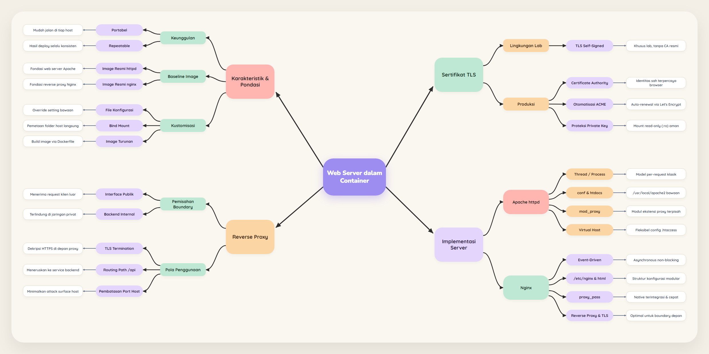

---

## 3. Alat dan Lingkungan

| Komponen | Spesifikasi / Nilai |
|---|---|
| Sistem Operasi Host | Ubuntu 26.04.1 LTS (via SSH VM) |
| Kernel | Linux 7.0.0-31-generic x86_64 |
| Akun Pengguna | `ras1putra` |
| Docker Engine | 29.8.1 (Community) |
| Docker Compose | v2.33.1 / plugin Compose v2 |
| Web Proxy Image | `nginx:alpine` |
| Web Origin Image | `httpd:2.4-alpine` |
| Backend Runtime | Python 3.12-slim (Gunicorn 23.0.0 + Flask 3.1.2) |
| Direktori Kerja | `~/docker-lab/bab-4/` |
| Port Host Terpetakan | `127.0.0.1:8080` (HTTP) dan `127.0.0.1:8443` (HTTPS) |

---

## 4. Langkah Praktikum

### 4.1 Persiapan Direktori Kerja

Langkah awal adalah membuat direktori kerja `~/docker-lab/bab-4` beserta sub-direktori untuk situs Apache, konfigurasi Nginx, sertifikat TLS, log bind mount, dan kode aplikasi Flask:

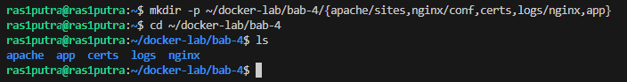

Sub-direktori `apache`, `app`, `certs`, `logs`, dan `nginx` berhasil dibuat secara terstruktur untuk mengisolasi setiap komponen konfigurasi.

---

### 4.2 Pembuatan Sertifikat TLS Laboratorium

Sertifikat *self-signed* X.509 dibuat menggunakan OpenSSL dengan kunci RSA 2048-bit, masa berlaku 365 hari, dan ekstensi *Subject Alternative Name* (SAN) untuk memvalidasi hostname `localhost` dan IP `127.0.0.1`. Selanjutnya, hak akses file diperketat (`chmod 600` untuk private key dan `chmod 644` untuk sertifikat publik):

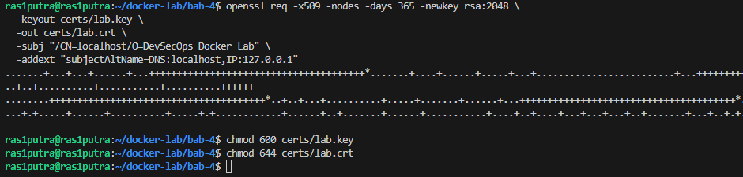

Kunci privat `lab.key` dan sertifikat `lab.crt` berhasil di-generate. Hak akses `600` menjamin hanya user pemilik proses yang dapat membaca *private key*.

---

### 4.3 Konfigurasi Multi-Service pada `compose.yaml`

File `compose.yaml` mendefinisikan tiga service terintegrasi dalam bridge network `web-net`:
- `proxy`: Nginx Alpine mengekspos port host `127.0.0.1:8080` (HTTP) dan `127.0.0.1:8443` (HTTPS), me-mount konfigurasi serta sertifikat secara *read-only* (`:ro`), serta direktori log.
- `apache-web`: Origin server HTTPD yang menyajikan file HTML via bind mount `:ro` tanpa mempublikasikan port ke host.
- `flask-app`: Backend API berbasis Python/Gunicorn yang dilengkapi *healthcheck* otomatis pada endpoint `/health`. Service `proxy` menunggu `flask-app` mencapai kondisi `service_healthy`.

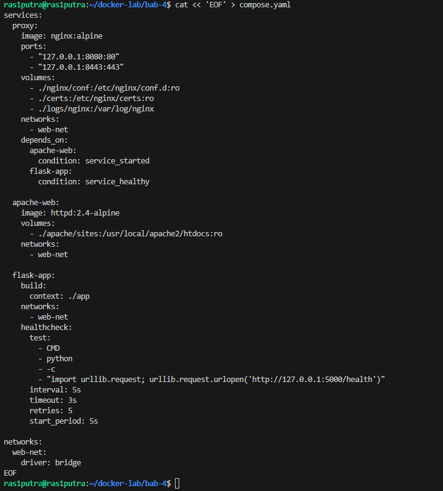

---

### 4.4 Konfigurasi Nginx Reverse Proxy (`nginx/conf/default.conf`)

Konfigurasi Nginx membagi upstream menjadi `apache_backend` dan `flask_backend`. Blok server HTTP port 80 melakukan redirect 301 ke HTTPS port 8443. Blok server HTTPS mengaktifkan SSL dengan sertifikat yang telah dibuat, membatasi protokol ke `TLSv1.2 TLSv1.3`, menyematkan security response headers (`nosniff`, `DENY`, `no-referrer`), serta meneruskan request ke backend dengan header proxy forward (`Host`, `X-Real-IP`, `X-Forwarded-For`, `X-Forwarded-Proto`):

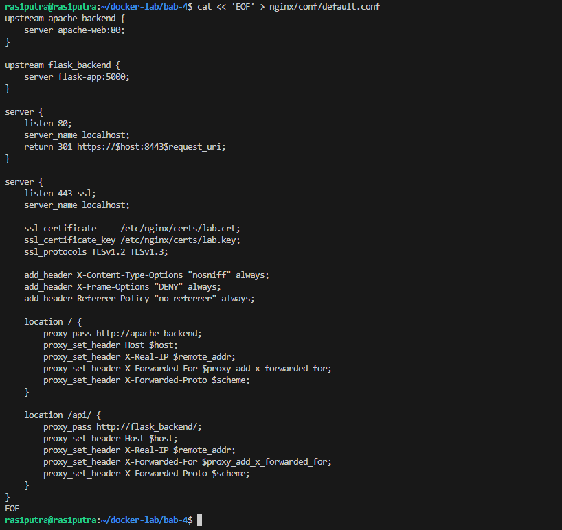

---

### 4.5 Penyiapan Dokumen Apache dan Kode Aplikasi Flask

File statis HTML untuk origin Apache serta dependensi dan kode REST API Flask dibuat. Endpoint Flask `/` mengembalikan status JSON dan mencatat protokol yang diteruskan (`X-Forwarded-Proto`), sedangkan `/health` bertindak sebagai target *probe healthcheck*:

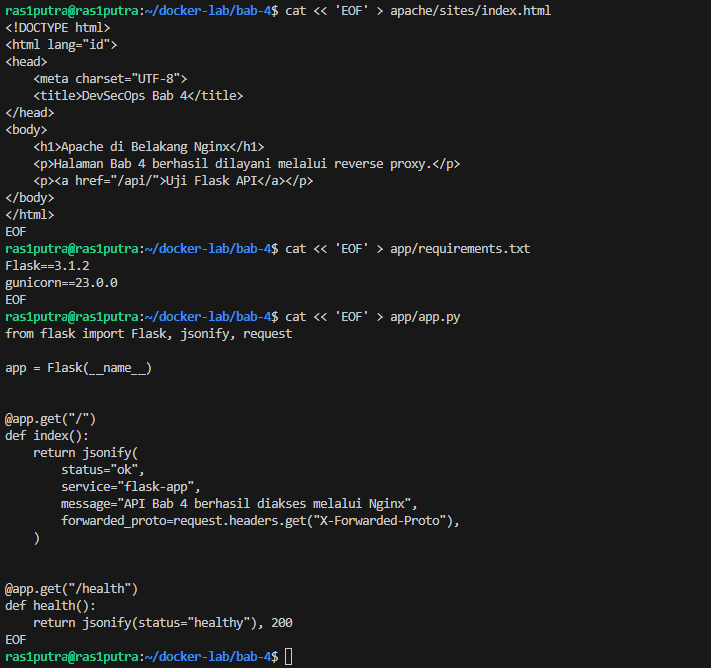

---

### 4.6 Pembuatan `Dockerfile` Hardened untuk Flask

Dockerfile dibuat menggunakan base image minimal `python:3.12-slim`. Untuk memenuhi prinsip keamanan *least privilege*, user sistem non-root dibuat dengan UID 10001 (`appuser`), dan proses server produksi Gunicorn dijalankan langsung di bawah user tersebut:

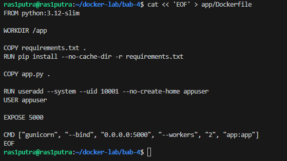

---

### 4.7 Validasi Konfigurasi dan Struktur Proyek

Validasi integritas dilakukan dengan memeriksa seluruh berkas yang telah dibuat serta memastikan file `compose.yaml` valid secara deklaratif:

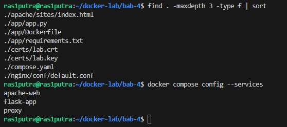

Pemeriksaan `find` menunjukkan seluruh file kunci berada pada lokasi yang tepat. Perintah `docker compose config --services` mengonfirmasi registrasi ketiga service: `apache-web`, `flask-app`, dan `proxy`.

---

### 4.8 Build Image dan Menjalankan Stack Multi-Container

Seluruh stack di-build dan dijalankan di latar belakang (*detached mode*). Compose mengunduh image `httpd:2.4-alpine`, mem-build image lokal `bab-4-flask-app`, membuat network bridge `bab-4_web-net`, serta memulai container dengan urutan yang tepat:

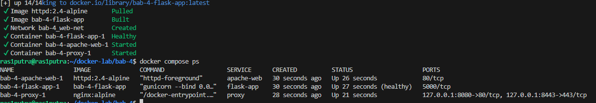

Hasil output memvalidasi:
- Container `bab-4-flask-app-1` mencapai status **`Up (healthy)`** setelah uji endpoint `/health` berhasil.
- Container `bab-4-apache-web-1` berstatus **`Up`** (port 80/tcp hanya terbuka di dalam network bridge).
- Container `bab-4-proxy-1` berstatus **`Up`** dengan port publik `127.0.0.1:8080->80/tcp` dan `127.0.0.1:8443->443/tcp`.

---

### 4.9 Pengujian Cepat Fungsionalitas Endpoint dan Redirection

Pengujian dilakukan menggunakan utilitas `curl` terhadap skenario HTTP redirect, HTTPS Apache, Flask API, dan endpoint healthcheck:

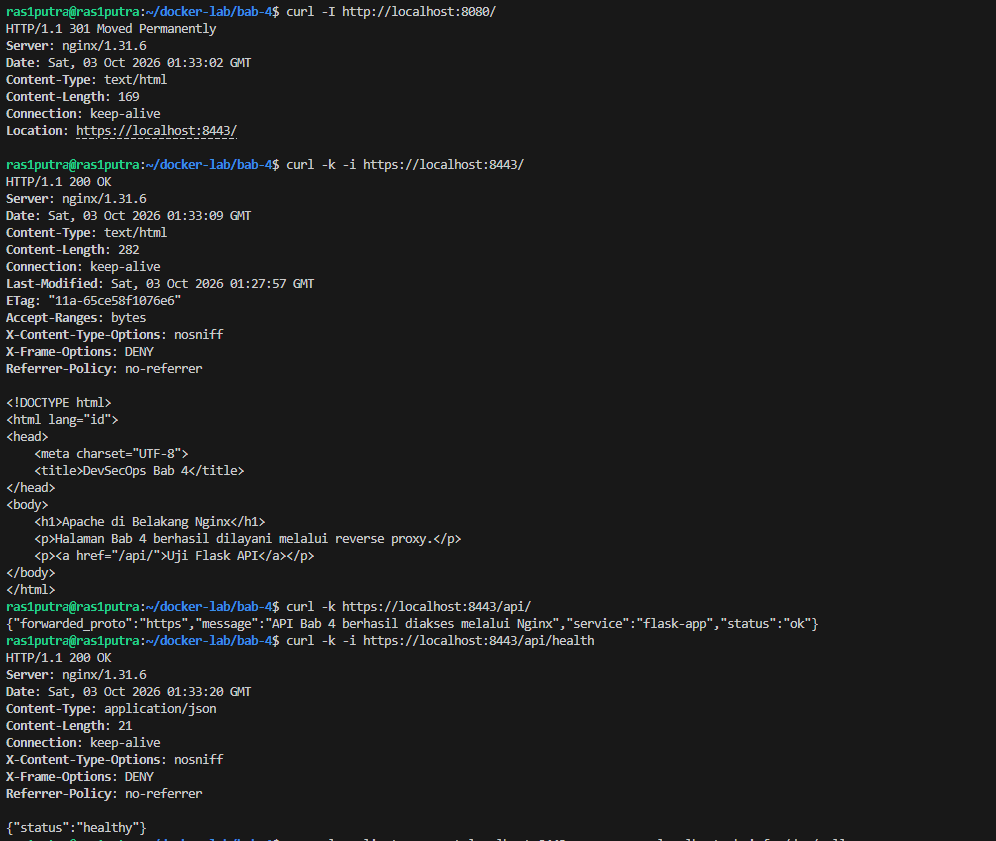

Hasil verifikasi:
1. Port 8080 mengembalikan header `HTTP/1.1 301 Moved Permanently` dengan header `Location: https://localhost:8443/`.
2. Port 8443 menampilkan respons `HTTP/1.1 200 OK`, menyertakan security response headers (`X-Content-Type-Options: nosniff`, `X-Frame-Options: DENY`, `Referrer-Policy: no-referrer`), serta konten HTML Apache `<h1>Apache di Belakang Nginx</h1>`.
3. Endpoint `/api/` berhasil meneruskan request ke backend Flask, menghasilkan JSON:  
   `{"forwarded_proto":"https","message":"API Bab 4 berhasil diakses melalui Nginx","service":"flask-app","status":"ok"}`.  
   Nilai `forwarded_proto: https` membuktikan bahwa Nginx sukses menginformasikan skema koneksi aman client kepada backend.
4. Endpoint `/api/health` mengembalikan kode status 200 dengan payload `{"status":"healthy"}`.

---

### 4.10 Pengujian Handshake TLS dan Kriptografi

Validasi koneksi SSL/TLS dilakukan secara mendalam menggunakan utilitas `openssl s_client`:

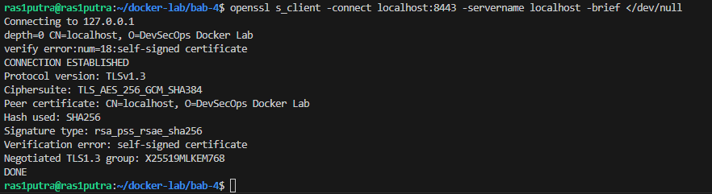

Rincian hasil handshake:
- **Protocol version**: `TLSv1.3` (protokol keamanan transport generasi terbaru).
- **Ciphersuite**: `TLS_AES_256_GCM_SHA384` (enkripsi simetris AEAD dengan integritas tinggi).
- **Peer certificate**: `CN=localhost, O=DevSecOps Docker Lab`.
- **Signature type**: `rsa_pss_rsae_sha256`.
- **Negotiated TLS1.3 group**: `X25519MLKEM768` (pertukaran kunci berbasis kurva eliptis modern dengan perlindungan pasca-kuantum).

---

### 4.11 Pemeriksaan Isolasi Jaringan dan Reachability Internal

Untuk membuktikan bahwa backend terlindungi dan komunikasi internal berjalan normal, perintah `wget` dieksekusi dari dalam container `proxy` menuju container backend menggunakan nama service Compose:

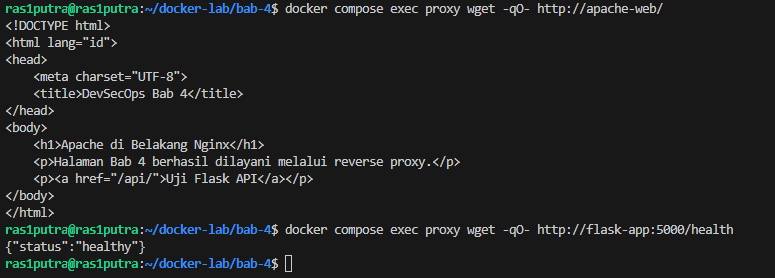

Container `proxy` berhasil melakukan *service discovery* dan mengambil konten dari `http://apache-web/` serta `http://flask-app:5000/health`. Karena `apache-web` dan `flask-app` tidak memiliki published port pada host, tidak ada pihak luar yang dapat mengakses backend secara langsung tanpa melewati filter dan inspeksi proxy Nginx.

---

### 4.12 Pemeriksaan Log Akses dan Log Error

Pemeriksaan log dilakukan langsung dari direktori host hasil bind mount `./logs/nginx` serta log container Gunicorn:

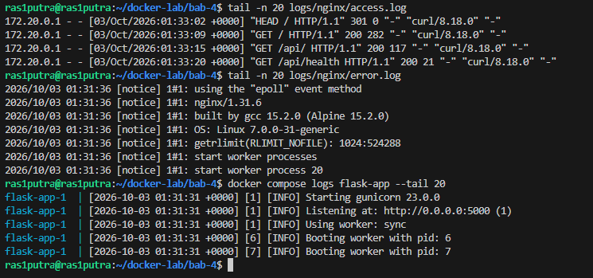

Analisis log:
1. `access.log` mencatat keempat transaksi request sebelumnya secara kronologis:
   - `HEAD / HTTP/1.1` -> Status `301` (Redirect)
   - `GET / HTTP/1.1` -> Status `200` (Apache)
   - `GET /api/ HTTP/1.1` -> Status `200` (Flask API)
   - `GET /api/health HTTP/1.1` -> Status `200` (Healthcheck API)
2. `error.log` menunjukkan startup Nginx 1.31.6 dengan model event `epoll` pada kernel Linux 7.0 tanpa adanya catatan kesalahan (*clean operation*).
3. Log `flask-app` membuktikan worker Gunicorn berjalan dengan PID 6 dan 7 di bawah mode `sync` dan siap melayani permintaan.

---

## 5. Analisis Hasil dan Pembahasan

### 5.1 Arsitektur Boundary dan Efektivitas Reverse Proxy
Pemisahan antara interface publik dan origin backend berhasil diimplementasikan secara elegan. Nginx berperan sebagai *single point of entry*. Dengan membatasi pemetaan port pada Compose (`127.0.0.1:8080` dan `127.0.0.1:8443`), host interface fisik tidak memaparkan port sembarangan ke jaringan eksternal. Backend Apache dan Flask sepenuhnya tersembunyi di dalam private bridge network `web-net`. Pola ini memutus vektor serangan langsung seperti eksploitasi celah aplikasi web atau injeksi HTTP raw pada backend.

### 5.2 Analisis Header Terpercaya (*Trusted Forwarded Headers*)
Pada pengujian `curl -k https://localhost:8443/api/`, respons JSON menunjukkan `"forwarded_proto": "https"`. Hal ini membuktikan efektivitas arahan:
```nginx
proxy_set_header X-Forwarded-Proto $scheme;
proxy_set_header X-Forwarded-For $proxy_add_x_forwarded_for;
```
Karena backend berada di jaringan terisolasi dan hanya dapat dihubungi oleh Nginx, backend dapat mempercayai header tersebut tanpa risiko *header spoofing* dari penyerang luar. Konteks ini krusial saat backend perlu men-generate URI absolut, melakukan validasi CSRF, atau menegakkan audit trail alamat IP asal klien (`X-Real-IP`).

### 5.3 Evaluasi Terminasi TLS dan Keamanan Kriptografi
Implementasi TLS pada Nginx berhasil menaikkan status keamanan transport layer ke **TLSv1.3** dengan cipher `TLS_AES_256_GCM_SHA384`. Terminasi TLS di Nginx memberikan keuntungan performa:
- Beban enkripsi asimetris diisolasi pada Nginx yang dioptimasi dengan arsitektur *event-driven* (epoll).
- Backend Flask/Gunicorn beroperasi secara efisien dalam melayani komputasi bisnis.
- Sertifikat SSL cukup diperbarui di satu tempat tanpa harus merestart atau mengonfigurasi ulang aplikasi Python dan Apache.

Penyematan security headers (`X-Content-Type-Options: nosniff`, `X-Frame-Options: DENY`, `Referrer-Policy: no-referrer`) pada level reverse proxy memastikan bahwa seluruh respons, baik statis maupun dinamis, terlindungi dari serangan *MIME-sniffing*, *clickjacking*, dan kebocoran informasi referer.

### 5.4 Dependensi Startup Berbasis Healthcheck
Pada arsitektur microservice, status container `running` tidak menjamin aplikasi siap menerima trafik (*readiness*). Dalam praktikum ini, arahan Compose:
```yaml
depends_on:
  flask-app:
    condition: service_healthy
```
mencegah *race condition* di mana Nginx memulai routing ke backend sebelum Gunicorn selesai melakukan *booting worker*. Dengan menguji endpoint `/health` secara berkala via Python internal, Nginx hanya akan melayani trafik setelah backend benar-benar berstatus `healthy`, mengeliminasi potensi error `502 Bad Gateway` saat sistem di-boot ulang.

---

## 6. Masalah yang Muncul dan Troubleshooting

### Masalah: Peringatan Sertifikat Untrusted pada Client
* **Gejala**: Ketika melakukan curl tanpa flag `-k`, client menolak koneksi dengan pesan kesalahan `curl: (60) SSL certificate problem: self signed certificate`.
* **Diagnosis**: OpenSSL memverifikasi sertifikat terhadap sistem *Certificate Store* lokal. Karena sertifikat lab dibuat sendiri (*self-signed*) dan belum ditandatangani oleh *Certificate Authority* (CA) publik tepercaya yang ada di daftar root CA OS, client mendeteksinya sebagai potensi ancaman *Man-In-The-Middle* (MITM).
* **Solusi**: 
  - Pada lingkungan laboratorium, bypass verifikasi dapat dilakukan dengan parameter `-k` (`--insecure`) pada `curl`, atau menggunakan `openssl s_client` untuk inspeksi langsung.
  - Untuk lingkungan produksi (*production-like*), sertifikat wajib diterbitkan oleh CA terpercaya (misalnya Let's Encrypt melalui certbot/ACME protocol), atau mengimpor root CA lokal lab ke dalam trust store sistem klien (`/usr/local/share/ca-certificates/` di Linux).

---

## 7. Risiko Keamanan dan Operasional

1. **Penyimpanan Private Key pada Bind Mount**:
   Sertifikat dan private key (`lab.key`) disimpan pada folder host yang di-mount ke container. Jika host tidak dijaga hak aksesnya, atau jika file repository di-commit ke Git publik secara tidak sengaja, private key dapat bocor. Kebocoran private key memungkinkan pihak ketiga melakukan dekripsi pasif terhadap rekaman trafik atau menyamar sebagai server yang sah.
2. **Koneksi Unencrypted di Sisi Internal (Internal Plaintext)**:
   Dengan terminasi TLS di Nginx, segmen komunikasi antara Nginx ke Apache dan Nginx ke Flask berjalan menggunakan HTTP plaintext. Jika penyerang berhasil mengompromikan salah satu container di jaringan `web-net` (atau melakukan sniffing pada interface docker bridge host), data sensitif yang melintasi jaringan internal dapat disadap.
3. **Risiko Denial of Service pada Single Point of Failure (SPOF)**:
   Karena seluruh trafik dipusatkan melalui single instance proxy Nginx, kegagalan pada proxy akan melumpuhkan seluruh akses aplikasi web dan API sekaligus. Tanpa adanya batasan rate limiting (`limit_req_zone`) atau pembatasan koneksi, penyerang dapat membanjiri Nginx dengan request DoS.

---

## 8. Rekomendasi Kesiapan Produksi (*Production-Readiness*)

Bila stack ini akan diimplementasikan ke lingkungan nyata/produksi, rekomendasi perbaikan berikut harus diterapkan:
1. **Gunakan Docker Secrets / Secret Manager**: Pindahkan private key TLS dari bind mount host ke mekanisme *Docker Secrets* (Docker Swarm/Kubernetes Secrets) atau HashiCorp Vault. Kunci hanya diinjeksikan ke memory buffer container tanpa pernah tersimpan sebagai plain file di filesystem host.
2. **Automasi Pembaruan Sertifikat via ACME / Let's Encrypt**: Ganti sertifikat self-signed dengan sertifikat valid menggunakan certbot yang berjalan sebagai *sidecar container* untuk rotasi sertifikat otomatis setiap 60–90 hari.
3. **Terapkan Strict Transport Security (HSTS)**: Tambahkan header `Strict-Transport-Security: max-age=31536000; includeSubDomains; preload` pada Nginx untuk memaksa browser selalu berkomunikasi via HTTPS dan mencegah serangan SSL Stripping.
4. **Terapkan Rate Limiting dan Request Size Restriction**: Konfigurasikan arahan `limit_req_zone` dan `client_max_body_size` pada Nginx untuk melindungi backend dari lonjakan request abnormal dan serangan buffer overflow.
5. **Implementasikan End-to-End TLS (mTLS)**: Jika aplikasi memproses data finansial atau rekam medis sensitif, terapkan mutual TLS (mTLS) atau internal HTTPS antara Nginx dan Gunicorn sehingga komunikasi intra-container tetap terenkripsi secara menyeluruh.

---

## 9. Kesimpulan

Praktikum Bab 4 berhasil mendemonstrasikan implementasi arsitektur web service terkontainerisasi yang aman, andal, dan terisolasi:
1. **Reverse Proxy & Routing**: Nginx sukses difungsikan sebagai reverse proxy yang memetakan jalur statis ke Apache dan jalur dinamis `/api/` ke Flask backend dengan penerusan konteks client yang akurat.
2. **Enkripsi & Redirection**: Mekanisme auto-redirect HTTP ke HTTPS (301 Moved Permanently) dan terminasi TLSv1.3 berjalan sempurna, membuktikan proteksi transfer data dengan cipher modern dan security headers.
3. **Boundary Security**: Penerapan isolasi jaringan di mana hanya Nginx yang memiliki exposed port, dipadukan dengan eksekusi backend di bawah akun non-root (`appuser`), secara nyata meminimalkan risiko eskalasi serangan.
4. **Orkestrasi Deklaratif**: Pemanfaatan `healthcheck` pada Docker Compose terbukti efektif menjamin ketersediaan layanan backend sebelum proxy membuka akses lalu lintas jaringan.

---

## 10. Evaluasi dan Latihan Mandiri

### 1. Mengapa reverse proxy tidak seharusnya menjalankan semua logic aplikasi?
**Jawaban**:  
Reverse proxy dirancang secara khusus untuk menangani fungsionalitas lapisan transport dan perbatasan jaringan (*edge routing*), seperti terminasi TLS, kompresi respons, caching berkas statis, load balancing, rate limiting, dan inspeksi header keamanan. Menjalankan *business logic* (seperti query database yang kompleks, komputasi transaksi bisnis, atau validasi alur kerja aplikasi) di dalam reverse proxy melanggar prinsip *Separation of Concerns* (pemisahan tanggung jawab). Hal ini dapat membebani worker thread proxy yang bersifat *event-driven*, mengurangi throughput penanganan koneksi masuk, serta meningkatkan kompleksitas pemeliharaan dan risiko celah keamanan pada gerbang pertahanan terluar sistem.

### 2. Apa perbedaan TLS termination dan end-to-end TLS?
**Jawaban**:  
- **TLS Termination**: Sesi enkripsi TLS dinegosiasikan dan dihentikan di reverse proxy. Lalu lintas antara client dan proxy terenkripsi (HTTPS), namun lalu lintas internal antara proxy ke backend berjalan dalam bentuk plaintext (HTTP). Pola ini menghemat beban CPU backend dan menyederhanakan sertifikat, cocok untuk arsitektur di mana jaringan internal sepenuhnya privat dan tepercaya.
- **End-to-End TLS**: Sesi enkripsi dipertahankan dari client hingga ke titik akhir backend (atau didekripsi di proxy lalu dienkripsi ulang dengan sesi TLS baru menuju backend). Pola ini menjamin keamanan maksimum karena data tidak pernah berada dalam kondisi plaintext di jaringan mana pun, sangat penting pada arsitektur *Zero Trust* atau lingkungan multi-tenant di cloud publik.

### 3. Bagaimana cara mengisolasi backend agar tidak langsung diakses dari host?
**Jawaban**:  
Backend dapat diisolasi dengan:
1. Menempatkan service backend (`apache-web`, `flask-app`) ke dalam *user-defined bridge network* terpisah.
2. **Tidak mendefinisikan direktif `ports`** (published port) pada service backend di file `compose.yaml`. Hanya gunakan direktif `expose` (opsional untuk dokumentasi internal) atau biarkan service mendengarkan port defaultnya di dalam jaringan bridge.
3. Jika proxy memerlukan publikasi port ke host, ikat port tersebut secara eksplisit ke loopback interface host, misalnya `127.0.0.1:8080:80` dan `127.0.0.1:8443:443`, bukan `0.0.0.0`, sehingga port tidak dapat diakses langsung dari jaringan luar host tanpa otorisasi.

### 4. Apa konsekuensi menyimpan private key TLS di bind mount?
**Jawaban**:  
Menyimpan private key melalui bind mount memiliki sejumlah risiko keamanan dan operasional:
1. **Risiko Kebocoran Repository**: File kunci yang berada di folder proyek lokal rentan terdorong (*committed*) ke sistem version control publik (Git) jika developer lupa menambahkan file ke `.gitignore`.
2. **Ketergantungan Izin File Host**: Hak akses file di container bergantung pada izin filesystem host (`chmod 600`). Jika host memiliki konfigurasi permission yang terlalu longgar (misal `777`), pengguna lokal lain pada host dapat membaca private key tersebut.
3. **Tidak Mendukung Rotasi Dinamis**: Pembaruan sertifikat memerlukan sinkronisasi manual file di host, berbeda dengan sistem *Secret Management* (seperti Docker Secrets atau Vault) yang mengelola siklus hidup kunci di memori dan mendukung rotasi tanpa risiko penulisan fisik ke disk secara sembarangan.

### 5. Bandingkan log Nginx dan log Apache dari sisi format dan kegunaan debugging!
**Jawaban**:  
- **Format Log**:
  - **Nginx**: Secara default menggunakan format `Combined Log Format` yang sangat ringkas dan efisien: `$remote_addr - $remote_user [$time_local] "$request" $status $body_bytes_sent "$http_referer" "$http_user_agent"`. Nginx sangat fleksibel dalam mengkustomisasi log format (misalnya menambahkan variabel `$upstream_response_time`, `$upstream_status`, dan `$ssl_protocol`).
  - **Apache**: Menggunakan format `Common Log Format` (CLF) atau `Combined`, namun log error Apache (`error_log`) memiliki format diagnostik yang lebih terstruktur dengan level keparahan modul: `[timestamp] [module:severity] [pid X:tid Y] [client IP:port] message`.
- **Kegunaan Debugging**:
  - **Nginx Log**: Sangat unggul untuk men-debug lalu lintas jaringan skala besar, bottleneck performa upstream, analisis latensi reverse proxy, serta tracking status kode HTTP (apakah kesalahan 502/504 berasal dari gateway Nginx atau upstream backend).
  - **Apache Log**: Sangat mendalam untuk men-debug masalah internal server web, seperti kesalahan sintaks direktif per-direktori (`.htaccess`), perizinan hak akses folder (*forbidden 403*), modul virtual host, dan interaksi native modul Apache.

---

### 6. Tugas Tambahan 1: Jelaskan Konsep Arsitektur Event-Driven (dan Kaitannya dengan Nginx vs Apache)!
**Jawaban**:  
- **Konsep Arsitektur Event-Driven**:  
  Arsitektur *Event-Driven Asynchronous* adalah paradigma pemrograman di mana aliran eksekusi program dikendalikan oleh *event* (kejadian), seperti masuknya koneksi jaringan baru, kesiapan socket untuk dibaca/ditulis (*I/O readiness*), atau sinyal timeout. Alih-alih mengalokasikan satu thread/proses khusus yang memblokir (*blocking*) eksekusi saat menunggu I/O selesai, arsitektur ini memanfaatkan mekanisme notifikasi event kernel sistem operasi (pada Linux menggunakan sistem panggilan `epoll`, atau `kqueue` pada BSD/macOS).
- **Perbandingan Nginx vs Apache**:
  - **Apache (Model Tradisional Process/Thread-per-Request)**:  
    Pada modul klasik MPM Prefork atau Worker, setiap koneksi klien ditangani oleh satu proses atau thread tersendiri. Ketika klien mengalami koneksi lambat (*slow client*) atau menunggu respons disk/backend, thread tersebut akan tertahan (*idle/blocked*). Jika terjadi lonjakan ribuan koneksi simultan (masalah *C10K problem*), sistem akan kehabisan memori akibat alokasi stack per-thread dan mengalami degradasi performa drastis akibat *overhead context switching* pada CPU.
  - **Nginx (Model Event-Driven Asynchronous)**:  
    Nginx hanya menjalankan sejumlah kecil *worker processes* (biasanya disesuaikan dengan jumlah core CPU fisik). Masing-masing worker mengeksekusi sebuah *single-threaded non-blocking event loop*. Satu worker dapat menangani puluhan ribu koneksi TCP secara simultan dalam satu thread karena worker tidak pernah menunggu data selesai dikirim; worker hanya bereaksi ketika kernel memberitahukan bahwa paket data telah tiba di socket buffer.
- **Korelasi dengan Hasil Praktikum**:  
  Hal ini terbukti secara empiris pada file `error.log` Nginx (screenshot **[assets/bab-04/12.png](file:///c:/Users/Putra Yanuar Rasyid/Downloads/devsecops-kuliah/3126640058%20-%20Putra%20Yanuar%20Rasyid/assets/bab-04/12.png)**), di mana tercatat baris:
  ```text
  [notice] 1#1: using the "epoll" event method
  [notice] 1#1: start worker process 20
  ```
  Ini membuktikan bahwa Nginx mengaktifkan subsistem `epoll` kernel Linux 7.0 untuk mengelola seluruh koneksi masuk secara non-blocking dengan efisiensi memori yang konstan dan skalabilitas tinggi.

---

### 7. Tugas Tambahan 2: Bagaimana Cara Menyimpan (*Store*) Private Key yang Aman?
**Jawaban**:  
Private key TLS merupakan aset kriptografi paling krusial karena kebocorannya memungkinkan penyerang melakukan dekripsi rekaman trafik (*eavesdropping*) atau menyamar sebagai server yang sah (*impersonation*). Menyimpan private key secara aman (*secure storage*) harus menerapkan strategi berlapis (*defense-in-depth*):

1. **Gunakan Orkestrasi Secret Management (Docker Secrets / Kubernetes Secrets)**:
   - **Prinsip**: Jangan pernah menyimpan file kunci dalam citra kontainer (*container image*) ataupun direktori filesystem persisten host yang tidak terenkripsi.
   - **Implementasi**: Gunakan fitur native *Docker Secrets* (pada Docker Swarm) atau *Kubernetes Secret*. Mekanisme ini menginjeksi private key ke dalam sistem berkas temporer memori RAM (*tmpfs in-memory filesystem*) di `/run/secrets/` saat container runtime dijalankan. Kunci tidak pernah ditulis ke media penyimpanan fisik (disk), dienkripsi saat diam (*encrypted at rest* via Raft/etcd), dan langsung musnah dari memori begitu container dimatikan.
2. **Integrasikan dengan Centralized Vault (HashiCorp Vault / Cloud KMS)**:
   - Simpan private key pada brankas rahasia terpusat seperti HashiCorp Vault, AWS Secrets Manager, Google Cloud Secret Manager, atau Azure Key Vault.
   - Akses diberikan berdasarkan identitas beban kerja (*workload identity / service account*) dengan kebijakan *Least Privilege* dan pencatatan jejak audit (*audit trail*) ketat untuk setiap operasi pembacaan kunci.
3. **Pemanfaatan Hardware Security Module (HSM) / Cloud KMS via PKCS#11**:
   - Untuk lingkungan tingkat tinggi (finansial, data medis), gunakan modul HSM fisik atau Cloud HSM. Private key disimpan dan dikunci secara permanen di dalam hardware fisik yang *tamper-resistant*. Nginx atau web server melakukan operasi kriptografi (seperti penandatanganan handshake TLS) melalui antarmuka PKCS#11 langsung ke dalam chip HSM tanpa kunci privat pernah diekspor atau keluar ke memori OS.
4. **Penegakan Hak Akses Berkas Ketat (*Strict File Permissions*)**:
   - Jika harus disimpan pada media host lokal (misal pada server standalone), file kunci wajib dimiliki oleh akun khusus non-root yang menjalankan daemon proxy (`chown appuser:appuser certs/lab.key`) dan dikunci dengan hak akses oktal `chmod 400` (*read-only owner*) atau `chmod 600`.
   - Pastikan direktori kunci dimasukkan ke dalam `.gitignore` dan `.dockerignore` untuk mencegah kebocoran yang tidak disengaja ke repositori kode sumber publik atau ke dalam layer build image.
5. **Otomatisasi Rotasi Kunci Berkala (Automated Short-Lived Keys)**:
   - Terapkan siklus hidup sertifikat berumur pendek (misalnya 30–90 hari via protokol ACME / Let's Encrypt) yang diperbarui secara otomatis. Rotasi berkala membatasi jendela eksploitasi (*blast radius*) seandainya kunci lama sempat terkompromikan.
