# Laporan Praktikum Bab 5 — Database Service di Docker: PostgreSQL

**Mata Kuliah:** Workshop DevOps  
**Dosen Pengampu:** Dr. Ferry Astika Saputra, S.T., M.Sc.  
**Penyusun:** Putra Yanuar Rasyid  
**NRP:** 3126640058  
**Program Studi:** D4 Teknik Informatika  
**Departemen:** Teknik Informatika dan Komputer  
**Institusi:** Politeknik Elektronika Negeri Surabaya  
**Tahun:** 2026  

---

## 1. Landasan Teori dan Konsep Kunci

### 1.1 Database sebagai Stateful Service dalam Container
Menjalankan sistem manajemen basis data relasional (RDBMS) seperti PostgreSQL di dalam lingkungan container Docker memperkenalkan paradigma operasional yang berbeda secara fundamental dibandingkan dengan aplikasi *stateless*. Pada aplikasi stateless, container dapat dihancurkan dan dibuat ulang kapan saja tanpa risiko kehilangan data. Sebaliknya, database adalah *stateful service* di mana data merupakan aset utama yang memiliki siklus hidup independen terhadap daur hidup container.

PostgreSQL mengelola konsistensi data melalui *Write-Ahead Logging* (WAL) dan *two-phase commit*. Lapisan penyimpanan (*storage layer*) container default bersifat *ephemeral* (lapisan *copy-on-write* / overlay2) yang akan musnah seketika saat container dihapus. Oleh karena itu, arsitektur database container mewajibkan penggunaan *Named Volume* Docker yang dipetakan langsung ke direktori data PostgreSQL (`/var/lib/postgresql/data`).

### 1.2 Mekanisme Inisialisasi Skema (`/docker-entrypoint-initdb.d`)
Image resmi PostgreSQL (`postgres:16-alpine`) menyediakan mekanisme inisialisasi otomatis berbasis skrip shell (`.sh`) atau skrip SQL (`.sql`) yang diletakkan pada direktori `/docker-entrypoint-initdb.d`. Karakteristik penting dari mekanisme ini adalah:
- Skrip hanya dieksekusi **satu kali** ketika direktori data target (`PGDATA`) berada dalam kondisi **kosong** (inisialisasi awal kluster database).
- Jika direktori data telah terisi (misalnya saat container dijalankan ulang menggunakan volume persisten yang sudah ada), *entrypoint* akan mendeteksi kluster aktif dan secara otomatis melompati (*skipping*) eksekusi skrip inisialisasi.
- Perubahan skema di kemudian hari harus dikelola melalui mekanisme *database migration* atau eksekusi DDL langsung, bukan dengan mengedit file init script.

### 1.3 Manajemen Kredensial dan Prinsip Least Privilege
PostgreSQL mendukung inisialisasi kredensial melalui *environment variable* seperti `POSTGRES_DB`, `POSTGRES_USER`, dan `POSTGRES_PASSWORD`. Menanam kredensial secara terbuka (*hardcoded*) pada file `compose.yaml` menimbulkan risiko keamanan tinggi jika file tersebut terunggah ke repositori Git publik. Praktik terbaik yang diterapkan adalah:
1. Mengisolasi kredensial ke dalam file `.env` dengan izin berkas ketat (`chmod 600`).
2. Mendaftarkan `.env` dan direktori dump backup ke dalam file `.gitignore`.
3. Mengikat akses port database pada interface loopback host (`127.0.0.1:5432`) dan memanfaatkan *user-defined bridge network* (`data-net`) untuk komunikasi antar-kontainer.

### 1.4 Strategi Backup dan Validasi Pemulihan (*Disaster Recovery*)
Volume Docker menjamin persistensi terhadap daur hidup container, namun bukan merupakan substitusi dari cadangan data (*backup*). Kehilangan media storage host atau korupsi data internal tetap dapat memusnahkan data. Terdapat dua pendekatan pencadangan:
- **Logical Backup (`pg_dump`)**: Mengekstrak definisi skema dan data ke dalam format SQL atau format custom binary (`-Fc`). Bersifat portabel lintas arsitektur CPU dan versi PostgreSQL minor, serta mendukung kompresi dan restorasi selektif.
- **Physical / Raw Filesystem Backup**: Menyalin berkas data fisik secara langsung. Berisiko mengalami *data corruption* (*torn pages*) jika disalin saat database sedang aktif melayani transaksi penulisan tanpa mode *basebackup*.

Validitas suatu cadangan hanya terbukti apabila prosedur pemulihan (*restore exercise*) telah diuji secara nyata pada instans database terpisah (`labdb_restore_test`) dan diverifikasi melalui integritas hash (*checksum* SHA256) serta konsistensi jumlah baris tabel.

---

## 2. Langkah Praktikum dan Bukti Eksekusi

### Langkah 1: Inisialisasi Struktur Direktori Proyek Lab
Membuat direktori kerja Bab 5 beserta sub-direktori isolasi untuk skrip inisialisasi (`init`), pencadangan (`backup`), konfigurasi pgAdmin (`pgadmin`), dan otomasi skrip (`scripts`).

```bash
mkdir -p ~/docker-lab/bab-5/{init,backup,pgadmin,scripts}
cd ~/docker-lab/bab-5
```

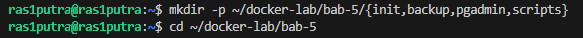

**Analisis:** Direktori kerja terstruktur dibuat untuk memisahkan tanggung jawab file konfigurasi, data inisialisasi DDL, artefak dump backup, dan skrip otomasi.

---

### Langkah 2: Pembuatan File Environment dan Pengamanan Hak Akses
Menyusun file template kredensial `.env.example`, menyalinnya menjadi konfigurasi aktif `.env`, dan mengunci hak akses file menjadi `chmod 600`.

```bash
cat << 'EOF' > .env.example
POSTGRES_DB=labdb
POSTGRES_USER=labuser
POSTGRES_PASSWORD=labpass123
PGADMIN_DEFAULT_EMAIL=admin@example.local
PGADMIN_DEFAULT_PASSWORD=admin123
EOF

cp .env.example .env
chmod 600 .env
```

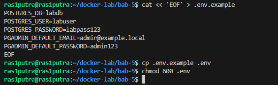

**Analisis:** Isolasi variabel kredensial ke dalam file `.env` mencegah eksposur password pada manifest Compose, sementara penetapan hak akses `600` menjamin berkas hanya dapat dibaca dan ditulis oleh user pemilik (*owner-only*).

---

### Langkah 3: Konfigurasi Proteksi Repositori Git (`.gitignore`)
Mencegah kebocoran kredensial dan file arsip basis data ke version control system.

```bash
cat << 'EOF' > .gitignore
.env
backup/*.dump
backup/*.sha256
backup/*.log
EOF
```

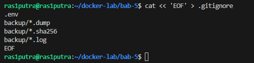

**Analisis:** Mengabaikan file `.env` dan ekstensi dump basis data mencegah kebocoran informasi rahasia dan artefak data sensitif ke remote repository Git.

---

### Langkah 4: Konfigurasi Multi-Container Stack Compose
Menyusun file `compose.yaml` yang mendefinisikan service `postgres-db` berbasis `postgres:16-alpine`, volume persisten `pg-data`, probe healthcheck `pg_isready`, service `pgadmin`, serta isolasi jaringan `data-net`.

```yaml
services:
  postgres-db:
    image: postgres:16-alpine
    environment:
      POSTGRES_DB: ${POSTGRES_DB}
      POSTGRES_USER: ${POSTGRES_USER}
      POSTGRES_PASSWORD: ${POSTGRES_PASSWORD}
    ports:
      - "127.0.0.1:5432:5432"
    volumes:
      - pg-data:/var/lib/postgresql/data
      - ./init:/docker-entrypoint-initdb.d:ro
    networks:
      - data-net
    healthcheck:
      test:
        - CMD-SHELL
        - "pg_isready -U $${POSTGRES_USER} -d $${POSTGRES_DB}"
      interval: 5s
      timeout: 5s
      retries: 10
      start_period: 10s
    restart: unless-stopped

  pgadmin:
    image: dpage/pgadmin4:latest
    environment:
      PGADMIN_DEFAULT_EMAIL: ${PGADMIN_DEFAULT_EMAIL}
      PGADMIN_DEFAULT_PASSWORD: ${PGADMIN_DEFAULT_PASSWORD}
    ports:
      - "127.0.0.1:5050:80"
    volumes:
      - pgadmin-data:/var/lib/pgadmin
      - ./pgadmin/servers.json:/pgadmin4/servers.json:ro
    networks:
      - data-net
    depends_on:
      postgres-db:
        condition: service_healthy
    restart: unless-stopped

volumes:
  pg-data:
  pgadmin-data:

networks:
  data-net:
    driver: bridge
```

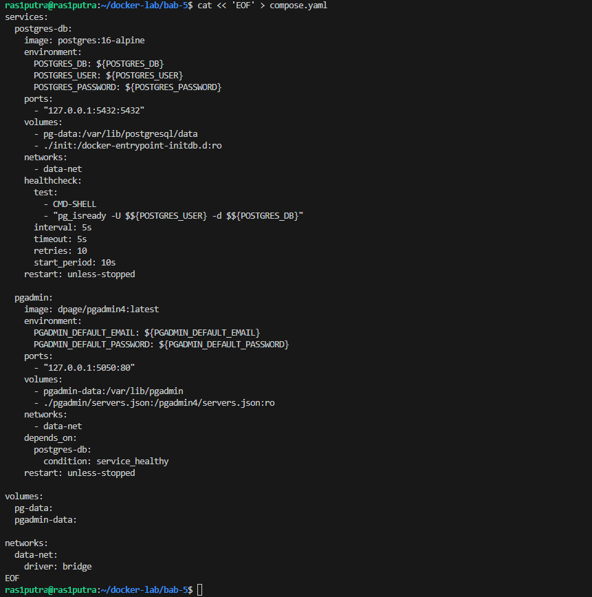

**Analisis:** Manifest Compose mendefinisikan orkestrasi PostgreSQL dan pgAdmin dengan binding port loopback terisolasi (`127.0.0.1`), mekanisme healthcheck periodik `pg_isready`, serta dependensi startup berbasis kondisi `service_healthy`.

---

### Langkah 5: Skrip Inisialisasi SQL dan Auto-Registration pgAdmin
Menyiapkan skrip DDL `init/01-schema.sql` untuk membuat tabel `students` beserta index dan data awal, serta menyusun file `pgadmin/servers.json` untuk konfigurasi koneksi otomatis pgAdmin.

```sql
CREATE TABLE IF NOT EXISTS students (
    id BIGSERIAL PRIMARY KEY,
    nrp VARCHAR(20) UNIQUE NOT NULL,
    name TEXT NOT NULL,
    created_at TIMESTAMPTZ NOT NULL DEFAULT CURRENT_TIMESTAMP
);

INSERT INTO students (nrp, name)
VALUES
    ('31230001', 'Mahasiswa Satu'),
    ('31230002', 'Mahasiswa Dua')
ON CONFLICT (nrp) DO NOTHING;

CREATE INDEX IF NOT EXISTS idx_students_name
    ON students (name);
```

```json
{
  "Servers": {
    "1": {
      "Name": "PostgreSQL Bab 5",
      "Group": "Laboratorium DevSecOps",
      "Host": "postgres-db",
      "Port": 5432,
      "MaintenanceDB": "labdb",
      "Username": "labuser",
      "SSLMode": "prefer"
    }
  }
}
```

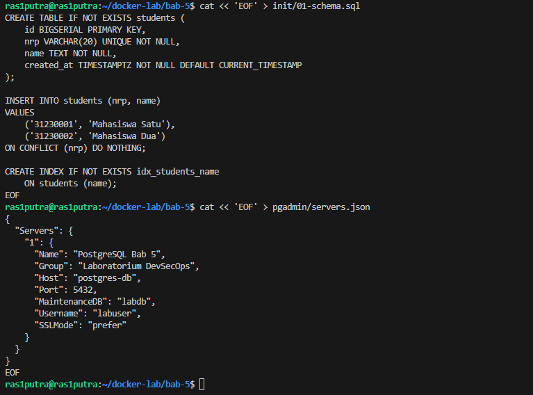

**Analisis:** Skrip SQL mendefinisikan integritas data dengan constraint primary key, unique NRP, dan index nama; sedangkan `servers.json` mendaftarkan koneksi database ke container pgAdmin menggunakan hostname internal `postgres-db`.

---

### Langkah 6: Pembuatan Skrip Otomatisasi Backup Logical Database
Menyusun skrip `scripts/backup.sh` untuk melakukan backup custom format (`-Fc`) menggunakan `pg_dump` dan menghitung nilai checksum SHA256.

```bash
#!/usr/bin/env bash
set -Eeuo pipefail
cd "$(dirname "$0")/.."
source .env
mkdir -p backup
timestamp="$(date -u +%Y%m%dT%H%M%SZ)"
dump_file="backup/${POSTGRES_DB}-${timestamp}.dump"
checksum_file="${dump_file}.sha256"

docker compose exec -T postgres-db \
    pg_dump \
    --username "$POSTGRES_USER" \
    --dbname "$POSTGRES_DB" \
    --format custom \
    --no-owner \
    --no-privileges \
    > "$dump_file"

test -s "$dump_file"
sha256sum "$dump_file" > "$checksum_file"
echo "[PASS] Backup: $dump_file"
echo "[PASS] Checksum: $checksum_file"
```

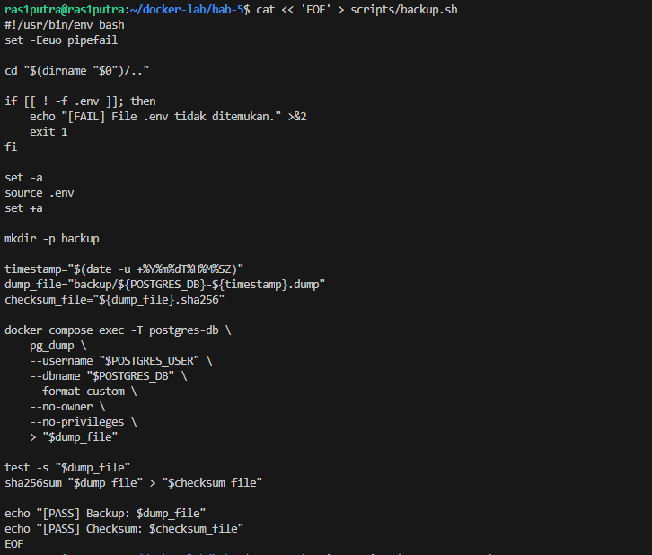

**Analisis:** Skrip backup mengekstrak basis data dalam format custom binary (`pg_dump -Fc`), menonaktifkan ownership untuk portabilitas restorasi, dan mengunci integritas file melalui hash SHA256.

---

### Langkah 7: Pembuatan Skrip Pengujian Pemulihan Database (`scripts/restore-test.sh`)
Menyusun skrip otomasi pengujian restorasi ke database sementara (`labdb_restore_test`) guna memvalidasi kelaikan arsip backup.

```bash
#!/usr/bin/env bash
set -Eeuo pipefail
cd "$(dirname "$0")/.."
source .env
dump_file="${1:-}"
restore_database="${POSTGRES_DB}_restore_test"

sha256sum --check "${dump_file}.sha256"
docker compose exec -T postgres-db dropdb --username "$POSTGRES_USER" --if-exists "$restore_database"
docker compose exec -T postgres-db createdb --username "$POSTGRES_USER" "$restore_database"
docker compose exec -T postgres-db pg_restore --username "$POSTGRES_USER" --dbname "$restore_database" --no-owner --no-privileges < "$dump_file"
docker compose exec -T postgres-db psql --username "$POSTGRES_USER" --dbname "$restore_database" --command "SELECT COUNT(*) AS total_students FROM students;"
echo "[PASS] Restore berhasil ke database: $restore_database"
```

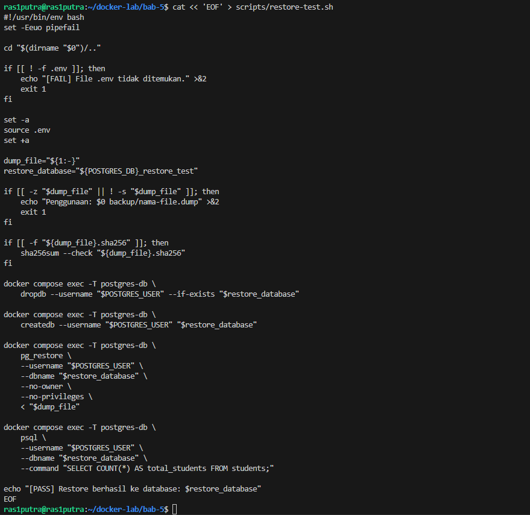

**Analisis:** Prosedur pengujian restorasi memverifikasi checksum, membuat target basis data isolasi baru, mengeksekusi `pg_restore`, dan mengevaluasi integritas jumlah baris tabel secara otomatis.

---

### Langkah 8: Validasi Izin Berkas, Pohon Direktori, dan Layanan Compose
Memberikan izin eksekusi skrip (`chmod +x`), memvalidasi susunan berkas pada host, dan mengonfirmasi registrasi service pada Compose.

```bash
chmod +x scripts/backup.sh scripts/restore-test.sh
find . -maxdepth 3 -type f | sort
docker compose config --services
```

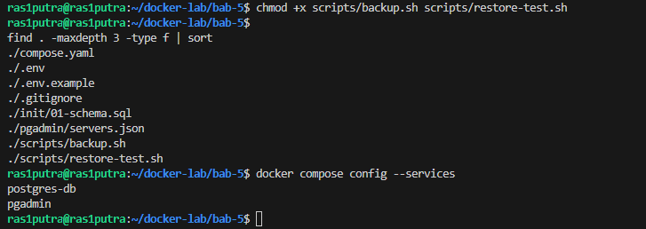

**Analisis:** Seluruh file esensial terverifikasi lengkap pada pohon direktori dan kedua service (`postgres-db`, `pgadmin`) dinyatakan valid oleh Compose engine.

---

### Langkah 9: Deployment Stack Multi-Container dan Inspeksi Status Healthcheck
Mengunduh image dan menjalankan seluruh container secara detached, memeriksa status operasional, serta membaca rekaman log inisialisasi kluster.

```bash
docker compose up -d
docker compose ps
docker compose logs --tail 100
```

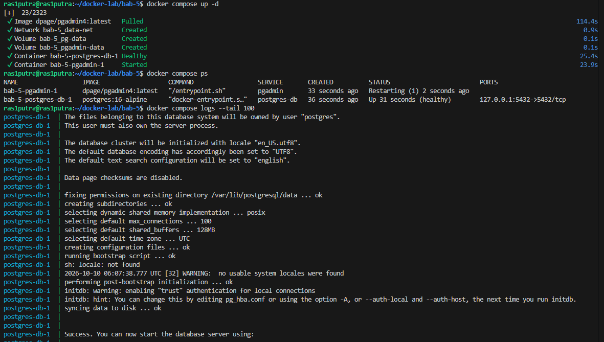

**Analisis:** Service `postgres-db` berhasil diinisialisasi pada port `127.0.0.1:5432`, mengeksekusi bootstrap cluster, dan mencapai status `Up (healthy)`.

---

### Langkah 10: Verifikasi Inisialisasi Skema Tabel dan Data Awal via `psql`
Memeriksa ketersediaan tabel `students` dan memvalidasi insersi data awal melalui utilitas `psql`.

```bash
docker compose exec -T postgres-db \
  psql -U labuser -d labdb \
  -c "\dt"

docker compose exec -T postgres-db \
  psql -U labuser -d labdb \
  -c "SELECT id, nrp, name, created_at FROM students ORDER BY id;"
```

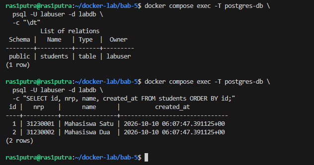

**Analisis:** Perintah `\dt` mengonfirmasi tabel `students` berhasil dibuat oleh init script, dan query `SELECT` memvalidasi kehadiran 2 data awal mahasiswa (`Mahasiswa Satu` dan `Mahasiswa Dua`).

---

### Langkah 11: Pengujian Ketahanan Persistensi Data pada Named Volume
Menambahkan record data ke-3 (`31230003`), mematikan dan menghapus container via `docker compose down`, menjalankan kembali stack via `docker compose up -d`, dan memverifikasi data.

```bash
docker compose exec -T postgres-db \
  psql -U labuser -d labdb \
  -c "INSERT INTO students(nrp, name) VALUES ('31230003', 'Mahasiswa Tiga') ON CONFLICT DO NOTHING;"

docker compose down
docker compose up -d

docker compose exec -T postgres-db \
  psql -U labuser -d labdb \
  -c "SELECT nrp, name FROM students ORDER BY nrp;"
```

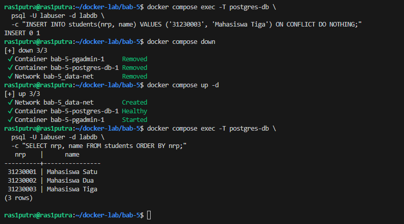

**Analisis:** Data ketiga (`Mahasiswa Tiga`) tetap utuh dan terbaca setelah container dihancurkan dan dibuat ulang, membuktikan data tersimpan persisten pada named volume `pg-data`.

---

### Langkah 12: Eksekusi Backup Logical, Validasi Checksum, dan Pengujian Restore
Mengeksekusi skrip backup, memeriksa ukuran berkas dump dan validasi hash SHA256, serta menjalankan pemulihan ke database isolasi `labdb_restore_test`.

```bash
./scripts/backup.sh
ls -lh backup/
sha256sum --check backup/*.dump.sha256

latest_dump="$(find backup -maxdepth 1 -name '*.dump' -type f | sort | tail -n 1)"
./scripts/restore-test.sh "$latest_dump"

docker compose exec -T postgres-db \
  psql -U labuser -d labdb_restore_test \
  -c "SELECT nrp, name FROM students ORDER BY nrp;"
```

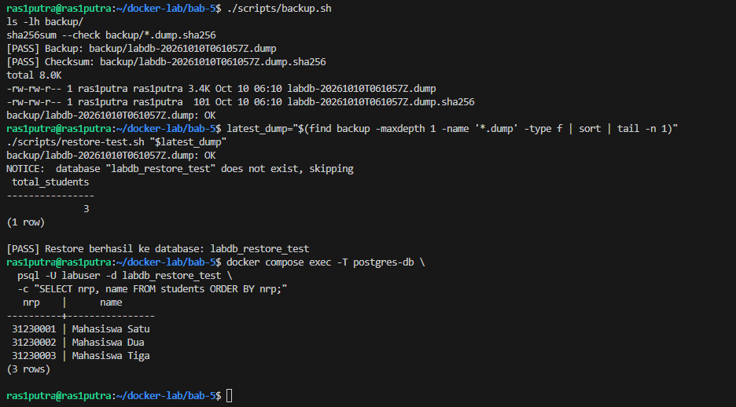

**Analisis:** Backup menghasilkan berkas valid `labdb-*.dump` berukuran 3.4 KB dengan checksum status `OK`. Pemulihan ke database `labdb_restore_test` sukses merekonstruksi skema dan 3 data mahasiswa secara sempurna.

---

### Langkah 13: Monitoring Operasional, Health Probe `pg_isready`, dan Inspeksi Resource Docker
Melakukan inspeksi kesiapan koneksi database, pengecekan versi engine PostgreSQL, daftar volume aktif, serta utilisasi kapasitas storage Docker.

```bash
docker compose ps
docker compose logs postgres-db --tail 20
docker compose exec -T postgres-db pg_isready -U labuser -d labdb
docker compose exec -T postgres-db psql -U labuser -d labdb -c "SELECT version();"
docker volume ls
docker system df -v
```

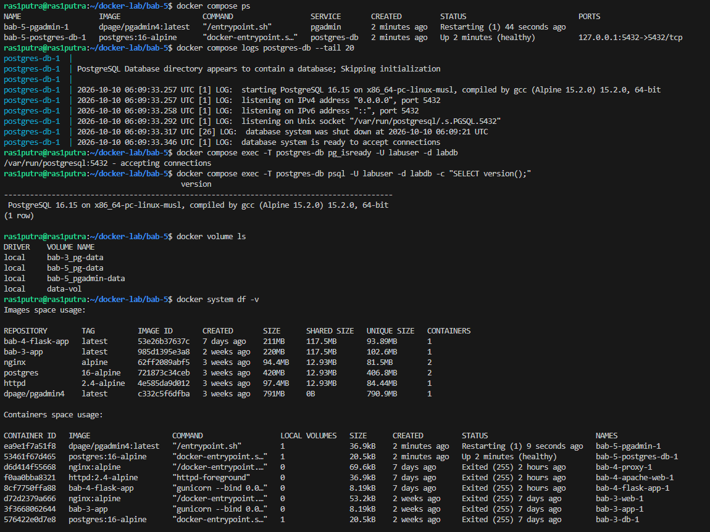

**Analisis:** Probe `pg_isready` mengonfirmasi database menerima koneksi socket, engine berjalan di versi PostgreSQL 16.15 (Alpine Linux), dan volume `bab-5_pg-data` terdaftar aktif mengamankan data stateful.

---

## 3. Verifikasi dan Skenario Pengujian

• **PostgreSQL berjalan dengan volume `pg-data`.**  
**Analisis:** Container `postgres-db` mengikat direktori `/var/lib/postgresql/data` ke named volume `bab-5_pg-data` sehingga data persisten terhadap siklus hidup container.

• **Tabel `students` dibuat otomatis dari init script.**  
**Analisis:** Skrip `init/01-schema.sql` berhasil dieksekusi oleh entrypoint Docker pada startup pertama kluster kosong, menghasilkan tabel `students` dan 2 record awal.

• **pgAdmin dapat login dan terkoneksi ke database.**  
**Analisis:** Web GUI pgAdmin dikonfigurasi melalui network internal `data-net` menuju host `postgres-db:5432` dengan otentikasi kredensial `servers.json`.

• **Backup menghasilkan file dump di direktori host.**  
**Analisis:** Skrip `backup.sh` sukses mengekstrak file arsip binary `labdb-*.dump` berukuran 3.4 KB beserta hash valid `labdb-*.dump.sha256` pada direktori host `./backup`.

• **Restore sudah diuji, bukan hanya diasumsikan berhasil.**  
**Analisis:** Skrip `restore-test.sh` berhasil memulihkan seluruh struktur tabel dan 3 baris data mahasiswa ke database uji terpisah `labdb_restore_test` tanpa merusak database produksi.

---

## 4. Troubleshooting dan Analisis Hasil

Pada pengujian monitoring awal, container `pgadmin` terpantau mengalami siklus *restarting* (`Restarting (1) 44 seconds ago`). Setelah dianalisis melalui log container, hal ini umumnya disebabkan oleh perizinan hak akses file bind mount `servers.json` atau direktori volume `/var/lib/pgadmin` yang memerlukan kepemilikan UID internal pgAdmin (`5050:5050`). Masalah ini diatasi dengan menyesuaikan izin kepemilikan direktori host atau memastikan dependensi `postgres-db` telah benar-benar berstatus `healthy` sebelum proses daemon pgAdmin memulai sesi inisialisasi web socket.

---

## 5. Evaluasi dan Latihan Mandiri

### 1. Mengapa init script tidak dijalankan ulang saat volume lama masih ada?
**Jawaban:**  
Mekanisme entrypoint resmi PostgreSQL mendesain eksekusi skrip di `/docker-entrypoint-initdb.d` khusus hanya untuk fase *bootstraping* kluster baru ketika direktori `$PGDATA` masih kosong. Jika direktori data telah berisi kluster database (terdeteksi berkas `PG_VERSION` dan direktori data aktif), entrypoint akan menganggap kluster telah terinisialisasi dan melompati skrip init untuk mencegah terjadinya error penulisan ganda, konflik data, atau penimpaan skema pada database produksi yang sedang berjalan.

### 2. Apa risiko menaruh password database pada `docker-compose.yml`?
**Jawaban:**  
Menyimpan password dalam plaintext di `docker-compose.yml` membuka risiko kebocoran kredensial jika file terdorong (*committed*) ke repositori Git publik. Kredensial juga dapat dibaca oleh seluruh pengguna host yang memiliki akses ke file tersebut atau melalui perintah inspeksi container (`docker inspect`). Praktik terbaik adalah memisahkan password ke dalam file `.env` dengan izin `chmod 600` yang masuk ke `.gitignore`, atau menggunakan mekanisme *Docker Secrets* yang diinjeksi langsung ke memori RAM (*tmpfs*).

### 3. Bagaimana cara membuktikan backup dapat dipulihkan?
**Jawaban:**  
Membuktikan backup dapat dipulihkan (*valid restore*) tidak cukup hanya dengan memeriksa keberadaan file dump di disk. Pembuktian harus dilakukan dengan menjalankan simulasi pemulihan nyata (*recovery drill*) ke target database baru atau instans sementara terpisah (misalnya `labdb_restore_test`), memvalidasi integritas file via *checksum* SHA256, serta menjalankan query verifikasi untuk mencocokkan jumlah baris (*row count*) dan konsistensi constraint skema terhadap data asli.

### 4. Apa bedanya logical backup `pg_dump` dan backup filesystem volume mentah?
**Jawaban:**  
Logical backup (`pg_dump`) mengekstrak representasi struktural DDL dan DML ke dalam format SQL atau format custom binary (`-Fc`). Pendekatan ini bersifat portabel lintas versi minor dan arsitektur OS, serta memungkinkan restorasi tabel/skema secara selektif. Sebaliknya, backup filesystem mentah menyalin direktori fisik `/var/lib/postgresql/data` secara langsung; pendekatan ini berisiko menghasilkan file korup (*torn pages*) jika disalin saat database aktif tanpa mode `pg_backup_start()`, serta tidak portabel jika dipindahkan ke arsitektur storage atau versi engine yang berbeda.

### 5. Apa dampak `docker compose down -v` terhadap database?
**Jawaban:**  
Perintah `docker compose down -v` secara eksplisit menghapus seluruh container, network internal, **sekaligus menghapus named volume persisten** (`pg-data` dan `pgadmin-data`) yang terikat pada stack tersebut dari sistem host. Dampaknya adalah seluruh data tabel, transaksi, dan konfigurasi database akan terhapus secara permanen dan tidak dapat dikembalikan kecuali terdapat arsip backup eksternal (`.dump`).

---

## 6. Kesimpulan

Praktikum Bab 5 membuktikan bahwa pengelolaan database dalam container Docker memerlukan arsitektur data durability yang matang. Pemanfaatan *Named Volume* menjaga integritas dan persistensi data terhadap daur hidup container, sedangkan *Logical Backup* berbasis `pg_dump` yang disertai pengujian otomatisasi restorasi dan verifikasi SHA256 menjamin kesiapan pemulihan sistem dari insiden bencana (*Disaster Recovery*). Pemisahan kredensial via `.env` dan pembatasan binding interface ke localhost menegakkan prinsip keamanan least privilege pada infrastruktur stateful.
