# Laporan Praktikum Bab 6 — Centralized Logging dengan Fluent Bit dan PostgreSQL

**Mata Kuliah:** Workshop DevOps  
**Dosen Pengampu:** Dr. Ferry Astika Saputra, S.T., M.Sc.  
**Penyusun:** Putra Yanuar Rasyid  
**NRP:** 3126640058  
**Program Studi:** D4 Teknik Informatika  
**Departemen:** Teknik Informatika dan Komputer  
**Institusi:** Politeknik Elektronika Negeri Surabaya  
**Tahun:** 2026  

---

## 1. Praktikum

### Membuat folder untuk praktikum

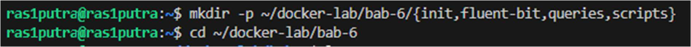

**Analisis:** Membuat folder utama lab beserta 5 sub-folder (app, policy, reports, sbom, keys) sekaligus dalam satu perintah.

---

### Membuat berkas template environment variable

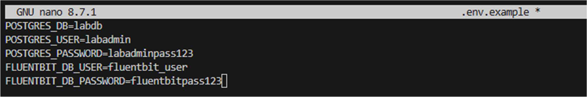

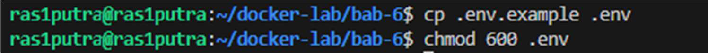

**Analisis:** Menyalin `.env.example` menjadi `.env` sebagai file konfigurasi aktif yang digunakan Docker Compose untuk membaca variabel basis data. Setelah itu, mengatur izin file ke mode 600 (`-rw-------`) agar hanya pemilik file yang dapat membaca dan mengubah isinya.

---

### Membuat file .gitignore

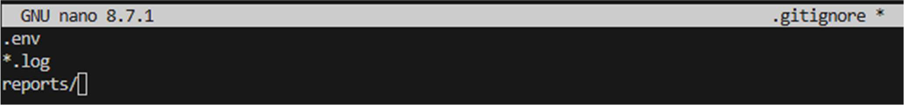

**Analisis:** Mengatur `.gitignore` agar Git mengabaikan file `.env` yang berisi kredensial, seluruh file log (`*.log`), dan direktori `reports/`.

---

### Membuat compose.yaml

```yaml
services:
  postgres-db:
    image: postgres:16-alpine
    environment:
      POSTGRES_DB: ${POSTGRES_DB}
      POSTGRES_USER: ${POSTGRES_USER}
      POSTGRES_PASSWORD: ${POSTGRES_PASSWORD}
      FLUENTBIT_DB_USER: ${FLUENTBIT_DB_USER}
      FLUENTBIT_DB_PASSWORD: ${FLUENTBIT_DB_PASSWORD}
    volumes:
      - pg-data:/var/lib/postgresql/data
      - ./init:/docker-entrypoint-initdb.d:ro
    networks:
      - logging-net
    healthcheck:
      test:
        - CMD-SHELL
        - "pg_isready -U $${POSTGRES_USER} -d $${POSTGRES_DB}"
      interval: 5s
      timeout: 5s
      retries: 12
      start_period: 10s
    restart: unless-stopped

  fluent-bit:
    image: fluent/fluent-bit:4.2.8
    environment:
      POSTGRES_DB: ${POSTGRES_DB}
      FLUENTBIT_DB_USER: ${FLUENTBIT_DB_USER}
      FLUENTBIT_DB_PASSWORD: ${FLUENTBIT_DB_PASSWORD}
    volumes:
      - ./fluent-bit/fluent-bit.conf:/fluent-bit/etc/fluent-bit.conf:ro
      - flb-storage:/var/log/flb-storage
    ports:
      - "127.0.0.1:24224:24224"
      - "127.0.0.1:2020:2020"
    networks:
      - logging-net
    depends_on:
      postgres-db:
        condition: service_healthy
    security_opt:
      - no-new-privileges:true
    restart: unless-stopped

  generator-auth:
    image: alpine:3.20
    command:
      - /bin/sh
      - -c
      - |
        i=1
        while [ "$$i" -le 20 ]; do
          printf '{"service":"auth","severity":"INFO","event":"login_test","sequence":%s}\n' "$$i"
          i=$$((i + 1))
          sleep 1
        done
    logging:
      driver: fluentd
      options:
        fluentd-address: "127.0.0.1:24224"
        fluentd-async: "true"
        tag: "docker.{{.Name}}"
    depends_on:
      - fluent-bit

  generator-api:
    image: alpine:3.20
    command:
      - /bin/sh
      - -c
      - |
        i=1
        while [ "$$i" -le 20 ]; do
          printf '{"service":"api","severity":"WARN","event":"latency_test","duration_ms":%s}\n' "$$((i * 10))"
          i=$$((i + 1))
          sleep 1
        done
    logging:
      driver: fluentd
      options:
        fluentd-address: "127.0.0.1:24224"
        fluentd-async: "true"
        tag: "docker.{{.Name}}"
    depends_on:
      - fluent-bit

  generator-worker:
    image: alpine:3.20
    command:
      - /bin/sh
      - -c
      - |
        i=1
        while [ "$$i" -le 20 ]; do
          printf '{"service":"worker","severity":"ERROR","event":"retry_test","attempt":%s}\n' "$$i"
          i=$$((i + 1))
          sleep 1
        done
    logging:
      driver: fluentd
      options:
        fluentd-address: "127.0.0.1:24224"
        fluentd-async: "true"
        tag: "docker.{{.Name}}"
    depends_on:
      - fluent-bit

volumes:
  pg-data:
  flb-storage:

networks:
  logging-net:
    driver: bridge
```

**Analisis:** Menyusun konfigurasi Docker Compose untuk menjalankan beberapa container, yaitu database `postgres-db` dengan healthcheck, collector log `fluent-bit`, serta tiga generator log (auth, api, dan worker). Ketiga generator mengirimkan log menggunakan driver fluentd secara asynchronous melalui opsi `fluentd-async: "true"`. Seluruh service dihubungkan melalui network internal `logging-net`.

---

### Menyiapkan skrip inisialisasi basis data init/01-init-logging.sh

```bash
#!/usr/bin/env bash
set -Eeuo pipefail

: "${POSTGRES_USER:?POSTGRES_USER belum diatur}"
: "${POSTGRES_DB:?POSTGRES_DB belum diatur}"
: "${FLUENTBIT_DB_USER:?FLUENTBIT_DB_USER belum diatur}"
: "${FLUENTBIT_DB_PASSWORD:?FLUENTBIT_DB_PASSWORD belum diatur}"

psql \
  --set=ON_ERROR_STOP=1 \
  --username "$POSTGRES_USER" \
  --dbname "$POSTGRES_DB" \
  --set=fb_user="$FLUENTBIT_DB_USER" \
  --set=fb_password="$FLUENTBIT_DB_PASSWORD" <<'SQL'
SELECT format(
    'CREATE ROLE %I LOGIN PASSWORD %L',
    :'fb_user',
    :'fb_password'
)
WHERE NOT EXISTS (
    SELECT 1 FROM pg_roles WHERE rolname = :'fb_user'
)
\gexec

CREATE SCHEMA IF NOT EXISTS logs;

CREATE TABLE IF NOT EXISTS logs.fluentbit (
    tag  TEXT NOT NULL,
    time TIMESTAMP WITHOUT TIME ZONE NOT NULL,
    data JSONB NOT NULL
);

CREATE INDEX IF NOT EXISTS idx_fluentbit_time
    ON logs.fluentbit (time DESC);

CREATE INDEX IF NOT EXISTS idx_fluentbit_tag
    ON logs.fluentbit (tag);

CREATE INDEX IF NOT EXISTS idx_fluentbit_data_gin
    ON logs.fluentbit USING GIN (data);

CREATE OR REPLACE VIEW logs.recent_logs AS
SELECT
    time,
    tag,
    replace(data ->> 'container_name', '/', '') AS container_name,
    data ->> 'source' AS source,
    left(data ->> 'log', 200) AS log_preview
FROM logs.fluentbit
ORDER BY time DESC
LIMIT 100;

SELECT format(
    'ALTER ROLE %I IN DATABASE %I SET search_path TO logs, public',
    :'fb_user',
    current_database()
)
\gexec

SELECT format('GRANT USAGE, CREATE ON SCHEMA logs TO %I', :'fb_user')
\gexec

SELECT format(
    'GRANT SELECT, INSERT ON TABLE logs.fluentbit TO %I',
    :'fb_user'
)
\gexec

SELECT format('GRANT SELECT ON TABLE logs.recent_logs TO %I', :'fb_user')
\gexec
SQL
```

**Analisis:** Menyiapkan skrip inisialisasi PostgreSQL yang dijalankan saat database pertama kali dibuat pada volume kosong. Skrip membuat akun khusus `fluentbit_user`, schema `logs`, tabel `fluentbit` dengan kolom JSONB, serta indeks untuk pencarian berdasarkan waktu, tag, dan isi data. Selain itu, view `recent_logs` menampilkan hingga 100 log terbaru beserta ringkasan pesannya. Hak akses collector dibatasi sesuai kebutuhan untuk membaca dan memasukkan log, tanpa menggunakan akun administrator database.

---

### Membuat file konfigurasi fluent-bit/fluent-bit.conf

```ini
[SERVICE]
    Flush                     1
    Daemon                    Off
    Log_Level                 info
    storage.path              /var/log/flb-storage
    storage.sync              normal
    storage.checksum          on
    storage.backlog.mem_limit 10M
    HTTP_Server               On
    HTTP_Listen               0.0.0.0
    HTTP_Port                 2020

[INPUT]
    Name          forward
    Listen        0.0.0.0
    Port          24224
    Mem_Buf_Limit 10M
    storage.type  filesystem

[OUTPUT]
    Name                     pgsql
    Match                    *
    Host                     postgres-db
    Port                     5432
    User                     ${FLUENTBIT_DB_USER}
    Password                 ${FLUENTBIT_DB_PASSWORD}
    Database                 ${POSTGRES_DB}
    Table                    fluentbit
    storage.total_limit_size 256M

[OUTPUT]
    Name   stdout
    Match  *
    Format json_lines
```

**Analisis:** Mengatur Fluent Bit untuk menerima log dari container lain melalui port 24224 dan menyimpannya ke PostgreSQL. Log juga disimpan sementara di filesystem jika pengiriman tertunda. Port 2020 digunakan untuk memantau Fluent Bit, sedangkan output stdout membantu memeriksa log dalam format JSON.

---

### Menyiapkan query untuk analisis queries/analysis.sql

```sql
\pset pager off
\timing on

-- 1. Jumlah event dan rentang waktu.
SELECT
    count(*) AS total_event,
    min(time) AS event_pertama,
    max(time) AS event_terakhir
FROM logs.fluentbit;

-- 2. Distribusi berdasarkan tag Docker.
SELECT
    tag,
    count(*) AS total
FROM logs.fluentbit
GROUP BY tag
ORDER BY total DESC, tag;

-- 3. Metadata terstruktur dari Docker logging driver.
SELECT
    time,
    tag,
    replace(data ->> 'container_name', '/', '') AS container_name,
    data ->> 'source' AS source,
    left(data ->> 'log', 160) AS log_preview
FROM logs.fluentbit
ORDER BY time DESC
LIMIT 15;

-- 4. Pencarian severity pada JSON yang masih berada di field log.
SELECT
    time,
    tag,
    data ->> 'log' AS log_message
FROM logs.fluentbit
WHERE data ->> 'log' ILIKE '%"severity":"ERROR"%'
ORDER BY time DESC;

-- 5. Ringkasan per menit untuk mengamati laju ingest.
SELECT
    date_trunc('minute', time) AS minute_bucket,
    count(*) AS total
FROM logs.fluentbit
GROUP BY minute_bucket
ORDER BY minute_bucket DESC
LIMIT 10;

-- Contoh retensi; tinjau dahulu sebelum menghapus data.
-- DELETE FROM logs.fluentbit
-- WHERE time < CURRENT_TIMESTAMP - INTERVAL '7 days';
```

**Analisis:** Menyiapkan query SQL untuk memeriksa log yang tersimpan di PostgreSQL, mulai dari jumlah dan rentang waktu event, distribusi log berdasarkan tag, hingga detail container dan pesan error. Query juga digunakan untuk melihat jumlah log yang masuk setiap menit.

---

### Membuat script generate logs scripts/generate-logs.sh

```bash
#!/usr/bin/env bash
set -Eeuo pipefail

cd "$(dirname "$0")/.."

if [[ ! -f .env ]]; then
    echo "[FAIL] File .env tidak ditemukan." >&2
    exit 1
fi

docker compose up -d postgres-db fluent-bit

for attempt in {1..30}; do
    if curl -fsS http://127.0.0.1:2020/api/v1/health >/dev/null; then
        break
    fi

    if [[ "$attempt" -eq 30 ]]; then
        echo "[FAIL] Endpoint kesehatan Fluent Bit belum siap." >&2
        exit 1
    fi
    sleep 2
done

docker compose up -d --force-recreate \
    generator-auth \
    generator-api \
    generator-worker

echo "[PASS] Tiga generator telah dijalankan. Tunggu sekitar 25 detik."
echo "[INFO] Pantau dengan: docker compose ps"
```

**Analisis:** Membuat skrip untuk menjalankan `postgres-db` dan `fluent-bit` terlebih dahulu, kemudian memeriksa health endpoint Fluent Bit hingga 30 kali dengan jeda dua detik. Setelah endpoint siap, skrip menjalankan ulang ketiga log generator (auth, api, dan worker). Jika file `.env` tidak ditemukan atau Fluent Bit belum siap setelah seluruh percobaan, proses dihentikan dan pesan error ditampilkan.

---

### Membuat file test buffering untuk menahan event scripts/test-buffering.sh

```bash
#!/usr/bin/env bash
set -Eeuo pipefail

cd "$(dirname "$0")/.."

if [[ ! -f .env ]]; then
    echo "[FAIL] File .env tidak ditemukan." >&2
    exit 1
fi

set -a
source .env
set +a

count_rows() {
    docker compose exec -T postgres-db \
        psql \
        --username "$POSTGRES_USER" \
        --dbname "$POSTGRES_DB" \
        --tuples-only \
        --no-align \
        --command 'SELECT count(*) FROM logs.fluentbit;'
}

before="$(count_rows)"
echo "[INFO] Jumlah awal: $before"

docker compose stop postgres-db

docker compose up -d --force-recreate \
    generator-auth \
    generator-api \
    generator-worker

echo "[INFO] PostgreSQL berhenti; generator berjalan selama 25 detik."
sleep 25

docker compose start postgres-db

for attempt in {1..30}; do
    if docker compose exec -T postgres-db \
        pg_isready -U "$POSTGRES_USER" -d "$POSTGRES_DB" >/dev/null 2>&1; then
        break
    fi

    if [[ "$attempt" -eq 30 ]]; then
        echo "[FAIL] PostgreSQL tidak kembali sehat." >&2
        exit 1
    fi
    sleep 2
done

for attempt in {1..60}; do
    after="$(count_rows)"
    if (( after > before )); then
        echo "[PASS] Jumlah sesudah pemulihan: $after"
        echo "[INFO] Kenaikan record: $((after - before))"
        exit 0
    fi
    sleep 2
done

echo "[FAIL] Tidak ada record baru setelah PostgreSQL pulih." >&2
echo "[INFO] Periksa: docker compose logs --tail 200 fluent-bit" >&2
exit 1
```

**Analisis:** Membuat skrip untuk menguji buffering Fluent Bit dengan menghentikan PostgreSQL sementara selama 25 detik saat log generator tetap berjalan. Setelah PostgreSQL dijalankan kembali, skrip memeriksa kesiapan database dan memantau jumlah record hingga 120 detik. Pengujian dinyatakan berhasil jika jumlah record bertambah setelah database pulih.

---

### Memberi izin eksekusi dan memvalidasi file

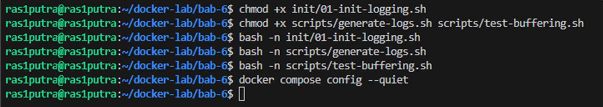

**Analisis:** Memberikan izin eksekusi pada ketiga skrip, lalu menggunakan `bash -n` untuk memeriksa sintaks setiap skrip tanpa menjalankannya. Terakhir, `docker compose config --quiet` memvalidasi konfigurasi Docker Compose tanpa menampilkan output jika tidak ada error.

---

### Memvalidasi konfigurasi Fluent Bit tanpa menjalankan seluruh stack compose.yaml

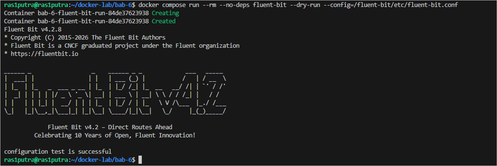

**Analisis:** Memvalidasi konfigurasi Fluent Bit menggunakan opsi `--dry-run` tanpa menjalankan seluruh stack. Opsi `--no-deps` mencegah Docker Compose menjalankan service dependency, sedangkan `--rm` menghapus container sementara setelah proses selesai. Output menunjukkan tes konfigurasi sukses.

### Alternatif jika image tidak mengenali --dry-run

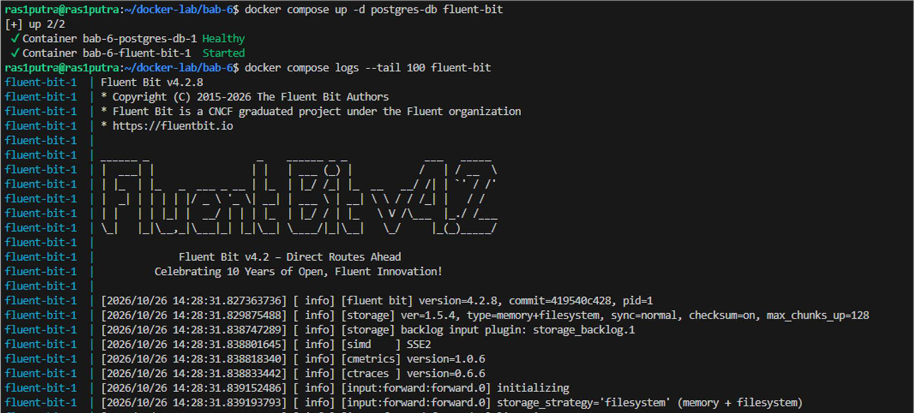

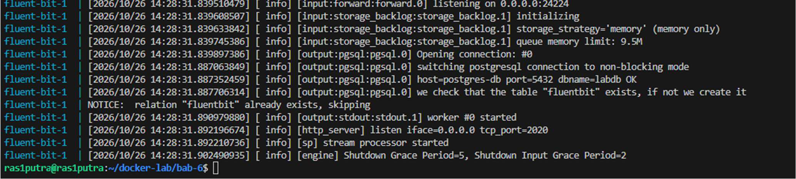

**Analisis:** Jika image Fluent Bit tidak mendukung opsi `--dry-run`, validasi dilakukan dengan menjalankan service `postgres-db` dan `fluent-bit`, kemudian memeriksa 100 baris log terakhir. Log startup digunakan untuk memastikan konfigurasi berhasil dimuat dan mendeteksi error pada input, output, atau koneksi ke PostgreSQL.

---

### Menjalankan pipeline dan menghasilkan log

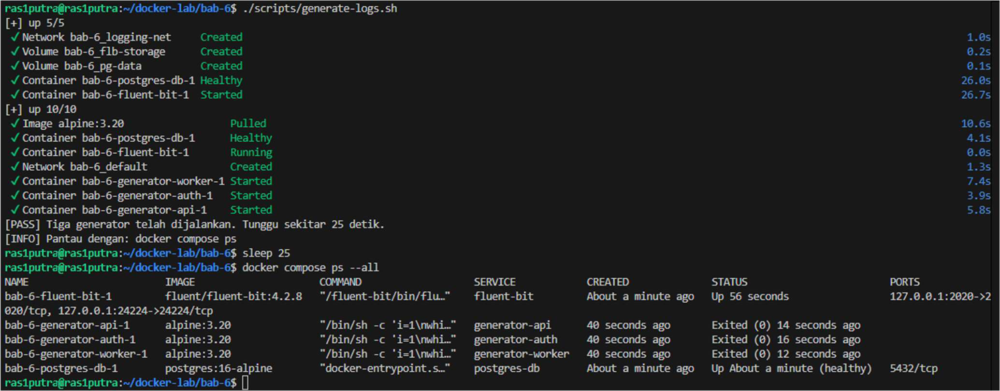

**Analisis:** Ketiga log generator (auth, api, dan worker) berhasil dijalankan dan selesai dengan status `Exited (0)`, yang menandakan proses berakhir tanpa error. Sementara itu, PostgreSQL berstatus `Up ... (healthy)` dan Fluent Bit berstatus `Up`, sehingga keduanya tetap berjalan setelah generator selesai. Output ini menunjukkan pipeline berhasil dijalankan, tetapi keberhasilan penyimpanan log ke PostgreSQL masih perlu diverifikasi melalui query SQL.

---

### Memeriksa Monitoring Fluent Bit

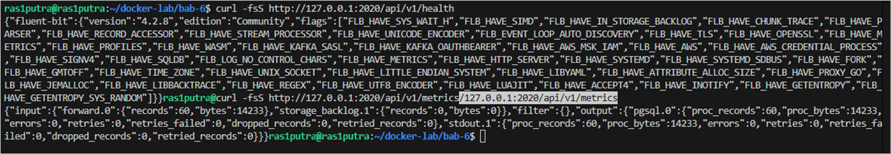

**Analisis:** Endpoint health Fluent Bit merespons dengan baik, sedangkan metrics menunjukkan 60 log record telah diterima dan diproses oleh input serta diteruskan ke PostgreSQL dan stdout. Nilai `errors`, `retries`, dan `dropped_records` sebesar 0.

---

### Memverifikasi Record PostgreSQL

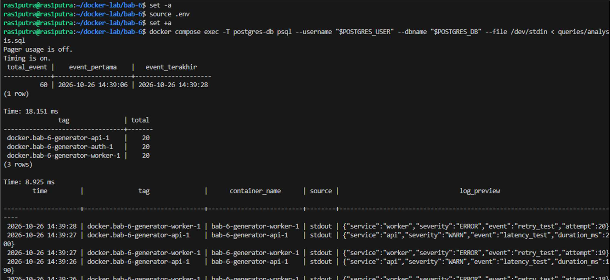

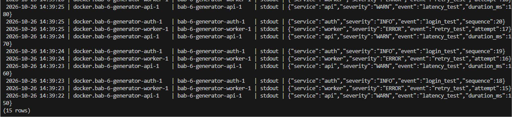

**Analisis:** Mengekspor variabel dari `.env` ke shell aktif agar kredensial dapat digunakan oleh perintah SQL tanpa perlu membuka port PostgreSQL ke publik. Hasil query menunjukkan 60 event log berhasil tersimpan, masing-masing 20 event dari `generator-api`, `generator-auth`, dan `generator-worker` dalam rentang 22 detik. Metadata container (`container_name` dan `source`) serta payload JSON yang berisi `service`, `severity`, dan detail event aplikasi juga tersimpan dalam kolom JSONB.

---

### Pemeriksaan ringkas terhadap view

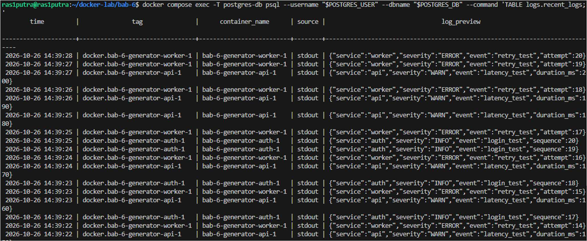

**Analisis:** Perintah `TABLE logs.recent_logs;` digunakan sebagai cara singkat untuk menampilkan seluruh kolom dari view `logs.recent_logs`. Hasilnya menampilkan log terbaru dalam bentuk tabel, termasuk timestamp, tag container, sumber log (stdout), dan cuplikan pesan beserta tingkat severity seperti `ERROR`, `WARN`, dan `INFO`. Data diurutkan dari waktu terbaru ke terlama (`time DESC`).

---

### Menguji Buffering dan Pemulihan

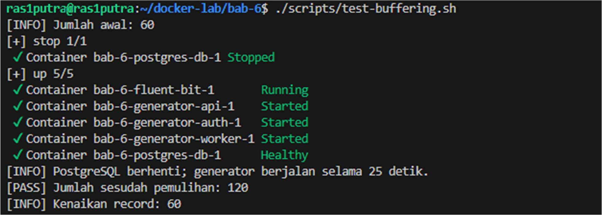

**Analisis:** Pengujian failover diawali dengan mencatat jumlah awal log di basis data sebanyak 60 entri, kemudian container `bab-6-postgres-db-1` dihentikan paksa (Stopped). Selama database mati, ketiga generator (api, auth, worker) dijalankan untuk beroperasi dan mengirimkan log selama 25 detik. Fluent Bit terbukti berhasil menahan seluruh lonjakan event baru ke dalam antrean filesystem buffer (`flb-storage`) tanpa mengalami crash. Begitu container database dinyalakan kembali hingga berstatus Healthy, Fluent Bit langsung menguras antrean backlog ke PostgreSQL, menghasilkan status `[PASS]` dengan penambahan tepat 60 record baru (total menjadi 120) yang membuktikan integritas data tetap terjaga tanpa ada log yang hilang selama database offline, seperti di screenshot di bawah ini:

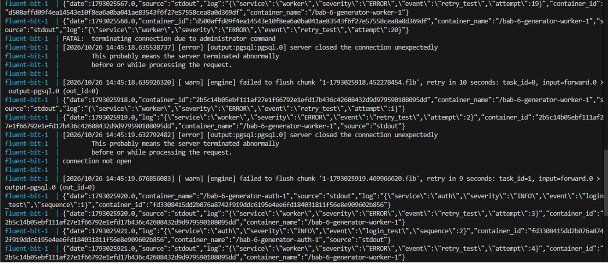

Menggunakan dua Docker volume, yaitu `bab-6_pg-data` untuk menyimpan data PostgreSQL dan `bab-6_flb-storage` untuk menyimpan antrean filesystem buffer Fluent Bit. Volume `bab-6_flb-storage` menjaga data buffer tetap tersimpan di disk ketika PostgreSQL mati atau container Fluent Bit mengalami restart, sehingga log yang belum terkirim dapat diproses kembali setelah service pulih.

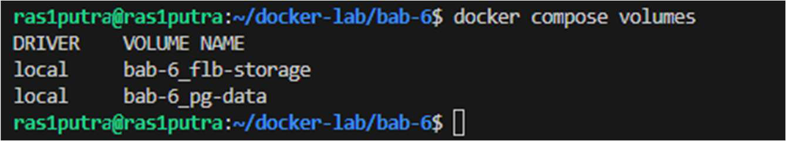

### Memverifikasi tipe data

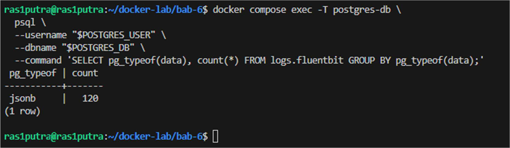

**Analisis:** Hasil query menunjukkan bahwa kolom `data` bertipe `jsonb` dengan total 120 record tersimpan di PostgreSQL. Hasil ini membuktikan bahwa struktur data log sesuai konfigurasi dan record berhasil tersimpan.

---

### Cleanup

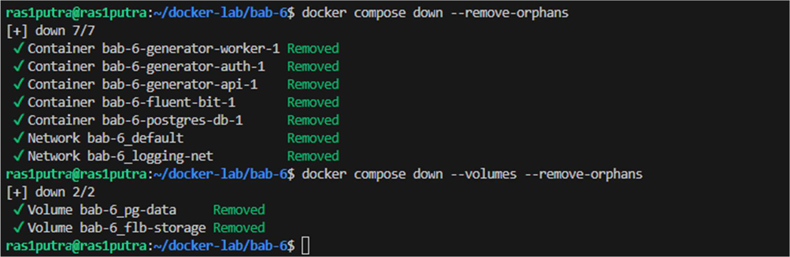

**Analisis:** Perintah `docker compose down --remove-orphans` menghentikan dan menghapus container serta network yang dibuat oleh Compose tanpa menghapus volume, sehingga data log tetap tersimpan. Sementara itu, opsi `--volumes` turut menghapus volume database dan backlog Fluent Bit, sehingga seluruh data praktikum yang tersimpan di dalamnya akan hilang.

---

## 2. Latihan Mandiri (Cheatsheet Bab 6)

### 1. Tambahkan field request_id pada generator dan susun query untuk menelusuri satu transaksi lintas service.

Menambahkan field `request_id` pada generator di `compose.yaml`:

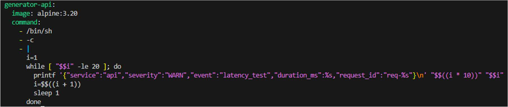

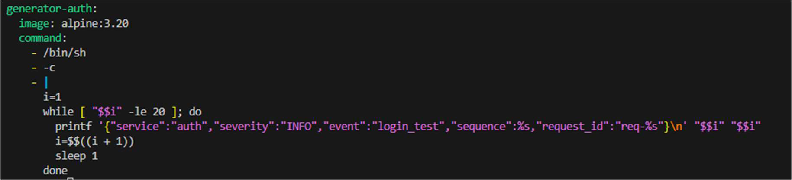


**Analisis:** Konfigurasi `printf` pada ketiga container diubah dengan menyisipkan pasangan key-value `"request_id":"req-%s"`.

Membuat ulang container:

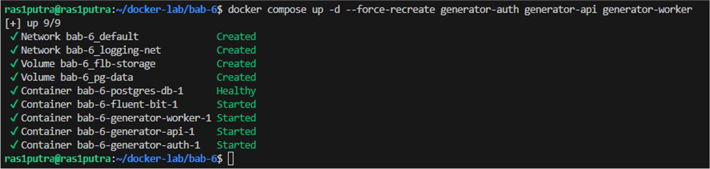

**Analisis:** Perintah `--force-recreate` menghancurkan dan membuat ulang ketiga container generator menggunakan konfigurasi baru.

Menjalankan query penelusuran transaksi lintas service:

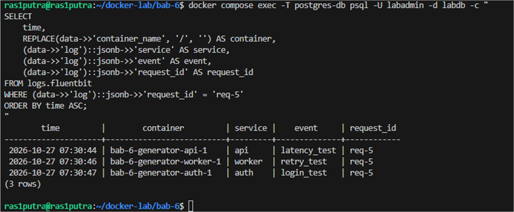

**Analisis:** Hasil query membuktikan bahwa satu siklus transaksi dengan identifier `req-5` berhasil tercatat dan ditelusuri secara berurutan pada 3 container berbeda.

---

### 2. Modifikasi pipeline agar isi JSON pada data.log diparse menjadi field terstruktur. Tulis pengujian negatif untuk log yang bukan JSON valid.

Menambahkan filter di config fluent bit:

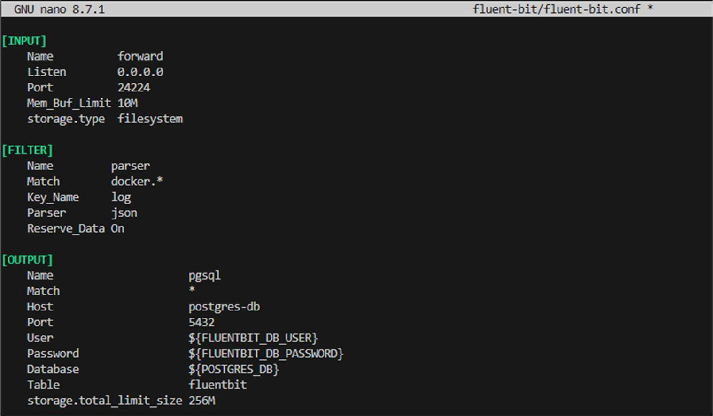

**Analisis:** Konfigurasi `Key_Name log` digunakan untuk mengambil isi dari field `log` sebagai data yang akan diproses, sedangkan `Parser json` menentukan parser JSON bawaan Fluent Bit untuk membaca log berformat JSON. Opsi `Reserve_Data On` berperan penting dalam pengujian negatif karena mempertahankan data asli ketika isi log bukan JSON yang valid, sehingga data tersebut tidak langsung dibuang (drop) dan tetap dapat diperiksa lebih lanjut.

Pengujian Positif (JSON Valid) dan Pengujian Negatif (Non-JSON):

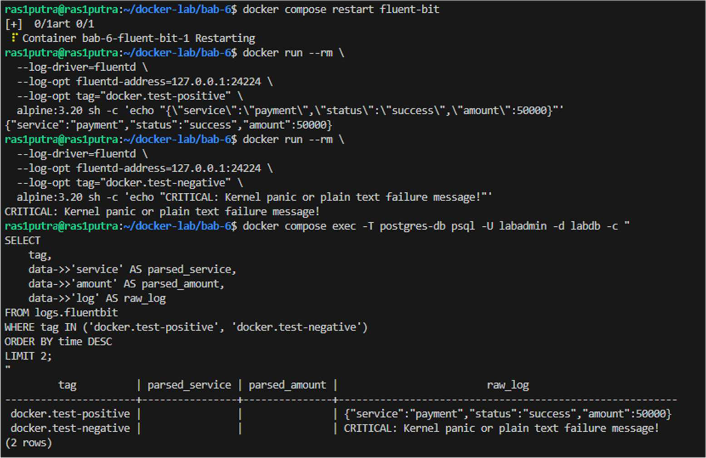

**Analisis:** Pada pengujian positif (`docker.test-positive`), pipeline berhasil mengekstrak nilai `payment` ke `parsed_service` dan `50000` ke `parsed_amount`. Pada pengujian negatif (`docker.test-negative`), sistem terbukti fault-tolerant; pesan galat teks biasa tetap tersimpan di database pada field `raw_log` tanpa menyebabkan kegagalan ingest pada Fluent Bit.

---

### 3. Sisipkan nilai canary yang menyerupai token sintetis, lalu rancang filter redaction dan buktikan nilai tersebut tidak mencapai PostgreSQL.

Memodifikasi `fluent-bit.conf` untuk Parsing dan Redaction Token:

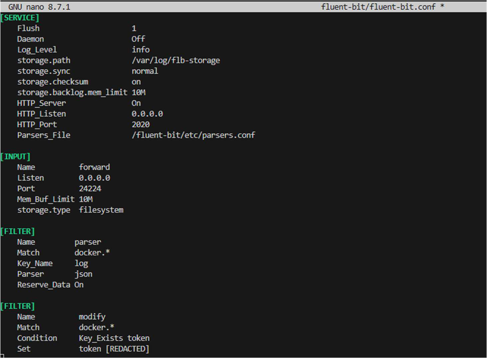

**Analisis:** Pada konfigurasi `fluent-bit.conf`, direktif `Parsers_File /fluent-bit/etc/parsers.conf` ditambahkan ke dalam blok `[SERVICE]` untuk memuat parser bawaan Fluent Bit. Hal ini diperlukan karena definisi parser tidak dapat ditulis langsung di berkas konfigurasi utama. Selanjutnya, filter `parser` dengan pengaturan `Parser json` dan `Reserve_Data On` digunakan untuk mengubah string JSON pada field `log` menjadi atribut yang dapat diproses secara terpisah. Pengaturan ini juga memastikan pesan teks yang bukan JSON tetap dipertahankan ketika proses parsing gagal. Setelah itu, filter `modify` dengan kondisi `Key_Exists token` memeriksa keberadaan atribut `token` dan mengganti nilainya menjadi `[REDACTED]` jika ditemukan. Proses penyamaran ini dilakukan sebelum log dikirim ke output PostgreSQL, sehingga nilai kredensial sensitif tidak diteruskan dalam bentuk aslinya.

Menguji injeksi canary token dan memverifikasi redaction di database:

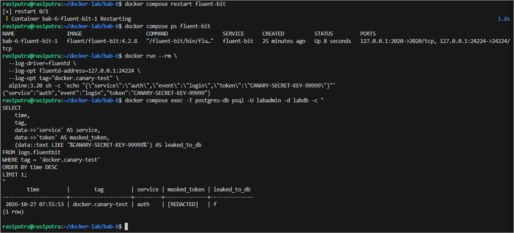

**Analisis:** Pengujian dilakukan dengan menjalankan container sementara yang mengirimkan log berformat JSON berisi token rahasia sintetis `CANARY-SECRET-KEY-99999` menggunakan Docker logging driver fluentd. Berdasarkan hasil query di PostgreSQL, field `service` berhasil diparse menjadi `auth`, sedangkan nilai token berhasil disamarkan menjadi `[REDACTED]` pada kolom `masked_token`. Selain itu, hasil evaluasi ekspresi `leaked_to_db` menunjukkan nilai `false` (`f`), yang berarti token rahasia tersebut tidak ditemukan tersimpan di database.

---

### 4. Bandingkan jumlah event yang dihasilkan, diterima input Fluent Bit, dan tersimpan di PostgreSQL. Jelaskan setiap selisih berdasarkan evidence.

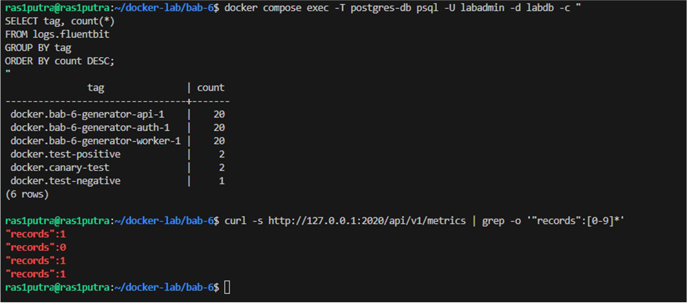

**Analisis:** Berdasarkan hasil pemeriksaan, database PostgreSQL menyimpan total 65 record, yang terdiri dari 60 log generator utama dan 5 log pengujian manual. Sementara itu, metrik Fluent Bit menunjukkan nilai `records: 1` pada input forward, output pgsql, dan output stdout. Hal ini menunjukkan bahwa satu record yang tercatat pada input diteruskan ke kedua output tersebut. Perbedaan jumlah record antara PostgreSQL dan metrik Fluent Bit terjadi karena keduanya mencatat informasi yang berbeda. PostgreSQL menyimpan log secara persisten menggunakan Docker named volume, sedangkan metrik Fluent Bit mencatat aktivitas pemrosesan sejak collector berjalan. Jika container direstart, nilai metrik dapat kembali ke awal. Oleh karena itu, angka 1 tidak dapat langsung dibandingkan dengan total 65 baris di database, dikarenakan direstart pada latihan mandiri di atas.

---

### 5. Rancang kebijakan retensi tujuh hari yang dapat dijalankan terjadwal tanpa mengunci tabel secara berlebihan.

Membuat script `scripts/purge-retention.sh`:

```bash
#!/usr/bin/env bash
set -euo pipefail

DAYS="${1:-7}"
BATCH_SIZE="${2:-5000}"

while true; do
    DELETED=$(docker compose exec -T postgres-db psql -U labadmin -d labdb -t -A -c "
        WITH to_delete AS (
            SELECT ctid FROM logs.fluentbit
            WHERE time < NOW() - INTERVAL '$DAYS days'
            LIMIT $BATCH_SIZE
        )
        DELETE FROM logs.fluentbit
        WHERE ctid IN (SELECT ctid FROM to_delete);
    ")
    COUNT=$(echo "$DELETED" | awk '{print $2}')
    if [ -z "$COUNT" ] || [ "$COUNT" -eq 0 ]; then
        break
    fi
    sleep 0.1
done
```

**Analisis:** Script `scripts/purge-retention.sh` dibuat untuk menghapus log yang berumur lebih dari tujuh hari secara bertahap (batch deletion). Proses penghapusan menggunakan Common Table Expression (CTE) dengan `ctid` sebagai penunjuk baris fisik dan `LIMIT 5000` untuk membatasi jumlah record yang dihapus dalam setiap batch. Dengan cara ini, penghapusan tidak dilakukan sekaligus dalam jumlah besar sehingga beban database dapat lebih terkendali. Strategi ini juga membantu mengurangi potensi gangguan terhadap proses penulisan log baru dari Fluent Bit. Namun, penghapusan bertahap tidak sepenuhnya menghilangkan risiko lock contention maupun lonjakan Write-Ahead Logging (WAL).

Memberikan izin eksekusi dan menjadwalkan otomasi via crontab:

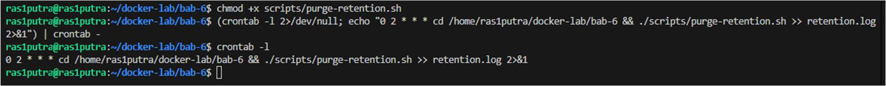

**Analisis:** Perintah `chmod +x` digunakan untuk memberikan izin eksekusi pada script agar dapat dijalankan langsung oleh sistem operasi. Selanjutnya, script didaftarkan melalui crontab agar proses pembersihan log berjalan secara otomatis tanpa perlu dijalankan secara manual oleh administrator. Jadwal menggunakan ekspresi `0 2 * * *`, yang berarti script dijalankan setiap hari pada pukul 02.00. Seluruh keluaran proses diarahkan ke berkas `retention.log` agar aktivitas pembersihan dapat diperiksa kembali sebagai bagian dari audit operasional.

Pengujian:

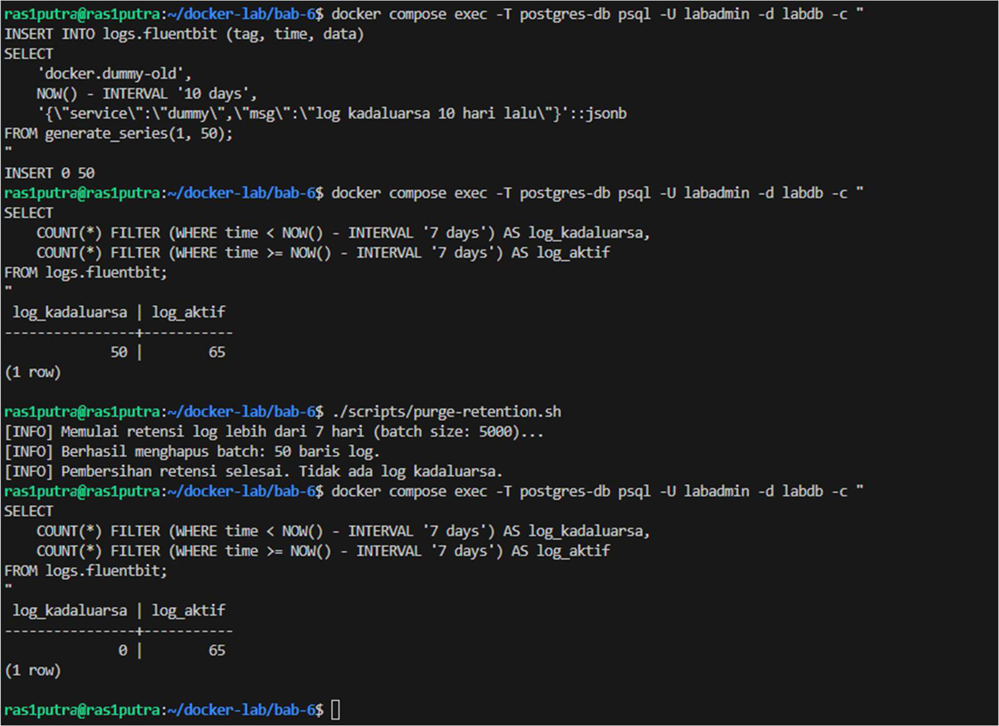

**Analisis:** Pengujian berhasil dimana data dummy kadaluarsa terhapus.

---

### 6. Jelaskan mengapa PostgreSQL sesuai untuk laboratorium ini, tetapi belum tentu tepat untuk telemetry berukuran sangat besar.

PostgreSQL cocok untuk lab karena mudah dijalankan melalui Docker, mendukung JSONB, dan menggunakan SQL standar. Namun, untuk telemetri skala besar, penyimpanan row-oriented dapat meningkatkan beban I/O saat menganalisis log dalam jumlah besar, sedangkan table bloat dapat membuat penggunaan ruang disk meningkat akibat penghapusan data yang berulang.

---

## 3. Verifikasi dan Skenario Pengujian

• **Fluent Bit menerima log dari minimal tiga container:** Tiga container generator (`generator-auth`, `generator-api`, dan `generator-worker`) mengirimkan masing-masing 20 event log melalui Docker fluentd logging driver ke port `127.0.0.1:24224`.

• **Tabel `logs.fluentbit` berisi data dengan tag, time, dan data JSONB:** Struktur tabel terverifikasi melalui fungsi `pg_typeof(data)` yang mengembalikan tipe `jsonb` dengan total 120 record.

• **View `recent_logs` menampilkan log terbaru:** Perintah `TABLE logs.recent_logs;` menampilkan hingga 100 log terbaru secara terstruktur (`time`, `tag`, `container_name`, `source`, dan `log_preview`).

• **Query distribusi per tag dan pencarian keyword berjalan:** Query analisis pada `queries/analysis.sql` berhasil menampilkan distribusi jumlah log per tag container, memfilter log ber-severity `ERROR`, dan menghitung laju ingest per menit.

• **Simulasi collector/database mati sementara (Buffering & Recovery):** Saat `postgres-db` dihentikan selama 25 detik melalui `scripts/test-buffering.sh`, Fluent Bit menahan 60 event baru di filesystem buffer (`flb-storage`) dan mengurasnya otomatis setelah database kembali sehat (`[PASS]` kenaikan 60 record dari 60 menjadi 120).

---

## 4. Evaluasi dan Latihan Mandiri

### 1. Apa risiko kehilangan log ketika Fluent Bit tidak tersedia?
Ketika Fluent Bit berhenti atau tidak dapat dijangkau, container aplikasi tetap dapat berjalan karena menggunakan opsi `fluentd-async: "true"`. Namun, log yang dihasilkan selama periode tersebut hanya ditampung sementara pada buffer memori internal Docker logging driver yang kapasitasnya terbatas. Apabila Fluent Bit mati terlalu lama hingga buffer memori driver penuh, event log baru akan terbuang (dropped) sehingga terjadi kehilangan jejak audit (log loss). Sebaliknya, jika `fluentd-async` tidak diaktifkan, ketiadaan Fluent Bit dapat memblokir stdout aplikasi atau menggagalkan proses startup container.

### 2. Mengapa structured logging lebih mudah dianalisis dibanding plain text logging?
Structured logging (seperti format JSON yang disimpan ke kolom JSONB) memisahkan setiap informasi ke dalam atribut key-value yang memiliki struktur dan nama field yang konsisten (misalnya `service`, `severity`, `event`, `request_id`, dan `duration_ms`). Hal ini memungkinkan database melakukan pencarian spesifik, pengindeksan menggunakan GIN Index, serta agregasi statistik secara langsung tanpa perlu mem-parsing string menggunakan regular expression (regex) yang kompleks dan mudah rusak apabila format pesan teks berubah.

### 3. Kapan PostgreSQL tidak lagi cocok sebagai log storage utama?
PostgreSQL sangat cocok untuk skala laboratorium dan volume log menengah karena kemudahan query SQL dan dukungan JSONB. Namun, PostgreSQL tidak lagi cocok sebagai log storage utama ketika volume telemetri mencapai ribuan hingga jutaan event per detik secara kontinu atau ukuran penyimpanan mencapai skala terabyte. Karakteristik penyimpanan row-oriented, overhead pembaruan indeks B-Tree dan GIN saat ingest tinggi, serta masalah table bloat dan beban VACUUM akibat penghapusan log retensi secara masif akan membebani I/O disk dibandingkan penyimpanan khusus seperti Grafana Loki, ClickHouse, atau OpenSearch.

### 4. Apa perbedaan log untuk observability dan log untuk forensik?
Log untuk observability dirancang untuk memantau kesehatan operasional, performa layanan, pelacakan bug (debugging), dan korelasi latency antar-komponen secara real-time dengan masa retensi yang umumnya pendek. Sementara itu, log untuk forensik dirancang sebagai alat bukti investigasi insiden keamanan dan kepatuhan audit (menjawab siapa melakukan apa, kapan, pada resource mana, dan dengan hasil apa). Oleh karena itu, log forensik menuntut jaminan keutuhan data tinggi (tamper-evident / immutable storage), pembatasan hak akses baca/hapus yang ketat, pencatatan checksum, serta masa retensi yang lebih panjang.

### 5. Buat query SQL untuk menampilkan jumlah log per menit dalam 10 menit terakhir.
Query SQL menggunakan fungsi `date_trunc('minute', time)` dengan klausa filter interval 10 menit terakhir:

```sql
SELECT
    date_trunc('minute', time) AS minute_bucket,
    COUNT(*) AS total_log
FROM logs.fluentbit
WHERE time >= CURRENT_TIMESTAMP - INTERVAL '10 minutes'
GROUP BY minute_bucket
ORDER BY minute_bucket DESC;
```

**Analisis:** Fungsi `date_trunc('minute', time)` membulatkan timestamp ke satuan menit terdekat, klausa `WHERE` membatasi data hanya pada 10 menit terakhir dari waktu saat ini, dan `GROUP BY` menghitung total event log yang masuk pada setiap menit.

---

## 5. Catatan Penggunaan AI dalam Praktikum

Dalam praktikum ini, Generative AI (Gemini) digunakan sebagai teman diskusi untuk membantu penulisan analisis, merapikan kalimat agar lebih baku dan mudah dipahami, serta mencari solusi saat menghadapi kendala teknis selama praktikum.
