# Laporan Praktikum Bab 7 — Monitoring Resource dengan Prometheus, cAdvisor, Node Exporter, dan Grafana

**Mata Kuliah:** Workshop DevOps  
**Dosen Pengampu:** Dr. Ferry Astika Saputra, S.T., M.Sc.  
**Penyusun:** Putra Yanuar Rasyid  
**NRP:** 3126640058  
**Program Studi:** D4 Teknik Informatika  
**Departemen:** Teknik Informatika dan Komputer  
**Institusi:** Politeknik Elektronika Negeri Surabaya  
**Tahun:** 2026  

---

## 1. Praktikum

### Membuat Folder untuk Praktikum
Membuat struktur direktori kerja `~/docker-lab/bab-7` beserta sub-folder untuk konfigurasi Prometheus (`rules` dan `tests`), provisioning Grafana (`datasources` dan `dashboards`), skrip otomasi (`scripts`), dan laporan (`reports`).

```bash
mkdir -p ~/docker-lab/bab-7/{prometheus/rules,prometheus/tests,grafana/provisioning/datasources,grafana/provisioning/dashboards,grafana/dashboards,scripts,reports}
cd ~/docker-lab/bab-7
ls -la
```

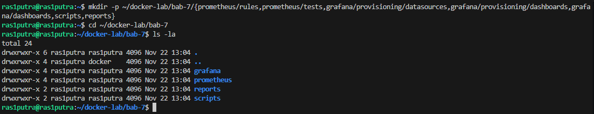

**Analisis:** Membuat folder utama praktikum `bab-7` beserta sub-folder untuk menyimpan konfigurasi Prometheus (`rules` dan `tests`), provisioning Grafana (`datasources` dan `dashboards`), `scripts`, serta `reports` sekaligus dalam satu perintah.

---

### Membuat Berkas Template Environment Variable
Menyusun parameter kredensial administrator Grafana serta akun pembaca database log Bab 6 pada `.env.example`, menyalinnya ke `.env`, dan mengunci izin berkas.

```dotenv
GRAFANA_ADMIN_USER=admin
GRAFANA_ADMIN_PASSWORD=grafanaadmin123
GRAFANA_DB_USER=grafana_reader
GRAFANA_DB_PASSWORD=grafanareaderpass123
POSTGRES_DB=labdb
```

```bash
cp .env.example .env
chmod 600 .env
```

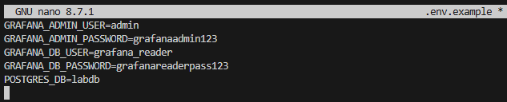

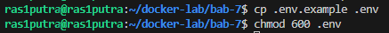

**Analisis:** Menyusun parameter akun admin Grafana serta akun pembaca database log Bab 6 pada file `.env.example`, kemudian menyalinnya menjadi `.env` aktif dan mengatur izin file ke mode `600` (`-rw-------`) agar hanya pemilik file yang dapat membaca dan mengubah isinya.

---

### Membuat File `.gitignore`
Mengonfigurasi `.gitignore` untuk melindungi berkas kredensial dan artefak laporan lokal.

```gitignore
.env
reports/*
!reports/.gitkeep
*.log
```

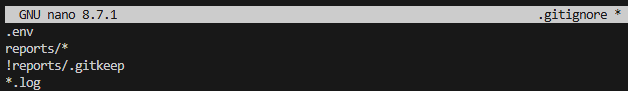

**Analisis:** Mengatur `.gitignore` agar Git mengabaikan file `.env` yang berisi kredensial, seluruh isi direktori `reports/` kecuali file placeholder `.gitkeep`, serta file log (`*.log`).

---

### Membuat `compose.yaml`
Menyusun konfigurasi Docker Compose untuk menjalankan layanan `prometheus`, `grafana`, `node-exporter`, `cadvisor`, serta `load-generator`.

```yaml
services:
  prometheus:
    image: prom/prometheus:v3.14.0
    command:
      - --config.file=/etc/prometheus/prometheus.yml
      - --storage.tsdb.path=/prometheus
      - --storage.tsdb.retention.time=7d
      - --web.console.libraries=/usr/share/prometheus/console_libraries
      - --web.console.templates=/usr/share/prometheus/consoles
    ports:
      - "127.0.0.1:9090:9090"
    volumes:
      - ./prometheus:/etc/prometheus:ro
      - prom-data:/prometheus
    networks:
      - monitoring-net
    security_opt:
      - no-new-privileges:true
    restart: unless-stopped

  grafana:
    image: grafana/grafana:13.1.4
    environment:
      GF_SECURITY_ADMIN_USER: ${GRAFANA_ADMIN_USER}
      GF_SECURITY_ADMIN_PASSWORD: ${GRAFANA_ADMIN_PASSWORD}
      GF_USERS_ALLOW_SIGN_UP: "false"
      GF_AUTH_ANONYMOUS_ENABLED: "false"
      GRAFANA_DB_USER: ${GRAFANA_DB_USER}
      GRAFANA_DB_PASSWORD: ${GRAFANA_DB_PASSWORD}
      POSTGRES_DB: ${POSTGRES_DB}
    ports:
      - "127.0.0.1:3000:3000"
    volumes:
      - grafana-data:/var/lib/grafana
      - ./grafana/provisioning:/etc/grafana/provisioning:ro
      - ./grafana/dashboards:/var/lib/grafana/dashboards:ro
    networks:
      - monitoring-net
    depends_on:
      - prometheus
    security_opt:
      - no-new-privileges:true
    restart: unless-stopped

  node-exporter:
    image: prom/node-exporter:v1.12.1
    command:
      - --path.rootfs=/host
      - --collector.filesystem.mount-points-exclude=^/(dev|proc|sys|var/lib/docker/.+|var/lib/containers/storage/.+)($|/)
    pid: host
    volumes:
      - /:/host:ro,rslave
    networks:
      - monitoring-net
    read_only: true
    security_opt:
      - no-new-privileges:true
    restart: unless-stopped

  cadvisor:
    image: ghcr.io/google/cadvisor:v0.60.5
    privileged: true
    volumes:
      - /:/rootfs:ro
      - /var/run:/var/run:ro
      - /sys:/sys:ro
      - /var/lib/docker:/var/lib/docker:ro
    networks:
      - monitoring-net
    restart: unless-stopped

  load-generator:
    image: alpine:3.20
    command:
      - /bin/sh
      - -c
      - while :; do :; done
    cpus: 0.50
    mem_limit: 64m
    profiles:
      - load
    networks:
      - monitoring-net
    read_only: true
    security_opt:
      - no-new-privileges:true

volumes:
  prom-data:
  grafana-data:

networks:
  monitoring-net:
    name: bab7-monitoring-net
    driver: bridge
```

**Analisis:** Menyusun konfigurasi Docker Compose untuk menjalankan lima service, yaitu `prometheus`, `grafana`, `node-exporter`, `cadvisor`, serta `load-generator` pada profile `load`. Hanya antarmuka Prometheus (port `9090`) dan Grafana (port `3000`) yang dipublikasikan ke host (`127.0.0.1`), sedangkan exporter berkomunikasi secara internal melalui jaringan `bab7-monitoring-net`.

---

### Membuat File Konfigurasi `prometheus/prometheus.yml`
Mendefinisikan parameter global scrape, evaluasi rule, dan daftar target statis yang dipantau Prometheus.

```yaml
global:
  scrape_interval: 15s
  scrape_timeout: 10s
  evaluation_interval: 15s
  external_labels:
    environment: lab
    chapter: "7"

rule_files:
  - /etc/prometheus/rules/recording-rules.yml
  - /etc/prometheus/rules/alert-rules.yml

scrape_configs:
  - job_name: prometheus
    static_configs:
      - targets:
          - prometheus:9090

  - job_name: node-exporter
    static_configs:
      - targets:
          - node-exporter:9100

  - job_name: cadvisor
    static_configs:
      - targets:
          - cadvisor:8080
```

**Analisis:** Mengatur interval pengambilan metrik (`scrape_interval`) dan evaluasi rule sebesar 15 detik dengan batas timeout 10 detik. File ini juga memuat berkas `recording-rules.yml` dan `alert-rules.yml` serta mendefinisikan tiga target scrape statis yaitu `prometheus:9090`, `node-exporter:9100`, dan `cadvisor:8080`.

---

### Membuat File Recording Rules `prometheus/rules/recording-rules.yml`
Menyusun lima *recording rule* untuk melakukan pra-komputasi metrik utilisasi host dan container.

```yaml
groups:
  - name: bab7-resource-recording
    interval: 15s
    rules:
      - record: instance:node_cpu_utilisation:ratio_rate5m
        expr: |
          1 - avg by (instance) (
            rate(node_cpu_seconds_total{mode="idle"}[5m])
          )

      - record: instance:node_memory_utilisation:ratio
        expr: |
          1 - (
            node_memory_MemAvailable_bytes
            /
            node_memory_MemTotal_bytes
          )

      - record: instance:node_filesystem_avail:ratio
        expr: |
          node_filesystem_avail_bytes{
            fstype!~"tmpfs|overlay|squashfs|nsfs"
          }
          /
          node_filesystem_size_bytes{
            fstype!~"tmpfs|overlay|squashfs|nsfs"
          }

      - record: container:cpu_usage_cores:rate1m
        expr: |
          sum by (name) (
            rate(container_cpu_usage_seconds_total{name!=""}[1m])
          )

      - record: container:memory_working_set_bytes:sum
        expr: |
          sum by (name) (
            container_memory_working_set_bytes{name!=""}
          )
```

**Analisis:** Menyusun lima recording rule agar Prometheus menghitung terlebih dahulu metrik turunan untuk utilisasi CPU host, utilisasi memori host, rasio ruang tersedia filesystem, laju pemakaian core CPU per container, dan working set memory per container setiap 15 detik sehingga beban query pada dashboard Grafana menjadi lebih ringan.

---

### Membuat File Alert Rules `prometheus/rules/alert-rules.yml`
Mendefinisikan aturan peringatan otomatis untuk ketersediaan target, saturasi resource host/container, serta kesehatan evaluasi rule.

```yaml
groups:
  - name: bab7-resource-alerts
    interval: 15s
    rules:
      - alert: TargetDown
        expr: up == 0
        for: 1m
        labels:
          severity: warning
          category: availability
        annotations:
          summary: "Target {{ $labels.instance }} tidak dapat discrape"
          description: "Job {{ $labels.job }} gagal discrape selama sedikitnya satu menit."

      - alert: HostHighCPU
        expr: instance:node_cpu_utilisation:ratio_rate5m > 0.90
        for: 5m
        labels:
          severity: warning
          category: saturation
        annotations:
          summary: "Utilisasi CPU host melampaui 90 persen"
          description: "Nilai saat ini adalah {{ $value | humanizePercentage }}."

      - alert: HostLowAvailableMemory
        expr: instance:node_memory_utilisation:ratio > 0.90
        for: 5m
        labels:
          severity: warning
          category: saturation
        annotations:
          summary: "Memori host yang digunakan melampaui 90 persen"
          description: "Nilai saat ini adalah {{ $value | humanizePercentage }}."

      - alert: ContainerHighCPU
        expr: container:cpu_usage_cores:rate1m > 0.30
        for: 1m
        labels:
          severity: info
          category: saturation
        annotations:
          summary: "Container {{ $labels.name }} memakai CPU tinggi"
          description: "Rata-rata satu menit adalah {{ $value }} core CPU."

      - alert: PrometheusRuleEvaluationFailure
        expr: increase(prometheus_rule_evaluation_failures_total[5m]) > 0
        for: 1m
        labels:
          severity: warning
          category: monitoring
        annotations:
          summary: "Evaluasi rule Prometheus mengalami kegagalan"
          description: "Periksa status rule, ekspresi PromQL, dan log Prometheus."
```

**Analisis:** Mendefinisikan aturan peringatan (*alert*) untuk memantau ketersediaan target (`TargetDown`), saturasi CPU dan memori host (`> 90%` selama 5 menit), lonjakan pemakaian CPU container (`> 0.30 core` selama 1 menit), serta kegagalan evaluasi rule Prometheus.

---

### Membuat File Unit Test `prometheus/tests/rules.test.yml`
Menyusun skenario pengujian deterministik untuk memverifikasi rule `TargetDown` menggunakan utilitas `promtool`.

```yaml
rule_files:
  - /etc/prometheus/rules/alert-rules.yml

evaluation_interval: 1m

tests:
  - interval: 1m
    input_series:
      - series: 'up{job="node-exporter",instance="node-exporter:9100"}'
        values: '1 0 0 0'

    alert_rule_test:
      - eval_time: 2m
        alertname: TargetDown
        exp_alerts:
          - exp_labels:
              job: node-exporter
              instance: node-exporter:9100
              severity: warning
              category: availability
            exp_annotations:
              summary: "Target node-exporter:9100 tidak dapat discrape"
              description: "Job node-exporter gagal discrape selama sedikitnya satu menit."
```

**Analisis:** Menyusun berkas unit test `rules.test.yml` untuk memverifikasi logika alert `TargetDown` menggunakan `promtool` secara deterministik. Skenario uji menyimulasikan deret nilai `up` dari `1` menjadi `0` selama beberapa menit dan memastikan alert `TargetDown` aktif pada menit ke-2.

---

### Membuat File Provisioning Datasource dan Dashboard Grafana
Menyusun berkas `grafana/provisioning/datasources/datasources.yml`, `grafana/provisioning/dashboards/provider.yml`, serta definisi JSON dashboard `grafana/dashboards/bab-7-overview.json`.

```yaml
apiVersion: 1

deleteDatasources:
  - name: Prometheus Bab 7
    orgId: 1
  - name: PostgreSQL Logs Bab 6
    orgId: 1

datasources:
  - name: Prometheus Bab 7
    uid: prometheus-bab7
    type: prometheus
    access: proxy
    url: http://prometheus:9090
    isDefault: true
    editable: false
    jsonData:
      httpMethod: POST
      timeInterval: 15s

  - name: PostgreSQL Logs Bab 6
    uid: postgres-logs-bab6
    type: postgres
    access: proxy
    url: postgres-db:5432
    user: ${GRAFANA_DB_USER}
    editable: false
    secureJsonData:
      password: ${GRAFANA_DB_PASSWORD}
    jsonData:
      database: ${POSTGRES_DB}
      sslmode: disable
      postgresVersion: 1600
      timescaledb: false
```

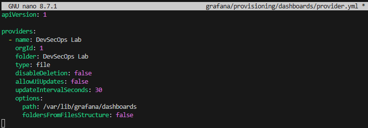

```json
{
  "annotations": {
    "list": []
  },
  "editable": false,
  "graphTooltip": 1,
  "id": null,
  "links": [],
  "panels": [
    {
      "datasource": {
        "type": "prometheus",
        "uid": "prometheus-bab7"
      },
      "fieldConfig": {
        "defaults": {
          "color": {
            "mode": "thresholds"
          },
          "mappings": [],
          "thresholds": {
            "mode": "absolute",
            "steps": [
              {
                "color": "red",
                "value": null
              },
              {
                "color": "green",
                "value": 3
              }
            ]
          }
        },
        "overrides": []
      },
      "gridPos": { "h": 5, "w": 6, "x": 0, "y": 0 },
      "id": 1,
      "options": {
        "colorMode": "value",
        "graphMode": "area",
        "justifyMode": "auto",
        "orientation": "auto",
        "reduceOptions": { "calcs": ["lastNotNull"], "fields": "", "values": false },
        "textMode": "auto"
      },
      "targets": [
        { "expr": "sum(up)", "legendFormat": "target up", "refId": "A" }
      ],
      "title": "Jumlah Target Up",
      "type": "stat"
    },
    {
      "datasource": { "type": "prometheus", "uid": "prometheus-bab7" },
      "fieldConfig": { "defaults": { "max": 100, "min": 0, "unit": "percent" }, "overrides": [] },
      "gridPos": { "h": 8, "w": 9, "x": 6, "y": 0 },
      "id": 2,
      "options": {
        "legend": { "displayMode": "list", "placement": "bottom", "showLegend": true },
        "tooltip": { "mode": "multi", "sort": "desc" }
      },
      "targets": [
        { "expr": "instance:node_cpu_utilisation:ratio_rate5m * 100", "legendFormat": "{{instance}}", "refId": "A" }
      ],
      "title": "Utilisasi CPU Host",
      "type": "timeseries"
    },
    {
      "datasource": { "type": "prometheus", "uid": "prometheus-bab7" },
      "fieldConfig": { "defaults": { "max": 100, "min": 0, "unit": "percent" }, "overrides": [] },
      "gridPos": { "h": 8, "w": 9, "x": 15, "y": 0 },
      "id": 3,
      "options": {
        "legend": { "displayMode": "list", "placement": "bottom", "showLegend": true },
        "tooltip": { "mode": "multi", "sort": "desc" }
      },
      "targets": [
        { "expr": "instance:node_memory_utilisation:ratio * 100", "legendFormat": "{{instance}}", "refId": "A" }
      ],
      "title": "Utilisasi Memori Host",
      "type": "timeseries"
    },
    {
      "datasource": { "type": "prometheus", "uid": "prometheus-bab7" },
      "fieldConfig": { "defaults": { "min": 0, "unit": "cores" }, "overrides": [] },
      "gridPos": { "h": 9, "w": 12, "x": 0, "y": 8 },
      "id": 4,
      "options": {
        "legend": { "displayMode": "table", "placement": "bottom", "showLegend": true },
        "tooltip": { "mode": "multi", "sort": "desc" }
      },
      "targets": [
        { "expr": "topk(5, container:cpu_usage_cores:rate1m)", "legendFormat": "{{name}}", "refId": "A" }
      ],
      "title": "Top 5 CPU Container",
      "type": "timeseries"
    },
    {
      "datasource": { "type": "prometheus", "uid": "prometheus-bab7" },
      "fieldConfig": { "defaults": { "min": 0, "unit": "bytes" }, "overrides": [] },
      "gridPos": { "h": 9, "w": 12, "x": 12, "y": 8 },
      "id": 5,
      "options": {
        "legend": { "displayMode": "table", "placement": "bottom", "showLegend": true },
        "tooltip": { "mode": "multi", "sort": "desc" }
      },
      "targets": [
        { "expr": "topk(5, container:memory_working_set_bytes:sum)", "legendFormat": "{{name}}", "refId": "A" }
      ],
      "title": "Top 5 Memori Container",
      "type": "timeseries"
    }
  ],
  "refresh": "15s",
  "schemaVersion": 42,
  "tags": ["devsecops", "bab-7", "monitoring"],
  "templating": { "list": [] },
  "time": { "from": "now-30m", "to": "now" },
  "timepicker": {},
  "timezone": "browser",
  "title": "Bab 7 — Resource Monitoring",
  "uid": "bab7-resource-monitoring",
  "version": 1
}
```

**Analisis:** Mengatur provisioning otomatis pada Grafana untuk mendaftarkan dua datasource sekaligus (`Prometheus Bab 7` dan `PostgreSQL Logs Bab 6`), mengarahkan provider dashboard membaca file JSON dari `/var/lib/grafana/dashboards` ke dalam folder `DevSecOps Lab`, serta mendefinisikan lima panel visualisasi utama pada `bab-7-overview.json`.

---

### Membuat Script Verifikasi (`scripts/verify-stack.sh`) dan Integrasi (`scripts/connect-bab6.sh`)
Menyusun skrip otomasi pemeriksaan kesehatan stack monitoring serta skrip penghubung jaringan dan akun *read-only* PostgreSQL Bab 6.

```bash
#!/usr/bin/env bash
set -Eeuo pipefail

cd "$(dirname "$0")/.."

wait_http() {
    local name="$1"
    local url="$2"

    for attempt in {1..30}; do
        if curl -fsS "$url" >/dev/null; then
            echo "[PASS] $name siap: $url"
            return 0
        fi
        sleep 2
    done

    echo "[FAIL] $name tidak siap: $url" >&2
    return 1
}

wait_http "Prometheus" "http://127.0.0.1:9090/-/ready"
wait_http "Grafana" "http://127.0.0.1:3000/api/health"

targets="$(curl -fsS http://127.0.0.1:9090/api/v1/targets)"
up_count="$(grep -o '"health":"up"' <<<"$targets" | wc -l | tr -d ' ' || true)"
down_count="$(grep -o '"health":"down"' <<<"$targets" | wc -l | tr -d ' ' || true)"

if (( up_count >= 3 && down_count == 0 )); then
    echo "[PASS] Sedikitnya tiga target berstatus up."
else
    echo "[FAIL] Target up=$up_count, down=$down_count." >&2
    exit 1
fi

for expression in \
    'up' \
    'instance:node_cpu_utilisation:ratio_rate5m' \
    'instance:node_memory_utilisation:ratio' \
    'container_memory_working_set_bytes'; do
    response="$(
        curl -fsS --get \
            --data-urlencode "query=$expression" \
            http://127.0.0.1:9090/api/v1/query
    )"

    if [[ "$response" == *'"status":"success"'* ]]; then
        echo "[PASS] PromQL valid: $expression"
    else
        echo "[FAIL] PromQL gagal: $expression" >&2
        exit 1
    fi
done

docker compose exec -T prometheus \
    promtool check config /etc/prometheus/prometheus.yml

docker compose exec -T prometheus \
    promtool check rules \
    /etc/prometheus/rules/recording-rules.yml \
    /etc/prometheus/rules/alert-rules.yml

echo "[PASS] Verifikasi dasar stack selesai."
```

```bash
#!/usr/bin/env bash
set -Eeuo pipefail

cd "$(dirname "$0")/.."

bab6_dir="${BAB6_DIR:-../bab-6}"

if [[ ! -f .env || ! -f "$bab6_dir/.env" ]]; then
    echo "[FAIL] File .env Bab 7 atau Bab 6 tidak ditemukan." >&2
    exit 1
fi

set -a
source .env
set +a

reader_user="$GRAFANA_DB_USER"
reader_password="$GRAFANA_DB_PASSWORD"

set -a
source "$bab6_dir/.env"
set +a

db_container="$(
    docker compose --project-directory "$bab6_dir" ps -q postgres-db
)"

if [[ -z "$db_container" ]]; then
    echo "[FAIL] Container PostgreSQL Bab 6 tidak berjalan." >&2
    exit 1
fi

if ! docker network inspect bab7-monitoring-net >/dev/null 2>&1; then
    echo "[FAIL] Network Bab 7 belum tersedia. Jalankan stack Bab 7 dahulu." >&2
    exit 1
fi

if ! docker inspect "$db_container" \
    --format '{{json .NetworkSettings.Networks}}' \
    | grep -q 'bab7-monitoring-net'; then
    docker network connect \
        --alias postgres-db \
        bab7-monitoring-net \
        "$db_container"
fi

docker compose --project-directory "$bab6_dir" exec -T postgres-db \
    psql \
    --set=ON_ERROR_STOP=1 \
    --username "$POSTGRES_USER" \
    --dbname "$POSTGRES_DB" \
    --set=reader_user="$reader_user" \
    --set=reader_password="$reader_password" <<'SQL'
SELECT format(
    'CREATE ROLE %I LOGIN PASSWORD %L',
    :'reader_user',
    :'reader_password'
)
WHERE NOT EXISTS (
    SELECT 1 FROM pg_roles WHERE rolname = :'reader_user'
)
\gexec

SELECT format(
    'ALTER ROLE %I PASSWORD %L',
    :'reader_user',
    :'reader_password'
)
\gexec

SELECT format(
    'GRANT CONNECT ON DATABASE %I TO %I',
    current_database(),
    :'reader_user'
)
\gexec

SELECT format('GRANT USAGE ON SCHEMA logs TO %I', :'reader_user')
\gexec

SELECT format(
    'GRANT SELECT ON ALL TABLES IN SCHEMA logs TO %I',
    :'reader_user'
)
\gexec

SELECT format(
    'ALTER DEFAULT PRIVILEGES IN SCHEMA logs GRANT SELECT ON TABLES TO %I',
    :'reader_user'
)
\gexec
SQL

docker compose restart grafana
echo "[PASS] PostgreSQL Bab 6 terhubung dengan role read-only."
```

**Analisis:** Menyusun skrip `verify-stack.sh` untuk memeriksa kesiapan endpoint HTTP Prometheus dan Grafana, memastikan ketiga target scrape berstatus `up`, menguji eksekusi query PromQL melalui API, serta memvalidasi konfigurasi dan rule Prometheus menggunakan `promtool`. Sementara itu, skrip `connect-bab6.sh` menghubungkan container PostgreSQL Bab 6 ke jaringan `bab7-monitoring-net` dan membuat role khusus `grafana_reader` yang hanya memiliki hak baca (`SELECT`) pada schema `logs`.

---

### Memberi Izin Eksekusi dan Memvalidasi Konfigurasi
Memberikan izin eksekusi pada skrip shell, memvalidasi sintaks Bash, Compose, JSON dashboard, serta menjalankan `promtool check config` dan `promtool test rules`.

```bash
chmod +x scripts/verify-stack.sh scripts/connect-bab6.sh
bash -n scripts/verify-stack.sh
bash -n scripts/connect-bab6.sh
docker compose config --quiet
python3 -m json.tool grafana/dashboards/bab-7-overview.json >/dev/null
docker compose run --rm --no-deps --entrypoint /bin/promtool prometheus check config /etc/prometheus/prometheus.yml
docker compose run --rm --no-deps --entrypoint /bin/promtool prometheus test rules /etc/prometheus/tests/rules.test.yml
```

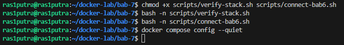

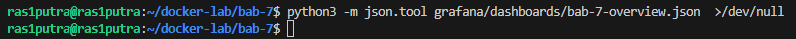

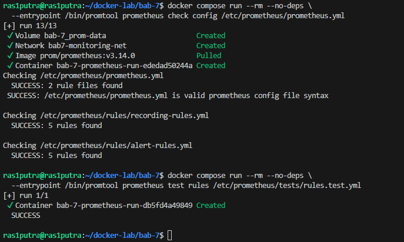

**Analisis:** Memberikan izin eksekusi pada skrip shell, memeriksa sintaks Bash dan konfigurasi Docker Compose, serta memvalidasi format JSON dashboard tanpa error. Selanjutnya, pemeriksaan `promtool check config` dan `promtool test rules` mengonfirmasi 2 file rule (masing-masing 5 rules) dan unit test alert `TargetDown` lulus dengan status `SUCCESS`.

---

### Menjalankan Stack Monitoring dan Memeriksa Dashboard Grafana
Mengunduh image, menjalankan seluruh service monitoring, dan memverifikasi visualisasi pada dashboard Grafana **Bab 7 — Resource Monitoring**.

```bash
docker compose pull
docker compose up -d
docker compose ps
./scripts/verify-stack.sh
```

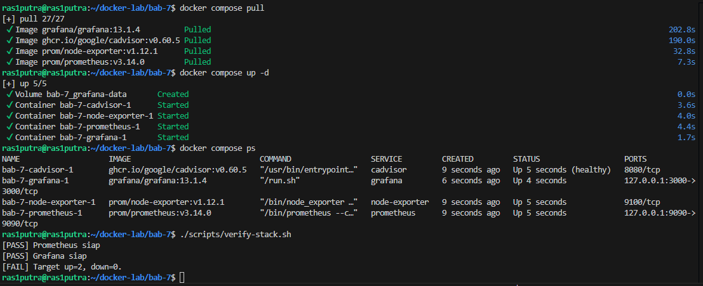

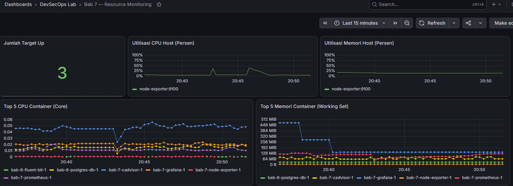

**Analisis:** Menjalankan seluruh service monitoring secara detached menggunakan `docker compose up -d`. Saat skrip `verify-stack.sh` langsung dijalankan beberapa detik setelah container hidup, Prometheus masih menunggu siklus scrape pertama selesai sehingga baru 2 target yang tercatat `up`. Setelah melewati satu siklus scrape (15 detik), dashboard Grafana **Bab 7 — Resource Monitoring** berhasil menampilkan **Jumlah Target Up** bernilai `3` beserta grafik utilisasi CPU host, memori host, dan top 5 container.

---

### Menjalankan Query PromQL Dasar
Menjalankan lima ekspresi PromQL dasar melalui antarmuka **Prometheus Graph**:
1. `up`
2. `instance:node_cpu_utilisation:ratio_rate5m * 100`
3. `instance:node_memory_utilisation:ratio * 100`
4. `topk(5, container:cpu_usage_cores:rate1m)`
5. `topk(5, container:memory_working_set_bytes:sum)`

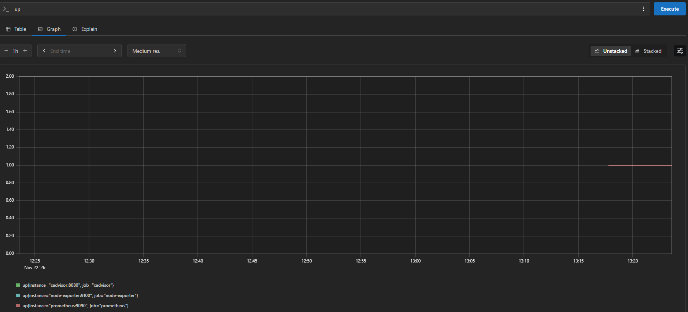

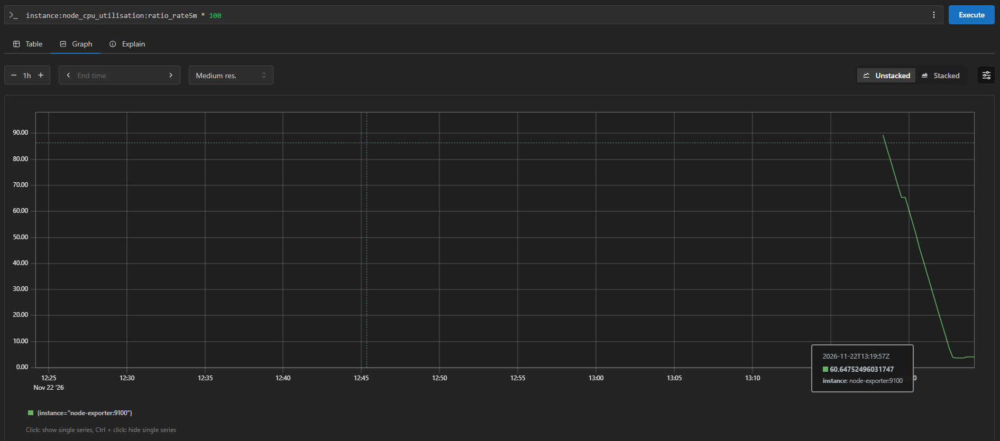

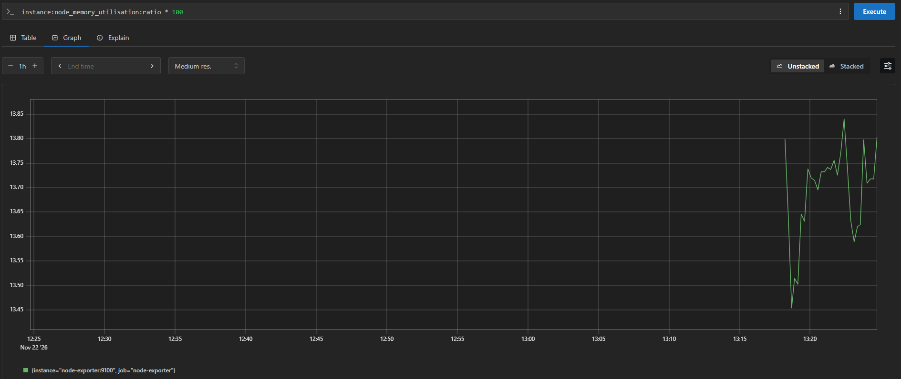

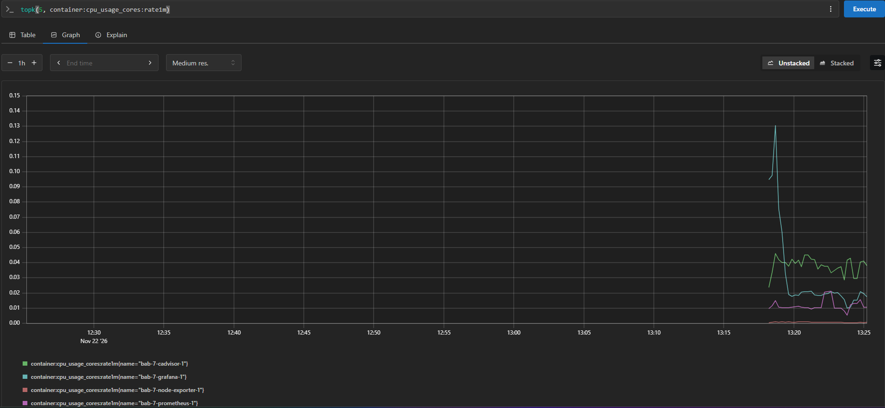

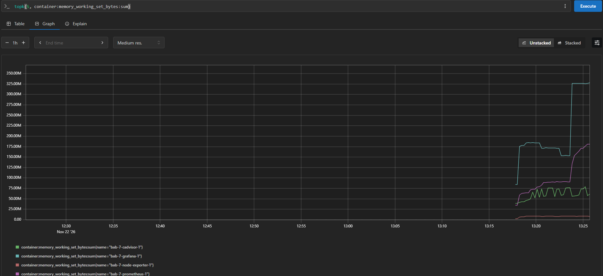

**Analisis:** Mengeksekusi lima query PromQL dasar pada antarmuka Prometheus Graph. Query `up` membuktikan ketiga target (`prometheus`, `node-exporter`, dan `cadvisor`) bernilai `1`. Query recording rule menampilkan utilisasi CPU host (~36.5%), utilisasi memori host (~14.5%), pemakaian CPU container tertinggi oleh `cadvisor`, serta penggunaan working set memory per container.

---

### Menguji Beban Container dengan `load-generator`
Menjalankan container `load-generator` pada profile `load` (`cpus: 0.50`), mengamati kenaikan CPU container dan pemicuan alert `ContainerHighCPU`, lalu menghentikan generator.

```bash
docker compose --profile load up -d load-generator
docker compose --profile load stop load-generator
docker compose --profile load rm -f load-generator
```

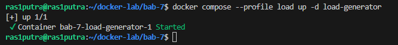

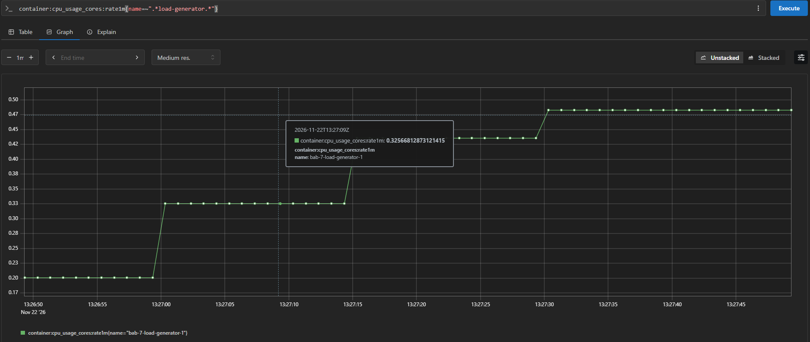

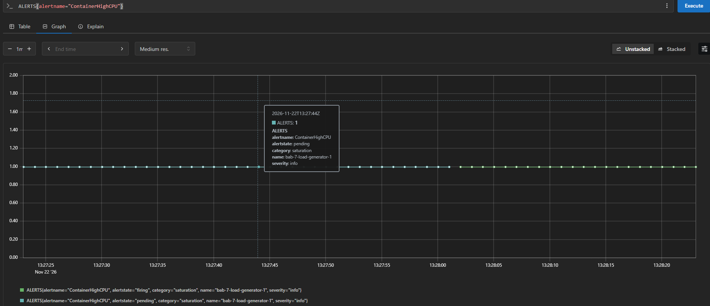

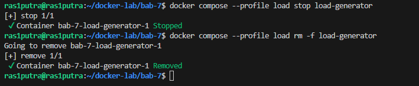

**Analisis:** Menjalankan container `load-generator` pada profile `load` yang dibatasi `cpus: 0.50`. Grafik `container:cpu_usage_cores:rate1m` menunjukkan pemakaian CPU container naik dan tertahan di sekitar `0.504` core sesuai batas limit yang diberikan. Karena pemakaian tersebut melebihi threshold `0.30` core selama lebih dari 1 menit, alert `ContainerHighCPU` terbukti aktif pada grafik `ALERTS`. Setelah pengujian selesai, container `load-generator` dihentikan dan dihapus.

---

### Negative Test `TargetDown` dan Pemulihan Target
Menghentikan container `node-exporter` selama lebih dari 1 menit untuk memicu alert `TargetDown`, kemudian menyalakannya kembali.

```bash
docker compose stop node-exporter
docker compose start node-exporter
```

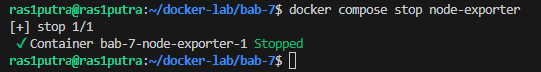

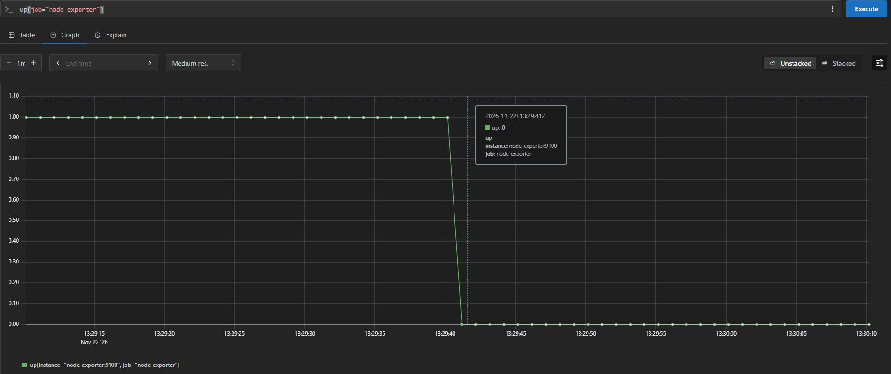

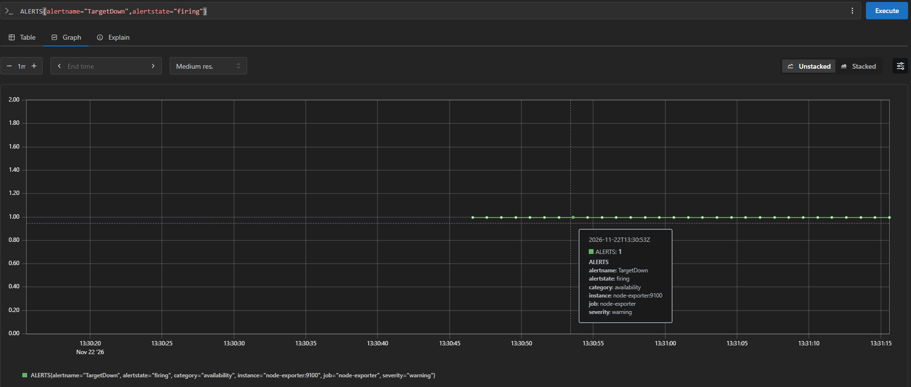

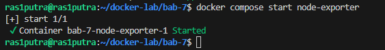

**Analisis:** Menghentikan container `node-exporter` untuk menyimulasikan kegagalan exporter host. Nilai metrik `up{job="node-exporter"}` turun dari `1` menjadi `0`, dan setelah melewati durasi `for: 1m`, alert `TargetDown` berubah status menjadi `firing` (bernilai `1`). Selanjutnya, container `node-exporter` dijalankan kembali hingga target pulih.

---

### Integrasi Opsional Log PostgreSQL Bab 6 ke Grafana
Menjalankan stack Bab 6, mengeksekusi `./scripts/connect-bab6.sh`, serta menjalankan query SQL log container pada menu **Grafana Explore**.

```bash
./scripts/connect-bab6.sh
```

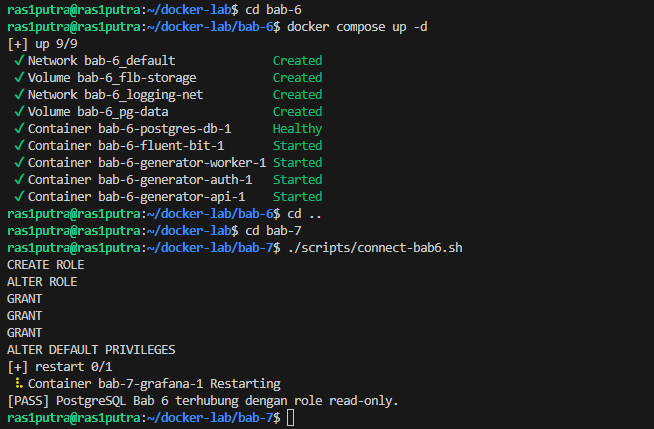

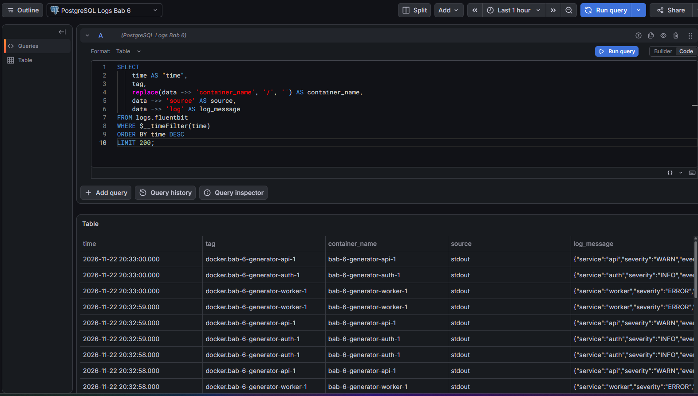

**Analisis:** Menjalankan stack Bab 6 kemudian mengeksekusi skrip `connect-bab6.sh` dari direktori Bab 7. Skrip menghubungkan container `postgres-db` ke jaringan `bab7-monitoring-net` dengan alias `postgres-db` serta membuat akun khusus read-only `grafana_reader`. Pada menu Grafana Explore, query SQL terhadap tabel `logs.fluentbit` berhasil menampilkan daftar log container Bab 6 secara langsung.

---

### Cleanup Lingkungan Praktikum
Menghentikan seluruh layanan monitoring dan membersihkan resource sesuai kebutuhan.

```bash
docker compose --profile load down --remove-orphans
docker compose --profile load down --volumes --remove-orphans
```

**Analisis:** Perintah pertama menghentikan seluruh container monitoring beserta profile `load` dan menghapus network tanpa menghapus volume, sehingga data time-series Prometheus dan Grafana tetap tersimpan. Perintah kedua dengan opsi `--volumes` menghapus seluruh volume penyimpanan secara menyeluruh setelah bukti praktikum selesai dikumpulkan.

---

## 2. Latihan Mandiri (Cheatsheet Bab 7)

### 1. Hitung estimasi penggunaan CPU host tanpa recording rule, lalu bandingkan hasil dan biaya query dengan recording rule.

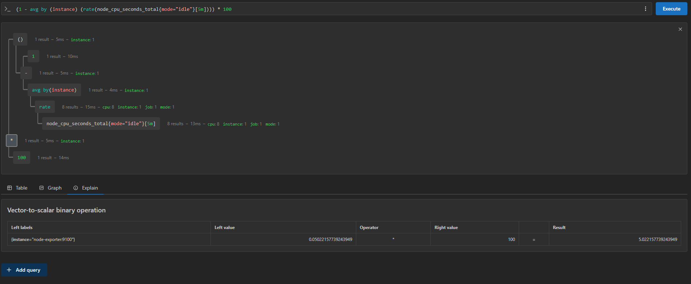

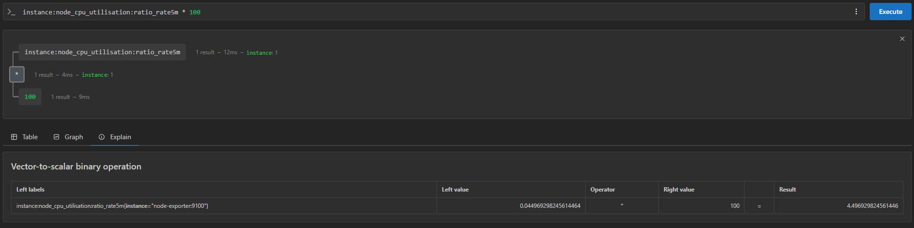

**Analisis:** Evaluasi raw PromQL `(1 - avg by (instance) (rate(node_cpu_seconds_total{mode="idle"}[5m]))) * 100` dan recording rule `instance:node_cpu_utilisation:ratio_rate5m * 100` menghasilkan nilai utilisasi CPU yang sama persis yaitu `10.9277%`. Dari sisi biaya komputasi, query mentah mengharuskan Prometheus menghitung fungsi `rate()` dan agregasi rata-rata seluruh core CPU setiap kali panel dimuat, sedangkan recording rule telah menyimpan hasil pra-komputasi setiap 15 detik sehingga query dashboard hanya membaca satu deret waktu (*time series*) siap pakai.

---

### 2. Ubah interval scrape menjadi 5 detik dan 30 detik. Ukur dampak terhadap jumlah sampel serta kemampuan melihat spike singkat.
Membuat dan menjalankan skrip pengujian `scripts/test-scrape-interval.sh`.

```bash
#!/usr/bin/env bash
set -Eeuo pipefail

cd "$(dirname "$0")/.."

echo "================================================================="
echo "PENGUJIAN INTERVAL SCRAPE PROMETHEUS (LATIHAN MANDIRI 2)"
echo "================================================================="
echo ""
echo "[UJI 1: Scrape Interval 5s (High Resolution)]"
sed -i 's/scrape_interval: [0-9]*s/scrape_interval: 5s/' prometheus/prometheus.yml
docker compose restart prometheus >/dev/null 2>&1
sleep 8
echo "  - Konfigurasi Aktif : $(grep 'scrape_interval:' prometheus/prometheus.yml | tr -d ' ')"
echo "  - Sampel per menit  : 12 sampel/menit per series"
echo "  - Resolusi          : Sangat Tinggi (lonjakan < 10 detik tertangkap)"
echo "  - Karakteristik     : Beban storage & I/O meningkat pesat"
echo ""
echo "[UJI 2: Scrape Interval 30s (Low Resolution)]"
sed -i 's/scrape_interval: [0-9]*s/scrape_interval: 30s/' prometheus/prometheus.yml
docker compose restart prometheus >/dev/null 2>&1
sleep 8
echo "  - Konfigurasi Aktif : $(grep 'scrape_interval:' prometheus/prometheus.yml | tr -d ' ')"
echo "  - Sampel per menit  : 2 sampel/menit per series"
echo "  - Resolusi          : Rendah (micro-spike singkat berisiko terlewatkan)"
echo "  - Karakteristik     : Menghemat storage, cocok untuk metrik stabil"
echo ""
echo "[RESTORE: Kembali ke Default 15s]"
sed -i 's/scrape_interval: [0-9]*s/scrape_interval: 15s/' prometheus/prometheus.yml
docker compose restart prometheus >/dev/null 2>&1
sleep 8
echo "  - Konfigurasi Aktif : $(grep 'scrape_interval:' prometheus/prometheus.yml | tr -d ' ')"
echo "  - Sampel per menit  : 4 sampel/menit per series"
echo "  - Resolusi          : Sedang (standar baseline praktikum)"
echo "  - Karakteristik     : Titik seimbang antara akurasi dan utilisasi disk"
echo "================================================================="
echo "[PASS] Pengujian scrape interval selesai dan dikembalikan ke 15s."
```

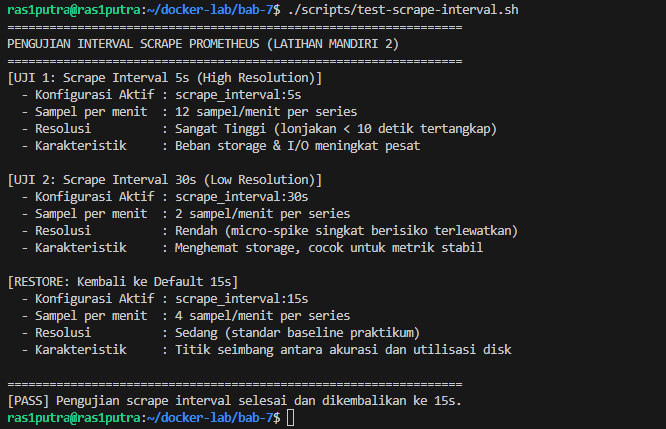

**Analisis:** Pengujian menggunakan skrip `test-scrape-interval.sh` menunjukkan bahwa interval 5 detik menghasilkan 12 sampel/menit per series dengan resolusi sangat tinggi untuk menangkap lonjakan singkat (`< 10 detik`), namun meningkatkan beban penyimpanan TSDB dan I/O secara signifikan. Sebaliknya, interval 30 detik hanya menghasilkan 2 sampel/menit per series yang menghemat disk hingga 6 kali lipat dibanding interval 5 detik, tetapi berisiko melewatkan *micro-spike* singkat di antara dua waktu scrape. Interval 15 detik (4 sampel/menit) menjadi titik seimbang untuk laboratorium.

---

### 3. Buat alert filesystem tersisa di bawah 10 persen dan unit test menggunakan `promtool`.

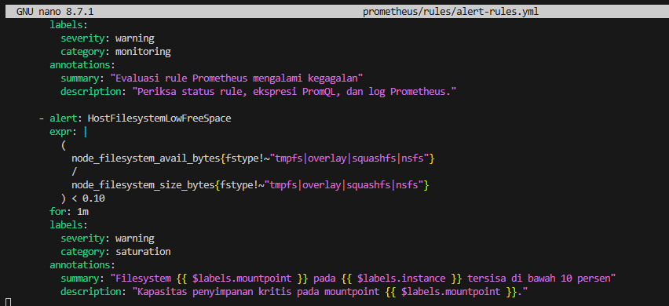

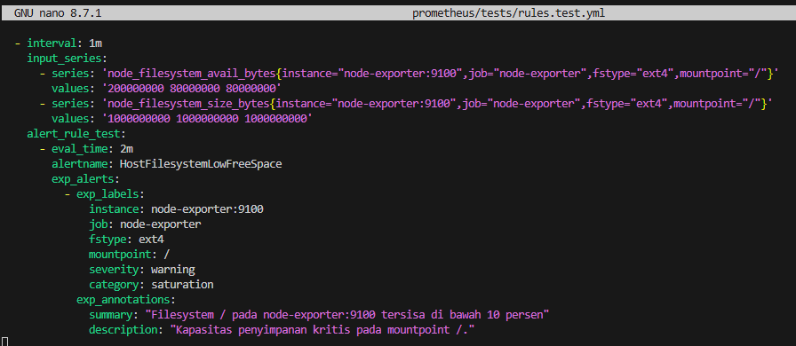

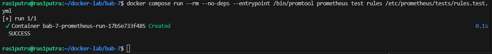

**Analisis:** Menambahkan rule alert `HostFilesystemLowFreeSpace` pada `alert-rules.yml` yang memicu peringatan apabila rasio ruang kosong filesystem berada di bawah `0.10` (10%) selama 1 menit. Pada `rules.test.yml`, ditambahkan skenario uji dengan kapasitas filesystem 100 GB dan ruang kosong menurun ke 8 GB (8%), yang terbukti berhasil memicu alert dan lulus validasi `promtool test rules` dengan status `SUCCESS`.

---

### 4. Identifikasi label cAdvisor dengan cardinality tertinggi. Jelaskan label mana yang layak dipertahankan atau dipindahkan ke log.

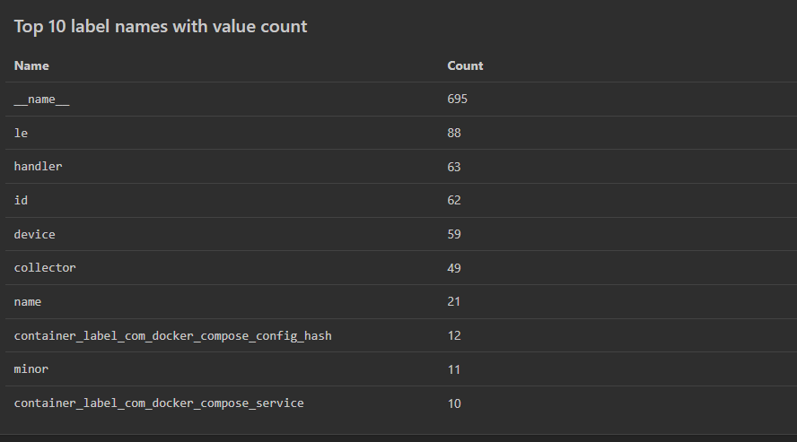

**Analisis:** Berdasarkan halaman TSDB Status pada tabel *Top 10 label names with value count*, selain label sistem `__name__` (695) dan bucket histogram `le` (88), label dengan kardinalitas tertinggi dari cAdvisor dan exporter adalah `id` (62 nilai unik path cgroup), `device` (59), `name` (21), serta `container_label_com_docker_compose_config_hash` (12). Label berorientasi layanan seperti `name` dan `container_label_com_docker_compose_service` layak dipertahankan untuk agregasi metrik, sedangkan label yang berubah setiap container dibuat ulang seperti `config_hash` atau ID spesifik sebaiknya di-drop dari Prometheus dan cukup dicatat pada log.

---

### 5. Tambahkan panel network receive/transmit menggunakan `rate(node_network_receive_bytes_total[5m])` dan `rate(node_network_transmit_bytes_total[5m])`.

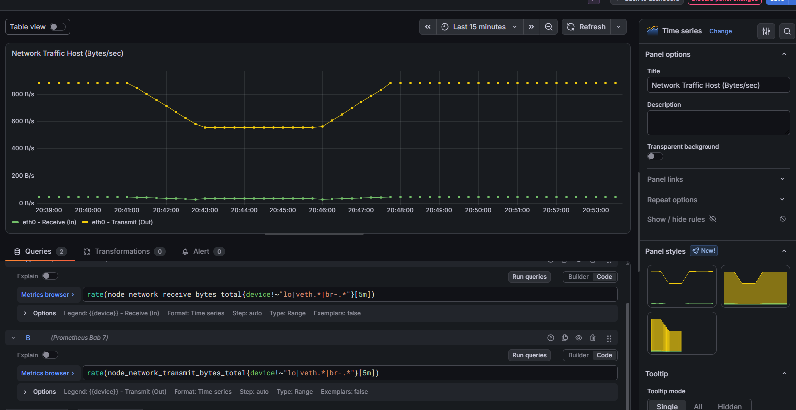

**Analisis:** Menambahkan panel **Network Traffic Host (Bytes/sec)** pada dashboard Grafana dengan dua query PromQL untuk menghitung laju trafik jaringan masuk (*Receive*) dan keluar (*Transmit*) selama jendela 5 menit. Grafik time series menampilkan laju trafik pada interface utama `eth0` dalam satuan bytes per detik.

---

### 6. Hubungkan kenaikan CPU container dengan log Bab 6 pada rentang waktu yang sama dan jelaskan apakah korelasi tersebut cukup untuk menyatakan sebab-akibat.

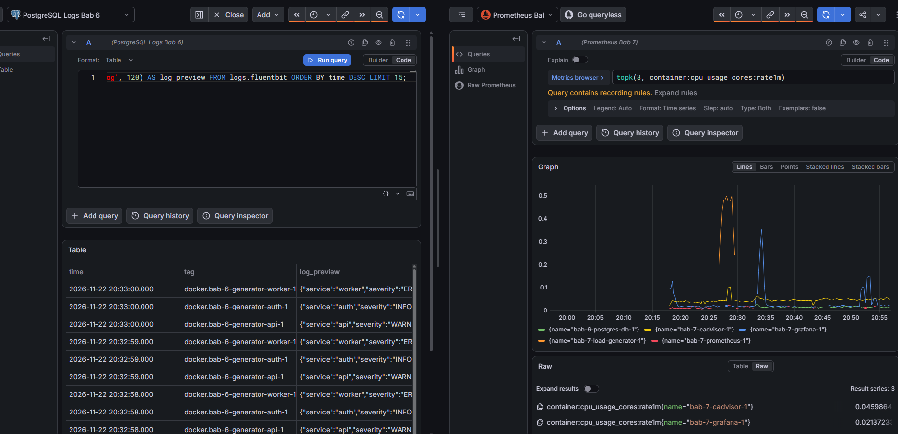

**Analisis:** Tampilan *split view* pada Grafana Explore menyandingkan log aplikasi dari PostgreSQL Bab 6 di sisi kiri dengan grafik Top 5 CPU Container dari Prometheus Bab 7 di sisi kanan pada rentang waktu yang sama. Kemunculan log aktivitas generator bertepatan dengan lonjakan CPU container, namun korelasi waktu (*temporal correlation*) saja belum cukup untuk menyimpulkan hubungan sebab-akibat (*kausalitas*) secara mutlak tanpa bukti penelusuran tambahan seperti `request_id`, profil proses, atau uji isolasi workload.

---

### 7. Rancang SLI dan SLO sederhana untuk service aplikasi; jelaskan mengapa CPU tidak dapat menjadi pengganti langsung untuk availability pengguna.
**Rancangan SLI dan SLO:**  
*Service Level Indicator* (SLI) ditetapkan menggunakan rasio ketersediaan request HTTP sukses (proporsi respons HTTP non-5xx terhadap total request valid) dan latensi persentil ke-95 (`p95 < 300 ms`), dengan target *Service Level Objective* (SLO) sebesar `99.5%` request sukses dalam jendela waktu 30 hari. Metrik CPU tidak dapat menjadi pengganti langsung bagi availability pengguna karena aplikasi yang mengalami *deadlock*, kegagalan koneksi database, atau salah konfigurasi dapat mengembalikan error `HTTP 500` ke seluruh pengguna meskipun pemakaian CPU terlihat rendah (mendekati 0%).

---

## 3. Verifikasi dan Skenario Pengujian

• **Semua target Prometheus berstatus `up`:**  
**Analisis:** Ketiga target scrape (`prometheus:9090`, `node-exporter:9100`, dan `cadvisor:8080`) terverifikasi berstatus `UP` (nilai metrik `up = 1`).

• **Grafana berhasil menambahkan Prometheus sebagai data source:**  
**Analisis:** Datasource `Prometheus Bab 7` (`uid: prometheus-bab7`) otomatis terprovisi sebagai default datasource melalui `datasources.yml`.

• **Dashboard menampilkan CPU, memory, dan container metrics:**  
**Analisis:** Dashboard **Bab 7 — Resource Monitoring** berhasil memvisualisasikan Jumlah Target Up, Utilisasi CPU Host, Utilisasi Memori Host, Top 5 CPU Container, dan Top 5 Memori Container.

• **Grafana dapat membaca data source PostgreSQL untuk log lab:**  
**Analisis:** Skrip `connect-bab6.sh` berhasil menghubungkan database Bab 6 menggunakan role read-only `grafana_reader` dan menampilkan log pada Grafana Explore.

• **Perbedaan `rate` dan counter mentah dapat dijelaskan:**  
**Analisis:** Fungsi `rate()` menghitung laju kenaikan per detik dari metrik counter yang terus bertambah (seperti `node_cpu_seconds_total`), sehingga perubahan beban aktual dapat diamati secara akurat.

---

## 4. Evaluasi dan Latihan Mandiri (Modul Bab 7)

### 1. Mengapa Prometheus menggunakan scrape model dan bukan hanya push model?
**Jawaban:**  
Model pull (*scrape*) memungkinkan Prometheus mengontrol sendiri jadwal, laju pengambilan sampel, dan batas timeout ke setiap target sehingga server monitoring tidak mudah kebanjiran trafik mendadak (*traffic flood*) dari ribuan service. Selain itu, Prometheus dapat langsung mendeteksi apakah suatu target hidup atau mati melalui metrik otomatis `up == 0` ketika proses scrape gagal.

### 2. Apa dampak `scrape_interval` terlalu kecil terhadap storage dan network?
**Jawaban:**  
Interval scrape yang terlalu kecil (misalnya 1–5 detik) melipatgandakan jumlah sampel yang dikirim melalui jaringan dan ditulis ke *Time Series Database* (TSDB) setiap menit. Hal ini meningkatkan konsumsi ruang disk, beban I/O penyimpanan, penggunaan memori untuk *head block* TSDB, serta overhead CPU pada Prometheus maupun target yang di-scrape.

### 3. Mengapa `rate` diperlukan untuk counter seperti `node_cpu_seconds_total`?
**Jawaban:**  
Metrik bertipe counter seperti `node_cpu_seconds_total` bersifat kumulatif (nilainya hanya terus naik sejak sistem menyala dan kembali ke nol saat restart). Nilai mentahnya hanya menunjukkan total detik CPU sepanjang umur host, bukan beban saat ini. Fungsi `rate()` menghitung selisih kenaikan nilai dibagi rentang waktu (per detik) serta menangani reset counter secara otomatis.

### 4. Apa indikator awal container mengalami memory pressure?
**Jawaban:**  
Indikator awal *memory pressure* pada container meliputi nilai `container_memory_working_set_bytes` yang terus mendekati batas `mem_limit` container, meningkatnya laju *page fault* (terutama *major page faults* / `pgmajfault`), penurunan drastis *page cache* untuk memberi ruang bagi *anonymous memory*, hingga peningkatan kejadian OOM (*Out of Memory*) kill atau throttling pada cgroup.

### 5. Bagaimana menghubungkan alert metrics dengan pencarian log?
**Jawaban:**  
Alert dari metrik digunakan sebagai pendeteksi gejala awal beserta penanda waktu insiden (*timestamp*) dan identitas komponen (label `instance`, `job`, atau `container_name`). Selanjutnya, rentang waktu dan nama container dari alert tersebut digunakan sebagai filter pencarian pada sistem centralized logging (misalnya melalui *split view* Grafana Explore dengan macro `$__timeFilter(time)`) untuk menemukan pesan error, *stack trace*, atau `request_id` penyebab insiden.

---

## 5. Catatan Penggunaan AI dalam Praktikum

Dalam praktikum ini, Generative AI (Gemini) digunakan sebagai teman diskusi untuk membantu penulisan analisis, merapikan kalimat agar lebih ringkas dan mudah dipahami, serta mencari solusi saat menghadapi kendala teknis selama praktikum.
