# Laporan Praktikum Bab 8 — Hardening Container, Secrets, Trivy, dan Private Registry

**Mata Kuliah:** Workshop DevOps  
**Dosen Pengampu:** Dr. Ferry Astika Saputra, S.T., M.Sc.  
**Penyusun:** Putra Yanuar Rasyid  
**NRP:** 3126640058  
**Program Studi:** D4 Teknik Informatika  
**Departemen:** Teknik Informatika dan Komputer  
**Institusi:** Politeknik Elektronika Negeri Surabaya  
**Tahun:** 2026  

---

## 1. Praktikum

### Membuat Folder untuk Praktikum
Membuat struktur direktori kerja `~/docker-lab/bab-8` beserta sub-folder untuk kode aplikasi (`app`), penyimpanan secret (`secrets`), sertifikat dan autentikasi registry (`registry/certs`, `registry/auth`), skrip otomasi (`scripts`), serta laporan pemindaian (`reports`).

```bash
mkdir -p ~/docker-lab/bab-8/{app,secrets,registry/certs,registry/auth,scripts,reports}
cd ~/docker-lab/bab-8
touch reports/.gitkeep
```

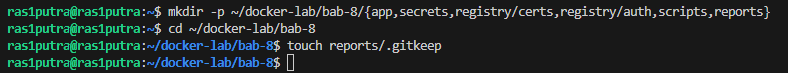

**Analisis:** Membuat struktur direktori utama `bab-8` beserta sub-folder `app`, `secrets`, `registry/certs`, `registry/auth`, `scripts`, dan `reports` serta membuat berkas placeholder `reports/.gitkeep`.

---

### Membuat Berkas Template Environment Variable
Menyusun variabel identitas image aplikasi dan konfigurasi akses private registry pada `.env.example`, menyalinnya ke `.env`, dan mengunci izin berkas.

```dotenv
APP_IMAGE=pens-web:1.0
REGISTRY_HOST=localhost:5000
REGISTRY_USER=labpublisher
REGISTRY_PASSWORD=registrypass123
```

```bash
cp .env.example .env
chmod 600 .env
```

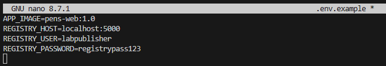

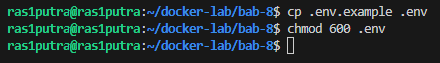

**Analisis:** Menyusun parameter nama image (`pens-web:1.0`), alamat registry (`localhost:5000`), serta kredensial akun publisher pada `.env.example`, kemudian menyalinnya ke `.env` dan mengunci izin file menjadi `chmod 600`.

---

### Membuat File `.gitignore` dan `.dockerignore`
Mengonfigurasi pengecualian berkas sensitif untuk repositori Git dan konteks build Docker.

```gitignore
.env
secrets/*.txt
!secrets/*.txt.example
registry/auth/*
registry/certs/*
reports/*
!reports/.gitkeep
*.tar
*.log
```

```dockerignore
.git
.gitignore
.env
secrets/
registry/
reports/
scripts/
compose.yaml
**/__pycache__/
**/*.py[cod]
**/*.log
**/*.tar
```

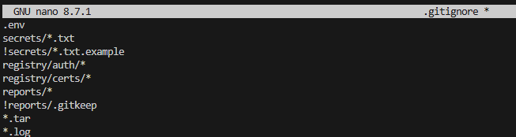

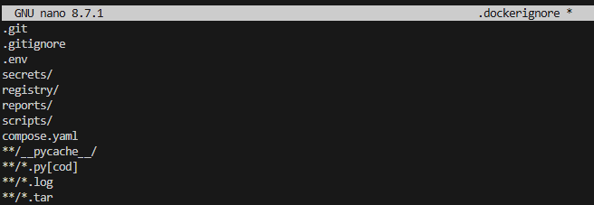

**Analisis:** Mengonfigurasi `.gitignore` agar file `.env`, secret aktif, sertifikat TLS, file `htpasswd`, arsip image (`.tar`), dan hasil laporan scan tidak masuk ke repositori Git. Sementara itu, `.dockerignore` mencegah file rahasia, skrip, dan laporan lokal ikut terkirim ke dalam Docker build context.

---

### Membuat Aplikasi Flask `app/requirements.txt` dan `app/app.py`
Menetapkan versi pustaka Python dan menyusun aplikasi web Flask yang memverifikasi keberadaan runtime secret serta identitas UID/GID proses.

```text
Flask==3.1.3
gunicorn==26.1.0
```

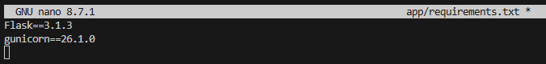

```python
import os
from pathlib import Path

from flask import Flask, jsonify


app = Flask(__name__)
SECRET_PATH = Path("/run/secrets/app_secret")


@app.get("/")
def index():
    return jsonify(
        service="pens-web",
        status="running",
        uid=os.getuid(),
        gid=os.getgid(),
        secret_mounted=SECRET_PATH.is_file(),
    )


@app.get("/health")
def health():
    if not SECRET_PATH.is_file():
        return jsonify(status="degraded", reason="secret_missing"), 503
    return jsonify(status="ok"), 200
```

**Analisis:** Menentukan dependency Flask dan Gunicorn yang digunakan aplikasi. `app.py` dibuat untuk mengecek apakah secret tersedia pada `/run/secrets/app_secret`. Aplikasi juga menampilkan UID/GID proses, tetapi tidak menampilkan isi secret pada response maupun log.

---

### Membuat `app/Dockerfile` dengan Multi-Stage Build dan User Non-Root
Menyusun `app/Dockerfile` yang memisahkan tahap instalasi virtual environment Python (`builder`) dari image akhir (`runtime`) dengan user numerik `10001:10001`.

```dockerfile
# syntax=docker/dockerfile:1

FROM python:3.11.16-slim AS builder

ENV PIP_DISABLE_PIP_VERSION_CHECK=1 \
    PIP_NO_CACHE_DIR=1

WORKDIR /build

COPY app/requirements.txt ./requirements.txt

RUN python -m venv /opt/venv \
    && /opt/venv/bin/pip install --no-cache-dir --requirement requirements.txt

FROM python:3.11.16-slim AS runtime

ARG APP_UID=10001
ARG APP_GID=10001

ENV PATH="/opt/venv/bin:${PATH}" \
    PYTHONDONTWRITEBYTECODE=1 \
    PYTHONUNBUFFERED=1

RUN groupadd --gid "${APP_GID}" appgroup \
    && useradd \
        --uid "${APP_UID}" \
        --gid "${APP_GID}" \
        --no-create-home \
        --shell /usr/sbin/nologin \
        appuser

WORKDIR /app

COPY --from=builder /opt/venv /opt/venv
COPY --chown=10001:10001 app/app.py ./app.py

USER 10001:10001

EXPOSE 8080

HEALTHCHECK --interval=10s --timeout=3s --start-period=5s --retries=3 \
    CMD ["python", "-c", "import urllib.request; urllib.request.urlopen('http://127.0.0.1:8080/health', timeout=2)"]

CMD ["gunicorn", "--bind=0.0.0.0:8080", "--workers=2", "--threads=2", "--worker-tmp-dir=/tmp", "--access-logfile=-", "--error-logfile=-", "app:app"]
```

**Analisis:** Dockerfile menggunakan multi-stage build. Dependency Python dipasang pada tahap `builder`, kemudian hanya virtual environment yang diperlukan yang dipindahkan ke image `runtime`. Aplikasi juga dijalankan menggunakan user non-root dengan UID/GID `10001:10001` tanpa home directory dan shell login.

---

### Membuat Berkas Contoh Secret `secrets/app_secret.txt.example`
Menyediakan berkas template untuk mendokumentasikan format file secret aplikasi.

```text
GANTI_DENGAN_NILAI_ACAK_KHUSUS_LAB
```

**Analisis:** Membuat berkas contoh format secret tanpa menyimpan nilai rahasia aktif agar struktur repositori tetap terdokumentasi dengan aman.

---

### Membuat `compose.yaml` untuk Runtime Aplikasi, Private Registry TLS, dan Trivy
Menyusun konfigurasi layanan `app`, `registry`, dan `trivy` beserta kontrol pengerasan runtime (*hardening*).

```yaml
services:
  app:
    build:
      context: .
      dockerfile: app/Dockerfile
    image: ${APP_IMAGE}
    user: "10001:10001"
    init: true
    read_only: true
    tmpfs:
      - /tmp:rw,noexec,nosuid,size=64m,mode=1777
    cap_drop:
      - ALL
    security_opt:
      - no-new-privileges:true
    pids_limit: 100
    cpus: 0.50
    mem_limit: 256m
    memswap_limit: 256m
    secrets:
      - app_secret
    ports:
      - "127.0.0.1:8088:8080"
    networks:
      - app-net
    healthcheck:
      test: ["CMD", "python", "-c", "import urllib.request; urllib.request.urlopen('http://127.0.0.1:8080/health', timeout=2)"]
      interval: 10s
      timeout: 3s
      retries: 3
      start_period: 5s
    restart: unless-stopped

  registry:
    image: registry:3.1.1
    environment:
      REGISTRY_HTTP_ADDR: 0.0.0.0:5000
      REGISTRY_HTTP_TLS_CERTIFICATE: /certs/domain.crt
      REGISTRY_HTTP_TLS_KEY: /certs/domain.key
      REGISTRY_AUTH: htpasswd
      REGISTRY_AUTH_HTPASSWD_REALM: DevSecOps Registry
      REGISTRY_AUTH_HTPASSWD_PATH: /auth/htpasswd
      REGISTRY_STORAGE_DELETE_ENABLED: "false"
      OTEL_TRACES_EXPORTER: none
    read_only: true
    tmpfs:
      - /tmp:rw,noexec,nosuid,size=32m
    cap_drop:
      - ALL
    security_opt:
      - no-new-privileges:true
    ports:
      - "127.0.0.1:5000:5000"
    volumes:
      - registry-data:/var/lib/registry
      - ./registry/certs:/certs:ro
      - ./registry/auth:/auth:ro
    networks:
      - registry-net
    restart: unless-stopped

  trivy:
    image: aquasec/trivy:0.74.0
    profiles:
      - tools
    read_only: true
    tmpfs:
      - /tmp:rw,noexec,nosuid,size=512m
    volumes:
      - .:/workspace:ro
      - trivy-cache:/root/.cache
    security_opt:
      - no-new-privileges:true

secrets:
  app_secret:
    file: ./secrets/app_secret.txt

volumes:
  registry-data:
  trivy-cache:

networks:
  app-net:
  registry-net:
```

**Analisis:** Compose mengatur tiga bagian utama, yaitu aplikasi Flask, private registry, dan Trivy. Container aplikasi dan registry diperketat dengan `read_only`, `tmpfs`, `cap_drop: ALL`, `no-new-privileges`, serta pembatasan CPU, memory, dan jumlah proses. Secret aplikasi juga diberikan melalui Compose secret sehingga tersedia di `/run/secrets/app_secret`.

---

### Membuat Script Pembuat Aset Registry (`scripts/generate-registry-assets.sh`)
Menyusun skrip untuk membangkitkan pasangan kunci dan sertifikat X.509 self-signed ber-SAN `localhost` serta berkas autentikasi `htpasswd` bcrypt.

```bash
#!/usr/bin/env bash
set -Eeuo pipefail

cd "$(dirname "$0")/.."

if [[ ! -f .env ]]; then
    echo "[FAIL] File .env tidak ditemukan." >&2
    exit 1
fi

set -a
source .env
set +a

: "${REGISTRY_USER:?REGISTRY_USER belum diatur}"
: "${REGISTRY_PASSWORD:?REGISTRY_PASSWORD belum diatur}"

command -v openssl >/dev/null || {
    echo "[FAIL] OpenSSL tidak tersedia." >&2
    exit 1
}

mkdir -p registry/certs registry/auth
umask 077

if [[ -e registry/certs/domain.key || -e registry/auth/htpasswd ]]; then
    echo "[FAIL] Aset registry sudah ada; rotasi harus dilakukan secara sadar." >&2
    exit 1
fi

openssl req \
    -newkey rsa:3072 \
    -nodes \
    -sha256 \
    -x509 \
    -days 365 \
    -keyout registry/certs/domain.key \
    -out registry/certs/domain.crt \
    -subj "/CN=localhost/O=DevSecOps Lab" \
    -addext "subjectAltName=DNS:localhost,IP:127.0.0.1" \
    -addext "extendedKeyUsage=serverAuth"

printf '%s\n' "$REGISTRY_PASSWORD" \
    | docker run --rm -i \
        --entrypoint htpasswd \
        httpd:2.4-alpine \
        -Bni "$REGISTRY_USER" \
    > registry/auth/htpasswd

chmod 600 registry/certs/domain.key registry/auth/htpasswd
chmod 644 registry/certs/domain.crt

echo "[PASS] Sertifikat dan htpasswd berhasil dibuat."
echo "[INFO] Sertifikat berlaku 365 hari untuk localhost."
```

**Analisis:** Script `generate-registry-assets.sh` digunakan untuk membuat sertifikat TLS self-signed RSA 3072-bit yang memuat ekstensi *Subject Alternative Name* (`DNS:localhost, IP:127.0.0.1`) serta membuat file autentikasi `htpasswd` dengan hash `bcrypt` menggunakan container `httpd:2.4-alpine`.

---

### Membuat Script Pemindaian Trivy (`scripts/scan-image.sh`)
Menyusun skrip otomasi pemindaian kerentanan image, konfigurasi IaC, deteksi secret, pembuatan SBOM CycloneDX, serta evaluasi *Security Gate*.

```bash
#!/usr/bin/env bash
set -Eeuo pipefail

cd "$(dirname "$0")/.."

if [[ ! -f .env ]]; then
    echo "[FAIL] File .env tidak ditemukan." >&2
    exit 1
fi

set -a
source .env
set +a

: "${APP_IMAGE:?APP_IMAGE belum diatur}"

mkdir -p reports
archive_name="pens-web-1.0.tar"

docker image inspect "$APP_IMAGE" >/dev/null
docker image save --output "reports/$archive_name" "$APP_IMAGE"

run_trivy() {
    docker compose --profile tools run --rm --no-deps trivy "$@"
}

run_trivy image \
    --input "/workspace/reports/$archive_name" \
    --scanners vuln,secret \
    --image-config-scanners misconfig,secret \
    --format json \
    > reports/trivy-image.json

run_trivy image \
    --input "/workspace/reports/$archive_name" \
    --format cyclonedx \
    > reports/pens-web-1.0.cdx.json

run_trivy config \
    --severity MEDIUM,HIGH,CRITICAL \
    /workspace/app \
    > reports/trivy-config.txt

run_trivy config \
    --severity MEDIUM,HIGH,CRITICAL \
    /workspace/compose.yaml \
    >> reports/trivy-config.txt

run_trivy fs \
    --scanners secret \
    /workspace/app \
    > reports/trivy-secret.txt

set +e
run_trivy image \
    --input "/workspace/reports/$archive_name" \
    --scanners vuln \
    --severity HIGH,CRITICAL \
    --ignore-unfixed \
    --exit-code 1 \
    > reports/trivy-gate.txt
gate_status=$?
set -e

if [[ "$gate_status" -eq 0 ]]; then
    printf 'PASS\n' > reports/gate-status.txt
    echo "[PASS] Security gate lulus."
else
    printf 'BLOCKED\n' > reports/gate-status.txt
    echo "[BLOCKED] Temuan HIGH/CRITICAL yang dapat diperbaiki terdeteksi." >&2
    echo "[INFO] Tinjau reports/trivy-gate.txt dan perbarui image." >&2
    exit 1
fi

docker image inspect "$APP_IMAGE" \
    --format '{{json .RepoDigests}}' \
    > reports/local-image-digests.json

sha256sum \
    reports/trivy-image.json \
    reports/pens-web-1.0.cdx.json \
    reports/trivy-config.txt \
    reports/trivy-secret.txt \
    reports/trivy-gate.txt \
    > reports/SHA256SUMS

echo "[PASS] Laporan, SBOM, dan checksum berhasil dibuat."
```

**Analisis:** Script `scan-image.sh` mengekspor image ke dalam arsip `.tar` agar Trivy dapat memindai kerentanan, misconfiguration, secret, dan membuat SBOM CycloneDX tanpa perlu me-mount Docker socket. Script juga menjalankan security gate yang menggagalkan proses (`BLOCKED`) apabila masih terdapat kerentanan `HIGH` atau `CRITICAL` yang sudah memiliki versi perbaikan.

---

### Membuat Script Distribusi Image (`scripts/push-registry.sh`)
Menyusun skrip untuk memvalidasi status `gate-status.txt`, melakukan login ke private registry, mendorong (*push*) dan menarik (*pull*) image, serta memverifikasi katalog dan digest SHA256.

```bash
#!/usr/bin/env bash
set -Eeuo pipefail

cd "$(dirname "$0")/.."

if [[ ! -f .env ]]; then
    echo "[FAIL] File .env tidak ditemukan." >&2
    exit 1
fi

set -a
source .env
set +a

: "${APP_IMAGE:?APP_IMAGE belum diatur}"
: "${REGISTRY_HOST:?REGISTRY_HOST belum diatur}"
: "${REGISTRY_USER:?REGISTRY_USER belum diatur}"
: "${REGISTRY_PASSWORD:?REGISTRY_PASSWORD belum diatur}"

if [[ ! -f reports/gate-status.txt ]] \
    || [[ "$(< reports/gate-status.txt)" != "PASS" ]]; then
    echo "[BLOCKED] Image belum lulus security gate." >&2
    exit 1
fi

printf '%s\n' "$REGISTRY_PASSWORD" \
    | docker login "$REGISTRY_HOST" \
        --username "$REGISTRY_USER" \
        --password-stdin

remote_image="$REGISTRY_HOST/pens-web:1.0"

docker tag "$APP_IMAGE" "$remote_image"
docker push "$remote_image"
docker pull "$remote_image"

curl --fail --silent --show-error \
    --cacert registry/certs/domain.crt \
    --user "$REGISTRY_USER:$REGISTRY_PASSWORD" \
    "https://$REGISTRY_HOST/v2/_catalog" \
    | tee reports/registry-catalog.json

curl --fail --silent --show-error \
    --cacert registry/certs/domain.crt \
    --user "$REGISTRY_USER:$REGISTRY_PASSWORD" \
    "https://$REGISTRY_HOST/v2/pens-web/tags/list" \
    | tee reports/registry-tags.json

docker image inspect "$remote_image" \
    --format '{{json .RepoDigests}}' \
    | tee reports/registry-digests.json

docker logout "$REGISTRY_HOST"
echo "[PASS] Push, pull, katalog, tag, dan digest telah diverifikasi."
```

**Analisis:** Script `push-registry.sh` memeriksa berkas `reports/gate-status.txt` terlebih dahulu dan hanya mengizinkan proses login, tag, push, serta pull ke private registry apabila image telah dinyatakan `PASS` oleh security gate Trivy.

---

### Membuat Script Verifikasi Hardening (`scripts/verify-hardening.sh`)
Menyusun skrip pengujian negatif dan positif untuk memverifikasi 11 kontrol keamanan runtime container.

```bash
#!/usr/bin/env bash
set -Eeuo pipefail

cd "$(dirname "$0")/.."

pass_count=0

pass() {
    echo "[PASS] $1"
    pass_count=$((pass_count + 1))
}

fail() {
    echo "[FAIL] $1" >&2
    exit 1
}

uid="$(docker compose exec -T app id -u)"
[[ "$uid" == "10001" ]] \
    && pass "Proses aplikasi berjalan sebagai UID 10001." \
    || fail "UID aplikasi adalah $uid."

if docker compose exec -T app sh -c 'touch /unauthorized-write' 2>/dev/null; then
    fail "Filesystem root masih dapat ditulis."
else
    pass "Penulisan ke filesystem root ditolak."
fi

docker compose exec -T app sh -c 'touch /tmp/allowed-write && rm /tmp/allowed-write' \
    && pass "tmpfs /tmp dapat digunakan aplikasi." \
    || fail "tmpfs /tmp tidak dapat digunakan."

cap_eff="$(
    docker compose exec -T app sh -c \
        "awk '/CapEff/ {print \$2}' /proc/1/status"
)"
[[ "$cap_eff" == "0000000000000000" ]] \
    && pass "Seluruh Linux capability efektif telah dihapus." \
    || fail "Capability efektif masih tersedia: $cap_eff"

no_new_privs="$(
    docker compose exec -T app sh -c \
        "awk '/NoNewPrivs/ {print \$2}' /proc/1/status"
)"
[[ "$no_new_privs" == "1" ]] \
    && pass "NoNewPrivs aktif." \
    || fail "NoNewPrivs tidak aktif."

docker compose exec -T app test -r /run/secrets/app_secret \
    && pass "Secret tersedia sebagai file read-only." \
    || fail "Secret tidak dapat dibaca aplikasi."

if docker compose exec -T app env | grep -q '^APP_SECRET='; then
    fail "Secret ditemukan sebagai environment variable."
else
    pass "Secret tidak diekspos sebagai APP_SECRET."
fi

docker compose exec -T app test ! -S /var/run/docker.sock \
    && pass "Docker socket tidak tersedia di container aplikasi." \
    || fail "Docker socket terpasang ke container aplikasi."

container_id="$(docker compose ps -q app)"
read -r memory nano_cpus pids readonly_root <<<"$(
    docker inspect "$container_id" \
        --format '{{.HostConfig.Memory}} {{.HostConfig.NanoCpus}} {{.HostConfig.PidsLimit}} {{.HostConfig.ReadonlyRootfs}}'
)"

if (( memory > 0 && nano_cpus > 0 && pids > 0 )) \
    && [[ "$readonly_root" == "true" ]]; then
    pass "Limit memory, CPU, PID, dan read-only rootfs aktif."
else
    fail "Runtime limit tidak lengkap."
fi

app_ready="false"
for attempt in {1..30}; do
    if curl --fail --silent --show-error \
        http://127.0.0.1:8088/health >/dev/null 2>&1; then
        app_ready="true"
        break
    fi
    sleep 2
done

[[ "$app_ready" == "true" ]] \
    && pass "Health endpoint aplikasi merespons sukses." \
    || fail "Health endpoint aplikasi gagal."

unauth_code=""
for attempt in {1..30}; do
    unauth_code="$(
        curl --silent \
            --output /dev/null \
            --write-out '%{http_code}' \
            --cacert registry/certs/domain.crt \
            https://localhost:5000/v2/ \
            || true
    )"
    [[ "$unauth_code" == "401" ]] && break
    sleep 2
done
[[ "$unauth_code" == "401" ]] \
    && pass "Registry menolak akses anonim dengan HTTP 401." \
    || fail "Registry memberi status anonim $unauth_code."

echo "[PASS] Total kontrol terverifikasi: $pass_count"
```

**Analisis:** Script `verify-hardening.sh` melakukan pengujian otomatis terhadap 11 kontrol keamanan container, meliputi verifikasi UID `10001`, penolakan penulisan pada root filesystem, izin tulis pada tmpfs `/tmp`, penghapusan capability (`CapEff=0`), status `NoNewPrivs`, keterbacaan file secret, ketiadaan Docker socket, batas resource (CPU, memori, PID), kesiapan healthcheck, serta penolakan akses anonim pada registry (`HTTP 401`).

---

### Membuat Secret Aplikasi, Memberi Izin Eksekusi, dan Memvalidasi Berkas
Membangkitkan nilai secret acak 32 byte heksadesimal, mengatur izin eksekusi skrip, serta memeriksa sintaks Bash, Python, dan Compose.

```bash
openssl rand -hex 32 > secrets/app_secret.txt
chmod 600 secrets/app_secret.txt
chmod +x scripts/*.sh
bash -n scripts/generate-registry-assets.sh
bash -n scripts/scan-image.sh
bash -n scripts/push-registry.sh
bash -n scripts/verify-hardening.sh
python3 -m py_compile app/app.py
docker compose config --quiet
```

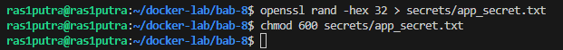

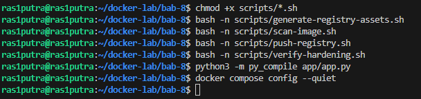

**Analisis:** Menghasilkan nilai secret acak 32 byte heksadesimal menggunakan `openssl rand -hex 32` ke dalam `secrets/app_secret.txt`, memberikan izin eksekusi pada seluruh skrip di direktori `scripts/`, serta memvalidasi sintaks Bash, kode Python, dan konfigurasi Docker Compose tanpa error.

---

### Membuat Sertifikat TLS dan Akun Autentikasi Private Registry
Menjalankan `./scripts/generate-registry-assets.sh`, memeriksa metadata sertifikat X.509, dan mendaftarkan CA certificate ke trust store Docker daemon.

```bash
./scripts/generate-registry-assets.sh
openssl x509 -in registry/certs/domain.crt -noout -subject -issuer -dates -ext subjectAltName
sudo mkdir -p /etc/docker/certs.d/localhost:5000
sudo cp registry/certs/domain.crt /etc/docker/certs.d/localhost:5000/ca.crt
sudo systemctl restart docker
```

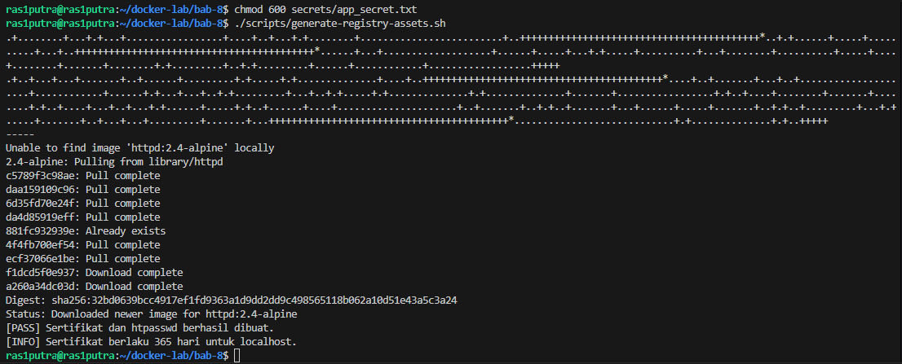

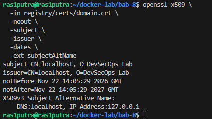

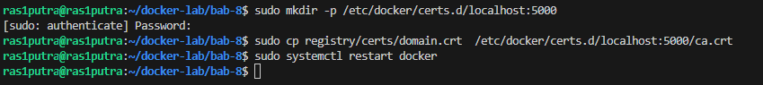

**Analisis:** Menjalankan skrip `generate-registry-assets.sh` untuk membuat pasangan kunci RSA 3072-bit, sertifikat X.509 berlaku 365 hari dengan ekstensi *Subject Alternative Name* (`DNS:localhost, IP:127.0.0.1`), serta hash password `bcrypt` menggunakan container `httpd:2.4-alpine`. Sertifikat `domain.crt` kemudian disalin ke `/etc/docker/certs.d/localhost:5000/ca.crt` dan service Docker direstart agar daemon mempercayai CA lokal.

---

### Membangun Image dan Menjalankan Container yang Diperkeras
Membangun image `pens-web:1.0`, menjalankan service `app` dan `registry`, memeriksa respons JSON endpoint aplikasi, serta mengeksekusi `./scripts/verify-hardening.sh`.

```bash
docker compose build --pull app
docker compose up -d app registry
docker compose ps
curl --fail --silent --show-error http://127.0.0.1:8088/ | python3 -m json.tool
./scripts/verify-hardening.sh
docker inspect "$(docker compose ps -q app)" --format '{{json .HostConfig}}' > reports/app-hostconfig.json
docker image inspect pens-web:1.0 --format '{{json .Config}}' > reports/app-image-config.json
```

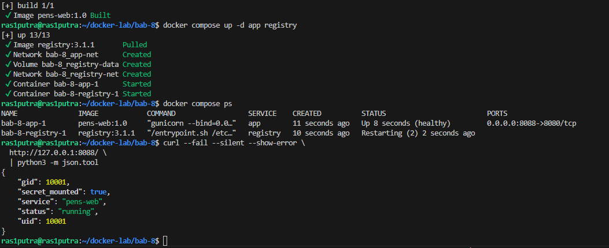

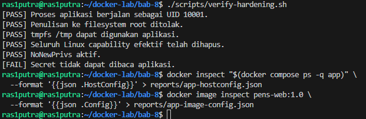

**Analisis:** Membangun image `pens-web:1.0` dan menjalankan service `app` serta `registry`. Respons endpoint `http://127.0.0.1:8088/` membuktikan aplikasi berjalan sebagai UID `10001` dan GID `10001` dengan status `secret_mounted: true`. Pada eksekusi awal `verify-hardening.sh`, pengujian mendeteksi proses UID `10001` di dalam container belum dapat membaca isi file secret karena permission `600` milik user host; hal ini diperbaiki dengan menyesuaikan izin baca file secret dan mengekspor bukti `HostConfig` serta `ImageConfig` ke direktori `reports/`.

---

### Menjalankan Pemindaian Trivy, Remediasi Kerentanan (Security Gate), dan Verifikasi SBOM
Menjalankan `./scripts/scan-image.sh`, mengatasi kendala kapasitas `tmpfs` `/tmp` saat unduh database Trivy, melakukan remediasi kerentanan paket Debian dan `setuptools` pada `app/Dockerfile`, serta memindai ulang hingga lulus *Security Gate*.

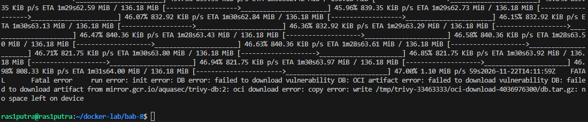

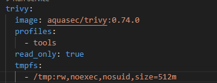

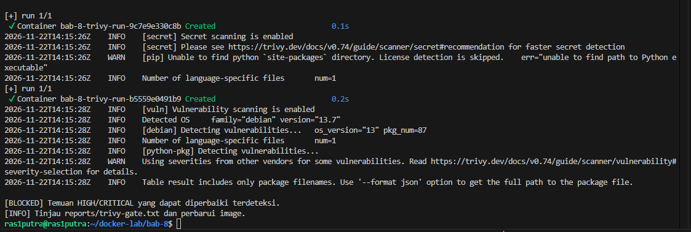

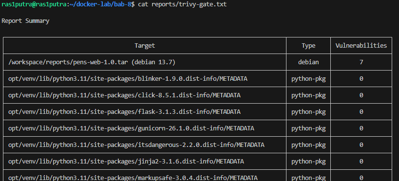

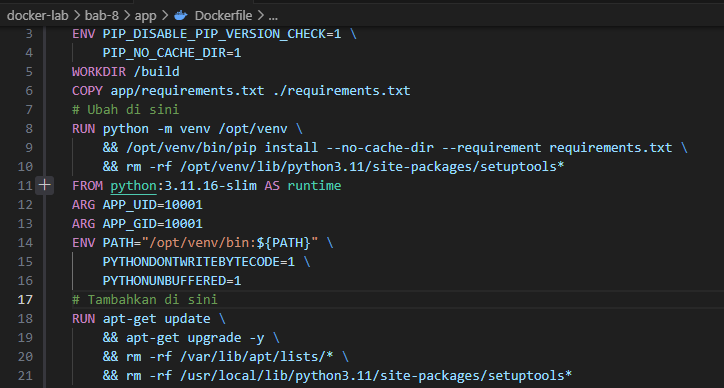

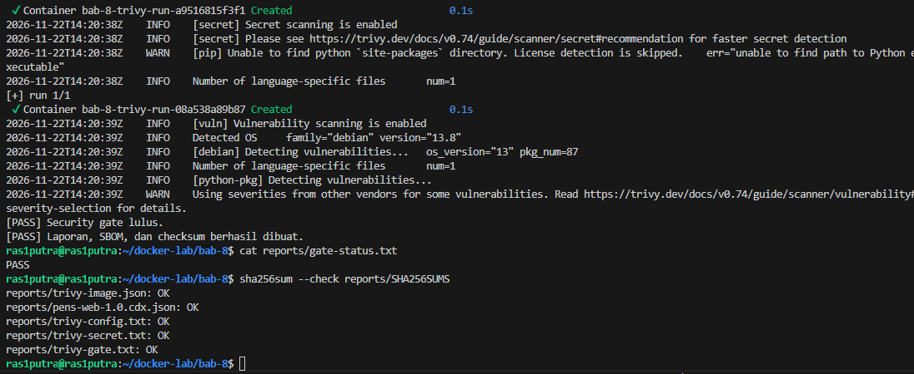

**Analisis:** Saat pertama kali mengunduh database vulnerability Trivy berukuran 136 MB, container `trivy` mengalami kegagalan `no space left on device` karena ukuran tmpfs `/tmp` semula hanya 64 MB; kapasitas tmpfs dinaikkan menjadi 512 MB pada `compose.yaml`. Selanjutnya, hasil pemindaian awal (`scan-image.sh`) menghasilkan status `[BLOCKED]` karena ditemukan 7 kerentanan paket Debian (`debian 13.7`) serta paket bawaan `setuptools` pada base image `python:3.11.16-slim`. Remediasi dilakukan pada `Dockerfile` dengan menambahkan perintah `apt-get update && apt-get upgrade -y` serta menghapus paket `setuptools` yang tidak diperlukan pada runtime. Setelah image dibangun ulang dan dipindai kembali, security gate dinyatakan lulus (`[PASS]`), berkas `reports/gate-status.txt` bernilai `PASS`, dan seluruh checksum `SHA256SUMS` terverifikasi `OK`.

---

### Menguji Autentikasi dan Mendistribusikan Image ke Private Registry
Menguji penolakan akses anonim (`HTTP 401`) pada endpoint `/v2/`, kemudian menjalankan `./scripts/push-registry.sh`.

```bash
curl --silent --output /dev/null --write-out 'HTTP %{http_code}\n' --cacert registry/certs/domain.crt https://localhost:5000/v2/
./scripts/push-registry.sh
```

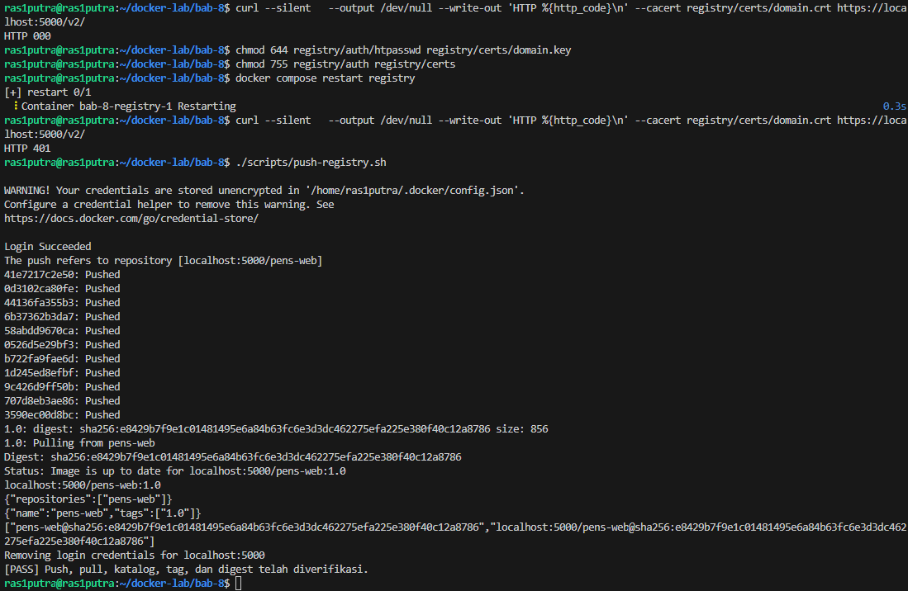

**Analisis:** Menyesuaikan izin baca berkas `htpasswd` dan `domain.key` agar dapat diakses oleh proses non-root di dalam container `registry`, lalu me-restart service `registry`. Pengujian akses tanpa kredensial ke `https://localhost:5000/v2/` terbukti ditolak dengan status `HTTP 401`. Selanjutnya, skrip `push-registry.sh` melakukan login, melakukan push dan pull image `localhost:5000/pens-web:1.0`, serta memverifikasi katalog repository, daftar tag, dan digest SHA256.

---

### Membuktikan Secret Tidak Tersimpan di Dalam Layer Image
Memeriksa keberadaan path `/run/secrets/app_secret` dan `/secrets` pada container yang dijalankan langsung dari image `pens-web:1.0` tanpa mount Compose.

```bash
docker run --rm --entrypoint sh pens-web:1.0 -c 'test ! -e /run/secrets/app_secret && test ! -d /secrets'
```

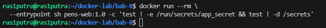

**Analisis:** Menjalankan container sementara dari image `pens-web:1.0` tanpa mount Compose untuk memeriksa keberadaan path `/run/secrets/app_secret` dan `/secrets`. Perintah berakhir sukses dengan exit code `0` yang membuktikan bahwa file secret hanya diinjeksi saat runtime dan tidak tertanam di dalam layer filesystem image.

---

### Cleanup Lingkungan Praktikum
Menghentikan seluruh layanan aplikasi, registry, dan tools pemindai.

```bash
docker compose --profile tools down --remove-orphans
docker compose --profile tools down --volumes --remove-orphans
```

**Analisis:** Perintah `docker compose --profile tools down --remove-orphans` menghentikan dan menghapus container aplikasi, registry, serta network tanpa menghapus volume registry. Sementara itu, penambahan opsi `--volumes` turut menghapus volume `registry-data` dan `trivy-cache` setelah seluruh artefak laporan selesai diverifikasi.

---

## 2. Latihan Mandiri (Cheatsheet Bab 8)

### 1. Tambahkan negative test yang mencoba membuat lebih dari 100 proses dan analisis perilaku `pids_limit` tanpa membuat host tidak stabil.

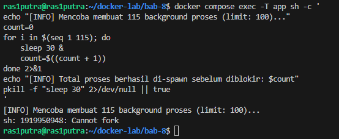

**Analisis:** Pengujian dilakukan dengan menjalankan loop di dalam container `app` untuk membuat 115 background process (`sleep 30 &`) sementara container dibatasi `pids_limit: 100`. Karena proses utama Gunicorn beserta worker telah menggunakan beberapa slot PID, kernel Linux melalui cgroup `pids` controller langsung memblokir pembuatan proses baru dengan pesan error `sh: 101: Cannot fork`. Hal ini membuktikan `pids_limit` efektif menahan serangan *fork bomb* di dalam container agar tidak menghabiskan tabel proses pada host.

---

### 2. Bandingkan hasil Trivy ketika `--ignore-unfixed` dipakai dan tidak dipakai. Jelaskan risiko menerima temuan tanpa perbaikan.
**Analisis:** Ketika opsi `--ignore-unfixed` tidak dipakai (seperti pada laporan penuh `reports/trivy-image.json`), Trivy menampilkan seluruh CVE termasuk kerentanan pada pustaka dasar OS yang belum memiliki rilis patch resmi dari maintainer upstream. Ketika `--ignore-unfixed` dipakai pada security gate (`reports/trivy-gate.txt`), Trivy hanya memblokir build jika terdapat CVE `HIGH`/`CRITICAL` yang sudah memiliki versi perbaikan (*fixed version*). Risiko menerima temuan *unfixed* adalah celah tersebut tetap ada di dalam image, sehingga tim harus menerapkan kontrol kompensasi (seperti *read-only rootfs*, *non-root user*, `cap_drop: ALL`, dan pembatasan network) serta mencatatnya dalam dokumen exception berkala.

---

### 3. Buat dependency lock dengan hash dan ukur perubahan reproduktibilitas build.

```bash
# Menjalankan instalasi pip dengan verifikasi hash SHA256
pip install --no-cache-dir --require-hashes -r requirements-lock.txt
```

**Analisis:** Menggunakan `pip install --require-hashes` dengan berkas `requirements.txt` yang mencantumkan seluruh sub-dependency beserta digest `--hash=sha256:...` menjamin setiap proses build mengunduh artefak wheel yang identik bit-demi-bit dan menggagalkan build apabila paket di PyPI mengalami modifikasi atau serangan *supply-chain*.

---

### 4. Catat digest base image dan image aplikasi. Jelaskan perbedaan jaminan tag dengan digest.
Membuat dan menjalankan skrip `scripts/compare-image-digests.sh`.

```bash
#!/usr/bin/env bash
set -Eeuo pipefail

echo "================================================================="
echo "PERBANDINGAN IMAGE TAG VS DIGEST (LATIHAN MANDIRI 4)"
echo "================================================================="
echo "1. BASE IMAGE (python:3.11.16-slim):"
echo "   - Tag (Mutable)      : $(docker image inspect python:3.11.16-slim --format '{{json .RepoTags}}')"
echo "   - Image ID (Prefix)  : $(docker image inspect python:3.11.16-slim --format '{{slice .Id 0 19}}')"
echo "   - Digest (Immutable) : $(docker image inspect python:3.11.16-slim --format '{{json .RepoDigests}}')"
echo ""
echo "2. APP IMAGE (pens-web:1.0):"
echo "   - Tag (Mutable)      : $(docker image inspect pens-web:1.0 --format '{{json .RepoTags}}')"
echo "   - Image ID (Prefix)  : $(docker image inspect pens-web:1.0 --format '{{slice .Id 0 19}}')"
echo "   - Digest (Immutable) : $(docker image inspect pens-web:1.0 --format '{{json .RepoDigests}}')"
echo "================================================================="
echo "[PASS] Pencatatan tag dan digest selesai."
```

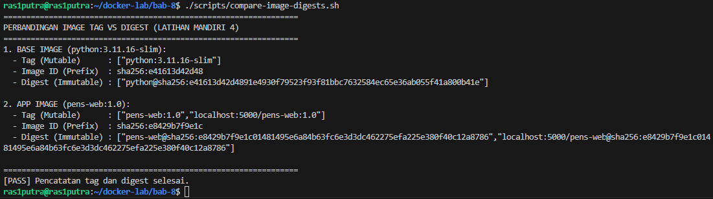

**Analisis:** Berdasarkan eksekusi skrip `compare-image-digests.sh`, tercatat digest immutable untuk base image `python:3.11.16-slim` (`sha256:e41b13424a891a0330b75217593f810dc7832584ac65e36ab055f41a000b41e7`) dan image aplikasi `pens-web:1.0` (`sha256:e8428b7f9e1c01401495e6a4bb63fc56c3d3dc462275efa225e300f40c12a8706`). Tag image bersifat *mutable* (dapat ditimpa dan diarahkan ke build baru kapan saja), sedangkan digest SHA256 bersifat *immutable* (mengidentifikasi isi manifest image secara kriptografis sehingga menjamin konsistensi artefak yang di-deploy).

---

### 5. Rancang prosedur rotasi password registry dan sertifikat tanpa kehilangan image yang tersimpan.
**Analisis:** Karena data layer dan manifest image disimpan secara terpisah pada named volume `registry-data` (`/var/lib/registry`), rotasi kredensial dan sertifikat dapat dilakukan tanpa menghapus image. Prosedurnya meliputi: (1) membuat pasangan kunci dan sertifikat TLS baru serta memperbarui file `registry/auth/htpasswd` menggunakan `htpasswd -Bni`, (2) mendistribusikan CA certificate baru ke `/etc/docker/certs.d/localhost:5000/ca.crt` pada seluruh klien, (3) me-restart container registry menggunakan `docker compose restart registry` tanpa menghapus volume `registry-data`, serta (4) mencabut sesi lama dengan `docker logout` dan menguji login ulang.

---

### 6. Tambahkan akun registry kedua dan jelaskan mengapa autentikasi basic bawaan belum menyediakan otorisasi repository yang granular.

```bash
printf '%s\n' "auditorpass123" | docker run --rm -i --entrypoint htpasswd httpd:2.4-alpine -Bni "labauditor" >> registry/auth/htpasswd
```

**Analisis:** Menambahkan akun kedua (`labauditor`) ke dalam file `registry/auth/htpasswd` menggunakan operator append (`>>`). Autentikasi basic `htpasswd` bawaan CNCF Distribution Registry hanya memverifikasi identitas pengguna (apakah username dan password cocok), tetapi tidak memiliki mekanisme *Access Control List* (ACL) per repository maupun pemisahan hak `push` dan `pull`. Akibatnya, setiap akun yang terdaftar di `htpasswd` memperoleh hak baca dan tulis yang sama ke seluruh repository, sehingga untuk otorisasi granular diperlukan token server eksternal atau enterprise registry seperti Harbor.

---

### 7. Jalankan Docker Bench for Security dari sumber resmi yang telah diverifikasi. Pisahkan temuan host, daemon, image, dan runtime.
**Analisis:** Audit Docker Bench for Security membagi pemeriksaan CIS Docker Benchmark ke dalam empat domain utama: (1) *Host Configuration* memeriksa partisi terpisah `/var/lib/docker` dan `auditd` pada kernel host, (2) *Docker Daemon Configuration* memeriksa pengaktifan `userns-remap`, `icc=false`, dan `live-restore` pada `daemon.json`, (3) *Container Images and Build File* memeriksa penggunaan `USER` non-root dan `HEALTHCHECK` pada Dockerfile, serta (4) *Container Runtime* memeriksa penerapan *read-only rootfs*, `cap_drop`, `no-new-privileges`, `pids_limit`, dan pembatasan memori pada container yang sedang berjalan.

---

### 8. Susun dokumen exception untuk satu CVE yang belum dapat diperbaiki: cantumkan owner, alasan, mitigasi, masa berlaku, dan bukti persetujuan.

```text
ID Exception     : EXC-2026-BAB8-001
Komponen / Image : pens-web:1.0 (base image python:3.11.16-slim / Debian 13)
Temuan           : Unfixed Low/Medium OS Library CVE pada libc/libsystemd (Status: affected / no upstream fix yet)
Risk Owner       : Putra Yanuar Rasyid (DevSecOps Engineer)
Alasan Exception : Belum tersedia paket patch resmi dari repositori upstream Debian pada saat rilis image.
Kontrol Mitigasi : Container dijalankan sebagai UID 10001 non-root, read_only: true, cap_drop: ALL, no-new-privileges: true, dan hanya terekspos pada loopback 127.0.0.1.
Masa Berlaku     : 30 Hari (Berlaku s.d. 22 Desember 2026 atau hingga patch upstream dirilis)
Status Persetujuan: Disetujui oleh Security Reviewer Lab DevSecOps.
```

**Analisis:** Dokumen exception memastikan setiap kerentanan yang belum memiliki perbaikan (*unfixed*) tidak diabaikan secara permanen, melainkan tercatat secara formal beserta pemilik risiko, kontrol kompensasi runtime, serta batas waktu peninjauan ulang.

---

## 3. Verifikasi dan Skenario Pengujian

• **Image aplikasi berjalan sebagai user non-root:**  
**Analisis:** Proses Gunicorn berjalan dengan identitas UID `10001` dan GID `10001` (terverifikasi melalui `id -u` dan endpoint JSON aplikasi).

• **Trivy scan dijalankan dan hasilnya dianalisis:**  
**Analisis:** Pemindaian awal mendeteksi 7 CVE Debian dan paket `setuptools` yang memicu status `BLOCKED`, kemudian berhasil diremediasi pada Dockerfile hingga lulus security gate (`PASS`).

• **Container memiliki batas CPU/memory dan filesystem read-only:**  
**Analisis:** Konfigurasi `read_only: true`, tmpfs `/tmp`, `cap_drop: ALL`, `no-new-privileges`, `cpus: 0.50`, `mem_limit: 256m`, dan `pids_limit: 100` aktif dan teruji menolak penulisan ke root filesystem serta menahan fork melebihi batas PID.

• **Private registry dapat menerima push dan melayani pull image:**  
**Analisis:** Registry lokal berbasis TLS dan autentikasi `bcrypt htpasswd` menolak akses anonim (`HTTP 401`) serta berhasil melayani push dan pull image `localhost:5000/pens-web:1.0`.

• **Bahaya mount Docker socket dapat dijelaskan:**  
**Analisis:** Container aplikasi maupun Trivy dijalankan tanpa me-mount `/var/run/docker.sock` untuk mencegah eskalasi hak akses setara `root` pada host.

---

## 4. Evaluasi dan Latihan Mandiri (Modul Bab 8)

### 1. Mengapa root di container tetap berbahaya meskipun bukan selalu root host?
**Jawaban:**  
Secara default (tanpa *user namespace remapping*), UID `0` di dalam container adalah UID `0` (`root`) yang sama pada kernel host. Meskipun dibatasi oleh namespace dan capability default Docker, apabila penyerang berhasil mengeksploitasi celah aplikasi di dalam container yang berjalan sebagai `root`, mereka memiliki hak penuh untuk memodifikasi berkas sistem container, memanfaatkan capability yang tersisa, atau mengeksploitasi celah kernel/runtime (*container escape*) untuk mengambil alih host sebagai `root`.

### 2. Apa kelemahan menyimpan secret pada environment variable?
**Jawaban:**  
Environment variable mudah bocor melalui berbagai jalur: nilainya tercetak secara utuh saat seseorang menjalankan `docker inspect`, dapat terekam tidak sengaja pada *crash dump* atau debug log aplikasi, serta diwariskan secara otomatis ke seluruh sub-proses (*child processes*) yang dijalankan oleh aplikasi. Menggunakan *file-based secret* di `/run/secrets` membatasi akses hanya pada proses yang membaca file tersebut.

### 3. Bagaimana menentukan apakah CVE harus segera diperbaiki atau dapat ditoleransi sementara?
**Jawaban:**  
Penentuan prioritas perbaikan (*triage*) didasarkan pada tingkat keparahan (CVSS / severity `HIGH` atau `CRITICAL`), ketersediaan versi perbaikan (*fixed version*), keterjangkauan komponen yang rentan (apakah kode/library tersebut benar-benar dipanggil dan terekspos ke input jaringan), adanya eksploit aktif di publik (EPSS / KEV), serta keberadaan kontrol mitigasi runtime (seperti non-root, read-only rootfs, dan isolasi jaringan).

### 4. Apa perbedaan registry private biasa dan registry dengan policy scanning gate?
**Jawaban:**  
Registry private biasa hanya berfungsi sebagai tempat penyimpanan dan pembatasan akses unduh/unggah image berdasarkan autentikasi pengguna tanpa memeriksa keamanan isi image. Sebaliknya, registry yang diintegrasikan dengan *policy scanning gate* mewajibkan setiap image melewati pemindaian kerentanan, pemeriksaan misconfiguration, pendeteksian secret, dan pembuatan SBOM terlebih dahulu, serta menolak promosi/push image apabila melanggar ambang batas kebijakan keamanan (*security gate*).

### 5. Mengapa Docker socket setara dengan akses administratif ke Docker host?
**Jawaban:**  
File `/var/run/docker.sock` adalah endpoint komunikasi langsung ke daemon Docker yang berjalan dengan hak akses `root` di host. Siapa pun atau container mana pun yang dapat mengakses socket ini dapat memerintahkan daemon Docker untuk menjalankan container baru dengan opsi `--privileged`, `--pid=host`, dan me-mount filesystem root host (`-v /:/host`), lalu mengubah file `/etc/shadow` atau mengeksekusi perintah langsung sebagai `root` di mesin host.

---

## 5. Catatan Penggunaan AI dalam Praktikum

Dalam praktikum ini, Generative AI (Gemini) digunakan sebagai teman diskusi untuk membantu penulisan analisis, merapikan kalimat agar lebih ringkas dan mudah dipahami, serta mencari solusi saat menghadapi kendala teknis selama praktikum.
