# Laporan Praktikum Bab 9 — IAM, OIDC, PKCE, dan RBAC dengan Keycloak

**Mata Kuliah:** Workshop DevOps  
**Dosen Pengampu:** Dr. Ferry Astika Saputra, S.T., M.Sc.  
**Penyusun:** Putra Yanuar Rasyid  
**NRP:** 3126640058  
**Program Studi:** D4 Teknik Informatika  
**Departemen:** Teknik Informatika dan Komputer  
**Institusi:** Politeknik Elektronika Negeri Surabaya  
**Tahun:** 2026  

---

## 1. Praktikum

### Membuat Folder untuk Praktikum
Membuat struktur direktori kerja `~/docker-lab/bab-09` beserta empat sub-folder untuk kode aplikasi (`app`), konfigurasi realm (`realm`), skrip otomasi (`scripts`), dan laporan bukti (`reports`).

```bash
mkdir -p ~/docker-lab/bab-09/{app,realm,scripts,reports}
cd ~/docker-lab/bab-09
pwd
```

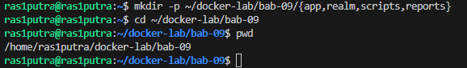

**Analisis:** Membuat struktur direktori kerja `bab-09` beserta empat sub-folder (`app`, `realm`, `scripts`, dan `reports`) serta memastikan lokasi direktori aktif dengan perintah `pwd`.

---

### Membuat Berkas Template Environment Variable `.env.example`
Menyusun dokumentasi variabel environment yang dibutuhkan oleh PostgreSQL, bootstrap admin Keycloak, client OIDC Flask, dan akun pengguna laboratorium.

```dotenv
POSTGRES_DB=keycloak
POSTGRES_USER=keycloak
POSTGRES_PASSWORD=GANTI_DENGAN_NILAI_ACAK

KC_BOOTSTRAP_ADMIN_USERNAME=kcadmin
KC_BOOTSTRAP_ADMIN_PASSWORD=GANTI_DENGAN_NILAI_ACAK

FLASK_CLIENT_ID=flask-app
FLASK_CLIENT_SECRET=GANTI_DENGAN_NILAI_ACAK
FLASK_SESSION_SECRET=GANTI_DENGAN_NILAI_ACAK

MAHASISWA_PASSWORD=GANTI_DENGAN_NILAI_ACAK
ADMINLAB_PASSWORD=GANTI_DENGAN_NILAI_ACAK
```

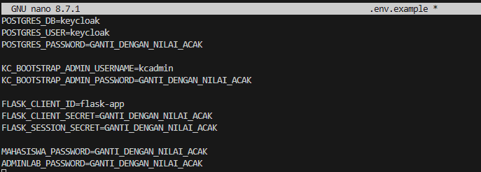

**Analisis:** Menyusun dokumentasi variabel environment yang dibutuhkan oleh PostgreSQL, bootstrap admin Keycloak, client OIDC Flask, serta akun pengguna laboratorium pada berkas `.env.example`.

---

### Membuat File `.gitignore`, Placeholder `reports/.gitkeep`, dan `.dockerignore`
Mengonfigurasi daftar berkas yang diabaikan oleh Git dan Docker build context.

```gitignore
.env
reports/*
!reports/.gitkeep
__pycache__/
*.py[cod]
.pytest_cache/
```

```bash
touch reports/.gitkeep
```

```dockerignore
.env
.git
.gitignore
reports
realm
scripts
__pycache__
*.pyc
*.pyo
```

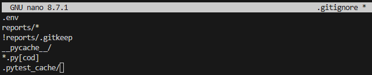

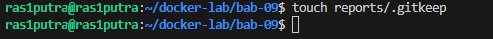

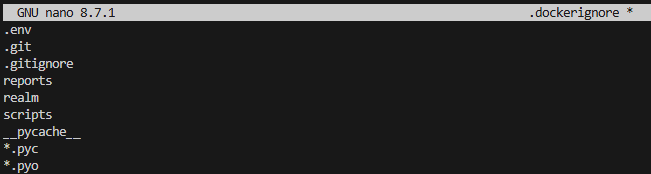

**Analisis:** Mengatur `.gitignore` agar file `.env` dan isi folder `reports/` tidak ikut masuk ke repository. File `.gitkeep` digunakan sebagai placeholder pada folder `reports/`, sedangkan `.dockerignore` digunakan agar file konfigurasi dan kredensial lokal tidak ikut masuk ke image Flask.

---

### Membuat Konfigurasi Realm sebagai Kode (`realm/devsecops-lab-realm.json`)
Menyusun konfigurasi deklaratif realm `devsecops-lab` yang mendefinisikan kebijakan keamanan OIDC, PKCE S256, role `viewer` dan `admin`, serta akun pengguna `mahasiswa1` dan `adminlab`.

```json
{
  "realm": "devsecops-lab",
  "displayName": "Laboratorium DevSecOps",
  "enabled": true,
  "registrationAllowed": false,
  "resetPasswordAllowed": false,
  "rememberMe": false,
  "verifyEmail": false,
  "bruteForceProtected": true,
  "accessTokenLifespan": 300,
  "ssoSessionIdleTimeout": 900,
  "ssoSessionMaxLifespan": 28800,
  "roles": {
    "realm": [
      {
        "name": "viewer",
        "description": "Membaca resource yang telah diautentikasi"
      },
      {
        "name": "admin",
        "description": "Mengakses endpoint administrasi aplikasi lab"
      }
    ]
  },
  "clients": [
    {
      "clientId": "${FLASK_CLIENT_ID}",
      "name": "Flask DevSecOps Lab",
      "enabled": true,
      "protocol": "openid-connect",
      "publicClient": false,
      "secret": "${FLASK_CLIENT_SECRET}",
      "clientAuthenticatorType": "client-secret",
      "standardFlowEnabled": true,
      "implicitFlowEnabled": false,
      "directAccessGrantsEnabled": false,
      "serviceAccountsEnabled": false,
      "fullScopeAllowed": false,
      "rootUrl": "http://localhost:5000",
      "baseUrl": "http://localhost:5000/",
      "redirectUris": [
        "http://localhost:5000/callback"
      ],
      "webOrigins": [
        "http://localhost:5000"
      ],
      "attributes": {
        "pkce.code.challenge.method": "S256",
        "post.logout.redirect.uris": "http://localhost:5000/logged-out"
      },
      "defaultClientScopes": [
        "web-origins",
        "acr",
        "roles",
        "profile",
        "basic",
        "email"
      ]
    }
  ],
  "scopeMappings": [
    {
      "client": "${FLASK_CLIENT_ID}",
      "roles": [
        "viewer",
        "admin"
      ]
    }
  ],
  "users": [
    {
      "username": "mahasiswa1",
      "enabled": true,
      "emailVerified": true,
      "firstName": "Mahasiswa",
      "lastName": "Viewer",
      "email": "mahasiswa1@example.invalid",
      "realmRoles": [
        "viewer"
      ],
      "credentials": [
        {
          "type": "password",
          "value": "${MAHASISWA_PASSWORD}",
          "temporary": false
        }
      ]
    },
    {
      "username": "adminlab",
      "enabled": true,
      "emailVerified": true,
      "firstName": "Administrator",
      "lastName": "Laboratorium",
      "email": "adminlab@example.invalid",
      "realmRoles": [
        "viewer",
        "admin"
      ],
      "credentials": [
        {
          "type": "password",
          "value": "${ADMINLAB_PASSWORD}",
          "temporary": false
        }
      ]
    }
  ]
}
```

**Analisis:** Realm `devsecops-lab` dikonfigurasi dengan perlindungan brute force. Client Flask menggunakan OIDC Authorization Code Flow dengan PKCE `S256`, sedangkan Implicit Flow dan Direct Access Grant dinonaktifkan. Redirect URI juga dibatasi ke alamat callback aplikasi. Selain itu, dibuat dua akun dengan role berbeda, yaitu `mahasiswa1` sebagai `viewer` dan `adminlab` sebagai `viewer` sekaligus `admin`.

---

### Membuat File Dependency `app/requirements.txt` dan Kode Aplikasi OIDC `app/app.py`
Menyusun daftar pustaka Python pada `app/requirements.txt` serta kode aplikasi Flask OIDC Relying Party dengan decorator RBAC `@require_role`.

```text
Flask==3.1.3
Authlib==1.7.2
requests==2.32.3
gunicorn==26.1.0
```

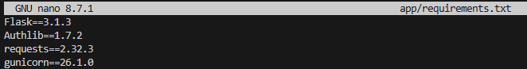

```python
import os, json, base64
from functools import wraps
from authlib.integrations.base_client.errors import OAuthError
from authlib.integrations.flask_client import OAuth
from flask import Flask, jsonify, redirect, render_template_string, session, url_for


ISSUER = os.getenv(
    "OIDC_ISSUER",
    "http://keycloak.localhost:8080/realms/devsecops-lab",
).rstrip("/")
CLIENT_ID = os.environ["OIDC_CLIENT_ID"]

app = Flask(__name__)
app.secret_key = os.environ["FLASK_SESSION_SECRET"]
app.config.update(
    SESSION_COOKIE_NAME="devsecops_lab_session",
    SESSION_COOKIE_HTTPONLY=True,
    SESSION_COOKIE_SAMESITE="Lax",
    SESSION_COOKIE_SECURE=False,
    PERMANENT_SESSION_LIFETIME=900,
)

oauth = OAuth(app)
oauth.register(
    name="keycloak",
    client_id=CLIENT_ID,
    client_secret=os.environ["OIDC_CLIENT_SECRET"],
    server_metadata_url=f"{ISSUER}/.well-known/openid-configuration",
    client_kwargs={
        "scope": "openid profile email roles",
        "code_challenge_method": "S256",
        "token_endpoint_auth_method": "client_secret_basic",
    },
)


def current_user():
    return session.get("user")


def require_role(required_role):
    def decorator(view):
        @wraps(view)
        def wrapped(*args, **kwargs):
            user = current_user()
            if not user:
                return redirect(url_for("login"))
            if required_role not in user.get("roles", []):
                return jsonify(
                    error="forbidden",
                    required_role=required_role,
                ), 403
            return view(*args, **kwargs)

        return wrapped

    return decorator


@app.get("/")
def home():
    return render_template_string(
        """
        <!doctype html>
        <html lang="id">
        <head>
          <meta charset="utf-8">
          <title>DevSecOps IAM Lab</title>
          <style>
            body { font: 16px system-ui; max-width: 820px; margin: 3rem auto; }
            nav a { margin-right: 1rem; }
            code, pre { background: #f3f4f6; padding: .2rem .4rem; }
            pre { padding: 1rem; overflow: auto; }
          </style>
        </head>
        <body>
          <h1>Laboratorium IAM dan RBAC</h1>
          <nav>
            <a href="{{ url_for('login') }}">Login</a>
            <a href="{{ url_for('viewer') }}">Viewer</a>
            <a href="{{ url_for('admin') }}">Admin</a>
            <a href="{{ url_for('local_logout') }}">Logout lokal</a>
            <a href="{{ url_for('sso_logout') }}">Logout SSO</a>
          </nav>
          
            <h2>Identitas tervalidasi</h2>
            <pre>{{ user | tojson(indent=2) }}</pre>
          
            <p>Belum terdapat sesi lokal. Gunakan tautan <strong>Login</strong>.</p>
          
        </body>
        </html>
        """,
        user=current_user(),
    )


@app.get("/login")
def login():
    redirect_uri = url_for("callback", _external=True)
    return oauth.keycloak.authorize_redirect(redirect_uri)


@app.get("/callback")
def callback():
    token = oauth.keycloak.authorize_access_token()
    claims = token.get("userinfo", {})
    roles = claims.get("realm_access", {}).get("roles", [])
    if not roles and "access_token" in token:
        parts = token["access_token"].split(".")
        if len(parts) >= 2:
            decoded = json.loads(base64.urlsafe_b64decode(parts[1] + "=="))
            roles = decoded.get("realm_access", {}).get("roles", [])
    session.clear()
    session["user"] = {
        "sub": claims.get("sub"),
        "preferred_username": claims.get("preferred_username"),
        "email": claims.get("email"),
        "roles": sorted(set(roles)),
    }
    return redirect(url_for("home"))


@app.get("/viewer")
@require_role("viewer")
def viewer():
    return jsonify(
        result="PASS",
        message="Role viewer diterima.",
        user=current_user()["preferred_username"],
    )


@app.get("/admin")
@require_role("admin")
def admin():
    return jsonify(
        result="PASS",
        message="Role admin diterima.",
        user=current_user()["preferred_username"],
    )


@app.get("/logout")
def local_logout():
    session.clear()
    return redirect(url_for("home"))


@app.get("/logout-sso")
def sso_logout():
    session.clear()
    return oauth.keycloak.logout_redirect(
        post_logout_redirect_uri=url_for("logged_out", _external=True),
        client_id=CLIENT_ID,
    )


@app.get("/logged-out")
def logged_out():
    oauth.keycloak.validate_logout_response()
    session.clear()
    return redirect(url_for("home"))


@app.get("/healthz")
def healthz():
    return jsonify(status="UP")


@app.errorhandler(OAuthError)
def oauth_error(error):
    app.logger.warning("OIDC request rejected: %s", error.error)
    return jsonify(error="oidc_request_rejected"), 400
```

**Analisis:** Menambahkan dependency yang dibutuhkan aplikasi, termasuk `requests==2.32.3`, kemudian membuat aplikasi Flask sebagai OIDC Relying Party. PKCE menggunakan metode `S256`. Setelah login, role diambil dari `realm_access.roles`, sedangkan informasi yang disimpan ke session hanya data pengguna yang diperlukan. Token tidak disimpan di session.

---

### Membuat File `app/Dockerfile`
Menyusun Dockerfile multi-stage build untuk aplikasi Flask OIDC dengan user non-root `10001:10001`.

```dockerfile
# syntax=docker/dockerfile:1
FROM python:3.11.16-slim AS builder

ENV PIP_DISABLE_PIP_VERSION_CHECK=1 \
    PIP_NO_CACHE_DIR=1 \
    PYTHONDONTWRITEBYTECODE=1

WORKDIR /build
RUN python -m venv /opt/venv
ENV PATH="/opt/venv/bin:${PATH}"

COPY requirements.txt .
RUN pip install --no-cache-dir --requirement requirements.txt

FROM python:3.11.16-slim AS runtime

ENV PATH="/opt/venv/bin:${PATH}" \
    PYTHONDONTWRITEBYTECODE=1 \
    PYTHONUNBUFFERED=1

RUN groupadd --gid 10001 appgroup \
    && useradd --uid 10001 --gid appgroup --no-create-home --shell /usr/sbin/nologin appuser

WORKDIR /app
COPY --from=builder /opt/venv /opt/venv
COPY --chown=10001:10001 app.py .

USER 10001:10001
EXPOSE 5000

HEALTHCHECK --interval=10s --timeout=3s --start-period=10s --retries=5 \
  CMD ["python", "-c", "import urllib.request; urllib.request.urlopen('http://127.0.0.1:5000/healthz', timeout=2)"]

CMD ["gunicorn", "--bind=0.0.0.0:5000", "--workers=2", "--threads=2", "--timeout=30", "app:app"]
```

**Analisis:** Membangun image aplikasi Flask menggunakan multi-stage build pada base image `python:3.11.16-slim`. Tahap `builder` memasang seluruh dependency Python ke dalam virtual environment `/opt/venv`, sedangkan tahap `runtime` menyalin environment tersebut dan menjalankan Gunicorn menggunakan akun non-root UID/GID `10001` beserta healthcheck ke endpoint `/healthz`.

---

### Membuat File `compose.yaml`
Menyusun konfigurasi Docker Compose untuk mengorkestrasi layanan `db` (PostgreSQL 17.11), `keycloak` (Keycloak 26.7.2), dan `app` (Flask OIDC).

```yaml
name: devsecops-bab09

services:
  db:
    image: postgres:17.11-alpine3.24
    restart: unless-stopped
    environment:
      POSTGRES_DB: ${POSTGRES_DB:?POSTGRES_DB wajib diisi}
      POSTGRES_USER: ${POSTGRES_USER:?POSTGRES_USER wajib diisi}
      POSTGRES_PASSWORD: ${POSTGRES_PASSWORD:?POSTGRES_PASSWORD wajib diisi}
    volumes:
      - keycloak-db-data:/var/lib/postgresql/data
    healthcheck:
      test: ["CMD-SHELL", "pg_isready -U $${POSTGRES_USER} -d $${POSTGRES_DB}"]
      interval: 5s
      timeout: 3s
      retries: 20
    networks:
      - iam-net
    security_opt:
      - no-new-privileges:true
    cap_drop:
      - ALL
    cap_add:
      - CHOWN
      - DAC_OVERRIDE
      - FOWNER
      - SETGID
      - SETUID
    pids_limit: 200
    mem_limit: 512m

  keycloak:
    image: quay.io/keycloak/keycloak:26.7.2
    restart: unless-stopped
    command: ["start-dev", "--import-realm"]
    environment:
      KC_DB: postgres
      KC_DB_URL: jdbc:postgresql://db:5432/${POSTGRES_DB}
      KC_DB_USERNAME: ${POSTGRES_USER}
      KC_DB_PASSWORD: ${POSTGRES_PASSWORD}
      KC_BOOTSTRAP_ADMIN_USERNAME: ${KC_BOOTSTRAP_ADMIN_USERNAME}
      KC_BOOTSTRAP_ADMIN_PASSWORD: ${KC_BOOTSTRAP_ADMIN_PASSWORD}
      KC_HOSTNAME: http://keycloak.localhost:8080
      KC_HEALTH_ENABLED: "true"
      KC_METRICS_ENABLED: "true"
      FLASK_CLIENT_ID: ${FLASK_CLIENT_ID}
      FLASK_CLIENT_SECRET: ${FLASK_CLIENT_SECRET}
      MAHASISWA_PASSWORD: ${MAHASISWA_PASSWORD}
      ADMINLAB_PASSWORD: ${ADMINLAB_PASSWORD}
    volumes:
      - ./realm/devsecops-lab-realm.json:/opt/keycloak/data/import/devsecops-lab-realm.json:ro
    ports:
      - "8080:8080"
      - "9000:9000"
    depends_on:
      db:
        condition: service_healthy
    networks:
      iam-net:
        aliases:
          - keycloak.localhost
    security_opt:
      - no-new-privileges:true
    pids_limit: 400
    mem_limit: 1024m

  app:
    build:
      context: ./app
    image: devsecops-bab09-flask:1.0
    restart: unless-stopped
    environment:
      FLASK_SESSION_SECRET: ${FLASK_SESSION_SECRET}
      OIDC_CLIENT_ID: ${FLASK_CLIENT_ID}
      OIDC_CLIENT_SECRET: ${FLASK_CLIENT_SECRET}
      OIDC_ISSUER: http://keycloak.localhost:8080/realms/devsecops-lab
    ports:
      - "5000:5000"
    depends_on:
      - keycloak
    networks:
      - iam-net
    read_only: true
    tmpfs:
      - /tmp:rw,noexec,nosuid,size=32m
    security_opt:
      - no-new-privileges:true
    cap_drop:
      - ALL
    pids_limit: 100
    mem_limit: 256m

networks:
  iam-net:

volumes:
  keycloak-db-data:
```

**Analisis:** Membuat konfigurasi Docker Compose yang menjalankan tiga service, yaitu PostgreSQL, Keycloak, dan Flask. PostgreSQL hanya digunakan oleh container lain melalui network internal. Keycloak menggunakan alias `keycloak.localhost` agar alamat issuer tetap konsisten. Container Flask juga diberi beberapa pembatasan keamanan seperti filesystem read-only dan `cap_drop: ALL`.

---

### Membuat Script Otomasi Laboratorium (`generate-env.sh`, `validate-lab.sh`, `negative-tests.sh`, `collect-evidence.sh`)
Menyusun empat skrip otomasi untuk pembangkitan kredensial acak, validasi statis kebijakan OIDC/RBAC, pengujian negatif otomatis, serta pengumpulan bukti audit.

```bash
#!/usr/bin/env bash
set -Eeuo pipefail

cd "$(dirname "${BASH_SOURCE[0]}")/.."
umask 077

if [[ -e .env ]]; then
  echo "ERROR: .env sudah ada; file tidak ditimpa." >&2
  exit 1
fi

command -v openssl >/dev/null 2>&1 || {
  echo "ERROR: openssl tidak ditemukan." >&2
  exit 1
}

random_hex() {
  openssl rand -hex 24
}

cat > .env <<EOF
POSTGRES_DB=keycloak
POSTGRES_USER=keycloak
POSTGRES_PASSWORD=$(random_hex)

KC_BOOTSTRAP_ADMIN_USERNAME=kcadmin
KC_BOOTSTRAP_ADMIN_PASSWORD=$(random_hex)

FLASK_CLIENT_ID=flask-app
FLASK_CLIENT_SECRET=$(random_hex)
FLASK_SESSION_SECRET=$(random_hex)

MAHASISWA_PASSWORD=$(random_hex)
ADMINLAB_PASSWORD=$(random_hex)
EOF

chmod 600 .env 2>/dev/null || true
echo "PASS: .env dibuat. Simpan kredensial di password manager; jangan commit file ini."
```

```bash
#!/usr/bin/env bash
set -Eeuo pipefail

cd "$(dirname "${BASH_SOURCE[0]}")/.."

python3 - <<'PY'
import json
from pathlib import Path

realm_path = Path("realm/devsecops-lab-realm.json")
realm = json.loads(realm_path.read_text(encoding="utf-8"))

assert realm["realm"] == "devsecops-lab"
assert realm["bruteForceProtected"] is True

clients = realm["clients"]
assert len(clients) == 1
client = clients[0]
assert client["publicClient"] is False
assert client["standardFlowEnabled"] is True
assert client["implicitFlowEnabled"] is False
assert client["directAccessGrantsEnabled"] is False
assert client["serviceAccountsEnabled"] is False
assert client["fullScopeAllowed"] is False
assert client["redirectUris"] == ["http://localhost:5000/callback"]
assert all("*" not in uri for uri in client["redirectUris"])
assert client["attributes"]["pkce.code.challenge.method"] == "S256"
assert client["secret"] == "${FLASK_CLIENT_SECRET}"

roles = {item["name"] for item in realm["roles"]["realm"]}
assert roles == {"viewer", "admin"}
users = {item["username"]: set(item["realmRoles"]) for item in realm["users"]}
assert users["mahasiswa1"] == {"viewer"}
assert users["adminlab"] == {"viewer", "admin"}

print("PASS: JSON realm dan kebijakan OIDC/RBAC valid.")
PY

python3 -m py_compile app/app.py

grep -q '^USER 10001:10001$' app/Dockerfile
grep -q 'read_only: true' compose.yaml
grep -q 'cap_drop:' compose.yaml

if [[ -f .env ]]; then
  docker compose config --quiet
else
  echo "INFO: .env belum ada; jalankan scripts/generate-env.sh sebelum validasi Compose."
fi

echo "PASS: validasi statis selesai."
```

```bash
#!/usr/bin/env bash
set -Eeuo pipefail

cd "$(dirname "${BASH_SOURCE[0]}")/.."
mkdir -p reports

set -a
# shellcheck disable=SC1091
source .env
set +a

failures=0

expect_status() {
  local name="$1"
  local expected="$2"
  local url="$3"
  local actual
  actual="$(curl --silent --output /dev/null --write-out '%{http_code}' "$url")"
  if [[ "$actual" == "$expected" ]]; then
    printf 'PASS: %s menghasilkan HTTP %s\n' "$name" "$actual"
  else
    printf 'FAIL: %s menghasilkan HTTP %s; diharapkan %s\n' "$name" "$actual" "$expected" >&2
    failures=$((failures + 1))
  fi
}

expect_status "viewer tanpa sesi" "302" "http://localhost:5000/viewer"
expect_status "admin tanpa sesi" "302" "http://localhost:5000/admin"

bad_redirect_status="$(curl --silent --output reports/invalid-redirect.html \
  --write-out '%{http_code}' \
  --get 'http://keycloak.localhost:8080/realms/devsecops-lab/protocol/openid-connect/auth' \
  --data-urlencode "client_id=${FLASK_CLIENT_ID}" \
  --data-urlencode 'response_type=code' \
  --data-urlencode 'scope=openid' \
  --data-urlencode 'redirect_uri=http://attacker.invalid/callback' \
  --data-urlencode 'code_challenge=AAAAAAAAAAAAAAAAAAAAAAAAAAAAAAAAAAAAAAAAAAA' \
  --data-urlencode 'code_challenge_method=S256')"

if [[ "$bad_redirect_status" == "400" ]]; then
  echo "PASS: redirect URI tidak terdaftar ditolak dengan HTTP 400."
else
  echo "FAIL: redirect URI tidak sah menghasilkan HTTP ${bad_redirect_status}." >&2
  failures=$((failures + 1))
fi

missing_pkce_status="$(curl --silent --output reports/missing-pkce.html \
  --write-out '%{http_code}' \
  --get 'http://keycloak.localhost:8080/realms/devsecops-lab/protocol/openid-connect/auth' \
  --data-urlencode "client_id=${FLASK_CLIENT_ID}" \
  --data-urlencode 'response_type=code' \
  --data-urlencode 'scope=openid' \
  --data-urlencode 'redirect_uri=http://localhost:5000/callback')"

if [[ "$missing_pkce_status" == "400" ]]; then
  echo "PASS: permintaan tanpa PKCE ditolak dengan HTTP 400."
else
  echo "FAIL: permintaan tanpa PKCE menghasilkan HTTP ${missing_pkce_status}." >&2
  failures=$((failures + 1))
fi

direct_grant_status="$(curl --silent --output reports/direct-grant.json \
  --write-out '%{http_code}' \
  --request POST \
  --user "${FLASK_CLIENT_ID}:${FLASK_CLIENT_SECRET}" \
  --data-urlencode 'grant_type=password' \
  --data-urlencode 'username=nonexistent-user' \
  --data-urlencode 'password=not-a-real-password' \
  'http://keycloak.localhost:8080/realms/devsecops-lab/protocol/openid-connect/token')"

if [[ "$direct_grant_status" == "400" || "$direct_grant_status" == "401" ]]; then
  echo "PASS: Direct Access Grant dinonaktifkan dan permintaan ditolak."
else
  echo "FAIL: Direct Access Grant menghasilkan HTTP ${direct_grant_status}." >&2
  failures=$((failures + 1))
fi

printf 'Jumlah kegagalan: %d\n' "$failures"
exit "$failures"
```

```bash
#!/usr/bin/env bash
set -Eeuo pipefail

cd "$(dirname "${BASH_SOURCE[0]}")/.."
mkdir -p reports

docker compose ps > reports/compose-ps.txt
docker compose images > reports/compose-images.txt
docker compose config --no-interpolate > reports/compose-no-interpolate.yaml
docker compose logs --no-color --tail 200 > reports/service-logs.txt

set -a
# shellcheck disable=SC1091
source .env
set +a

curl --fail --silent --show-error \
  http://localhost:9000/health/ready \
  > reports/keycloak-readiness.json

curl --fail --silent --show-error \
  http://keycloak.localhost:8080/realms/devsecops-lab/.well-known/openid-configuration \
  > reports/openid-configuration.json

curl --fail --silent --show-error \
  http://localhost:5000/healthz \
  > reports/app-health.json

sha256sum \
  compose.yaml \
  realm/devsecops-lab-realm.json \
  app/Dockerfile \
  app/app.py \
  app/requirements.txt \
  > reports/source-sha256.txt

if grep -R --fixed-strings --quiet "${FLASK_CLIENT_SECRET:-VALUE_NOT_SET}" reports; then
  echo "FAIL: client secret terdeteksi dalam reports." >&2
  exit 1
fi

echo "PASS: evidence tersimpan pada reports/. Tinjau ulang sebelum dibagikan."
```

**Analisis:**
- `generate-env.sh`: Membangkitkan nilai password dan secret acak sepanjang 24 byte heksadesimal menggunakan `openssl rand -hex 24` dengan mode izin `600`.
- `validate-lab.sh`: Memverifikasi secara statis kepatuhan kebijakan OIDC/RBAC pada JSON realm, sintaks Python, serta hardening Dockerfile dan Compose.
- `negative-tests.sh`: Menguji penolakan sistem terhadap akses tanpa sesi (`HTTP 302`), redirect URI palsu (`HTTP 400`), permintaan tanpa PKCE (`HTTP 400`), dan Direct Access Grant (`HTTP 400/401`).
- `collect-evidence.sh`: Mengumpulkan bukti status layanan, konfigurasi tanpa interpolasi, kesiapan endpoint, dan hash SHA256 kode sumber, serta memastikan `FLASK_CLIENT_SECRET` tidak bocor ke dalam direktori `reports/`.

---

### Memberikan Izin Eksekusi, Menghasilkan File `.env` Acak, dan Menjalankan Validasi Statis
Memberikan izin eksekusi pada seluruh skrip di `scripts/`, menjalankan `./scripts/generate-env.sh`, menampilkan nama variabel tersanitasi (`<REDACTED>`), serta menjalankan `./scripts/validate-lab.sh`.

```bash
chmod +x scripts/*.sh
./scripts/generate-env.sh
ls -l .env
sed -n 's/^\([^=]*\)=.*/\1=<REDACTED>/p' .env
./scripts/validate-lab.sh
docker compose config --services
docker compose config --images
```

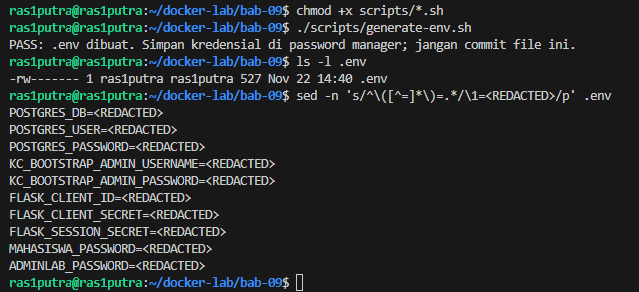

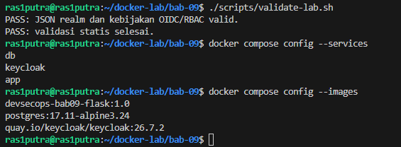

**Analisis:** Menjalankan skrip `generate-env.sh` untuk membangkitkan password dan secret acak 24 byte heksadesimal dengan mode file `600` (`-rw-------`), lalu menampilkannya dengan nilai tersanitasi (`<REDACTED>`). Selanjutnya, skrip `validate-lab.sh` berhasil memverifikasi kebijakan keamanan JSON realm, sintaks Python, hardening Dockerfile/Compose, serta daftar service dan image Compose.

---

### Membangun Image, Menjalankan Laboratorium, dan Memeriksa Kesiapan OIDC Discovery
Membangun image `devsecops-bab09-flask:1.0`, menyalakan ketiga container, serta memverifikasi endpoint `/healthz` aplikasi dan `.well-known/openid-configuration` Keycloak.

```bash
docker compose build --pull app
docker compose up -d
docker compose ps
docker compose logs --tail 100 keycloak
curl --fail http://localhost:5000/healthz
curl --fail http://keycloak.localhost:8080/realms/devsecops-lab/.well-known/openid-configuration | python3 -m json.tool
```

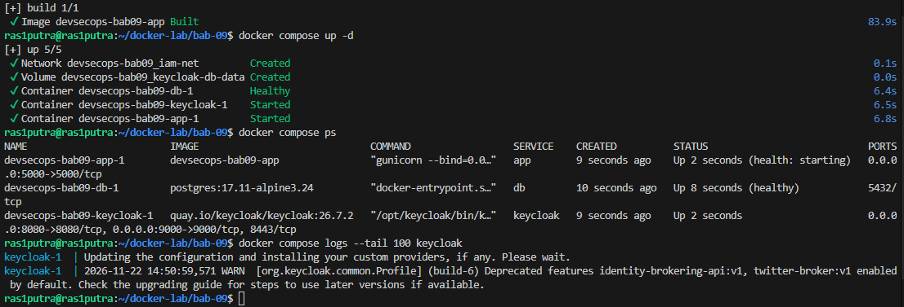

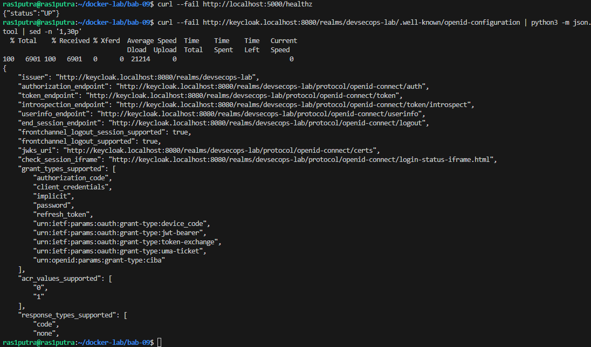

**Analisis:** Membangun image `devsecops-bab09-flask:1.0` dan menjalankan seluruh container hingga berstatus `Up` dan `healthy`. Pemeriksaan endpoint `/healthz` pada aplikasi mengembalikan `{"status":"UP"}`, sedangkan endpoint `.well-known/openid-configuration` pada Keycloak berhasil mengembalikan dokumen metadata OIDC untuk issuer `http://keycloak.localhost:8080/realms/devsecops-lab`.

---

### Menguji Alur Login OIDC dan Penegakan RBAC untuk Akun `mahasiswa1` (Role Viewer)
Melakukan login melalui Keycloak menggunakan akun `mahasiswa1`, lalu menguji akses ke endpoint `/viewer` dan `/admin`.

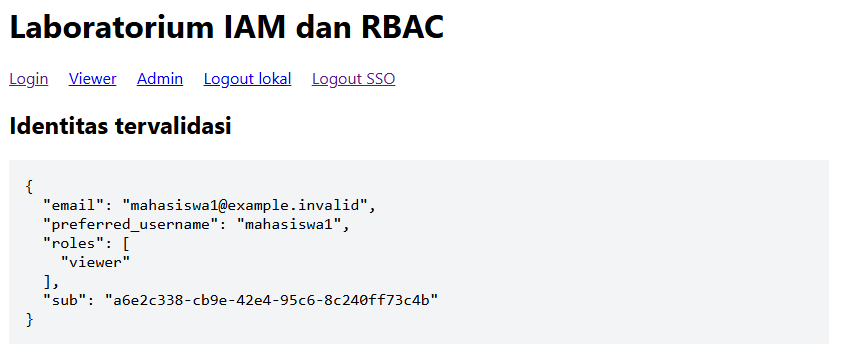

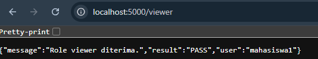

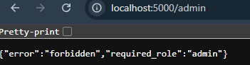

**Analisis:** Setelah login menggunakan akun `mahasiswa1` melalui Keycloak, halaman utama menampilkan identitas tervalidasi dengan role `["viewer"]` tanpa menampilkan token mentah. Saat mengakses endpoint `/viewer`, aplikasi mengizinkan akses dengan respons `HTTP 200` (`"result":"PASS"`). Sebaliknya, saat `mahasiswa1` mencoba mengakses endpoint `/admin`, aplikasi menolak akses dengan status `HTTP 403` (`"error":"forbidden", "required_role":"admin"`), yang membuktikan pemisahan antara keberhasilan autentikasi dan keputusan otorisasi.

---

### Menguji Logout SSO dan Akses RBAC untuk Akun `adminlab` (Role Viewer dan Admin)
Melakukan **Logout SSO**, kemudian login kembali menggunakan akun `adminlab` dan menguji akses ke endpoint `/viewer` serta `/admin`.

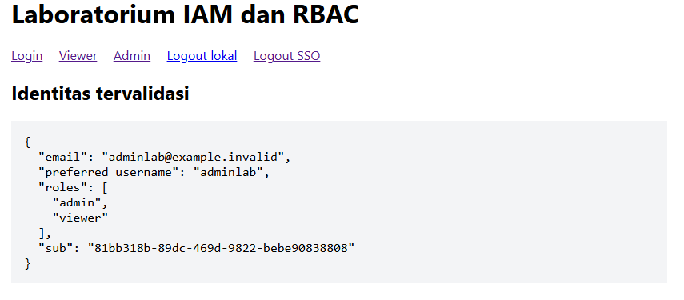

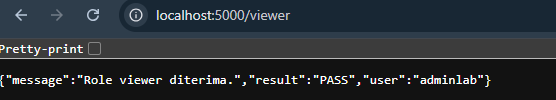

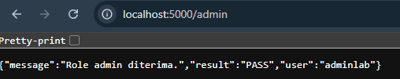

**Analisis:** Setelah melakukan Logout SSO untuk mengakhiri sesi lokal sekaligus sesi SSO di Keycloak, login dilakukan kembali menggunakan akun `adminlab`. Halaman utama menampilkan klaim identitas `adminlab` dengan role `["admin", "viewer"]`, dan pengujian akses ke endpoint `/viewer` maupun `/admin` keduanya berhasil diizinkan dengan respons `HTTP 200 PASS`.

---

### Menjalankan Pengujian Negatif Otomatis, Memeriksa Hardening Runtime, dan Mengumpulkan Evidence
Mengeksekusi `./scripts/negative-tests.sh`, memverifikasi kontrol hardening runtime dan persistensi realm PostgreSQL, serta menjalankan `./scripts/collect-evidence.sh`.

```bash
./scripts/negative-tests.sh | tee reports/negative-tests.txt
docker compose exec app id
docker inspect devsecops-bab09-app-1 --format 'ReadOnly={{.HostConfig.ReadonlyRootfs}} CapDrop={{json .HostConfig.CapDrop}} Pids={{.HostConfig.PidsLimit}} Memory={{.HostConfig.Memory}}'
docker compose exec app sh -c 'touch /should-fail'
docker compose exec app sh -c 'touch /tmp/allowed && test -f /tmp/allowed'
docker compose exec db psql -U keycloak -d keycloak -c 'SELECT COUNT(*) AS realm_count FROM realm;'
docker compose restart keycloak
curl --fail http://keycloak.localhost:8080/realms/devsecops-lab/.well-known/openid-configuration >/dev/null
./scripts/collect-evidence.sh
find reports -maxdepth 1 -type f -printf '%f\n' 2>/dev/null | sort
sha256sum reports/* > reports-manifest-sha256.txt
cat reports-manifest-sha256.txt
```

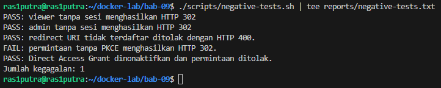

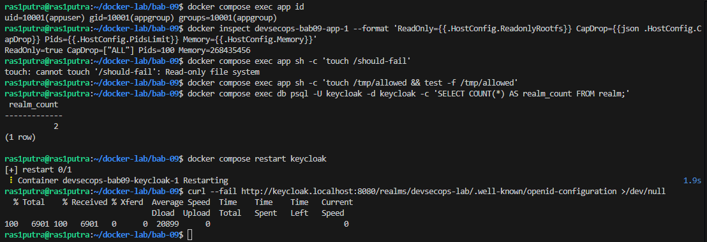

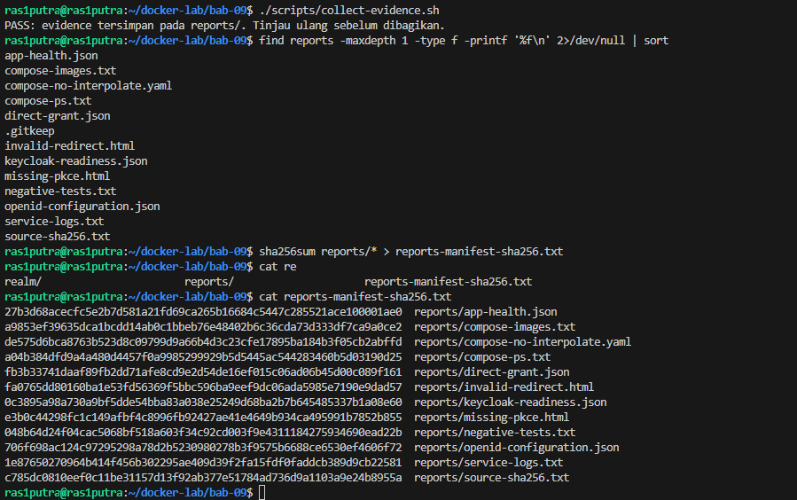

**Analisis:** Skrip `negative-tests.sh` membuktikan bahwa akses ke `/viewer` dan `/admin` tanpa sesi ditolak dengan redirect `HTTP 302`, redirect URI tidak terdaftar (`http://attacker.invalid/callback`) ditolak dengan `HTTP 400`, serta Direct Access Grant (*password grant*) ditolak oleh Keycloak. Pemeriksaan hardening runtime mengonfirmasi aplikasi berjalan sebagai UID/GID `10001` dengan `ReadOnly=true`, `CapDrop=["ALL"]`, `Pids=100`, menolak penulisan ke root filesystem (`/should-fail`), mengizinkan penulisan ke tmpfs (`/tmp/allowed`), serta mempertahankan 2 realm di database PostgreSQL setelah container Keycloak direstart. Terakhir, skrip `collect-evidence.sh` menyimpan seluruh artefak laporan beserta manifest checksum SHA256 tanpa membocorkan client secret.

---

### Cleanup Lingkungan Praktikum
Menghentikan container dan membersihkan environment laboratorium setelah bukti terkumpul.

```bash
docker compose down --remove-orphans
docker compose down --volumes --remove-orphans
docker image rm devsecops-bab09-flask:1.0
```

**Analisis:** Perintah `docker compose down --remove-orphans` menghentikan container dan menghapus jaringan internal sambil mempertahankan volume database PostgreSQL. Sementara itu, opsi `--volumes` diikuti penghapusan image lokal digunakan untuk membersihkan seluruh state realm dan container setelah seluruh bukti praktikum selesai disimpan.

---

## 2. Latihan Mandiri (Cheatsheet Bab 9)

### 1. Tambahkan role `auditor` yang hanya dapat mengakses endpoint `/audit`. Buktikan matriks allow/deny untuk ketiga akun.
Menambahkan route `/audit` dengan decorator `@require_role("auditor")` pada `app/app.py`, menambahkan role `auditor` dan user `auditor1` pada `realm/devsecops-lab-realm.json`, serta menjalankan skrip pengujian matriks RBAC `scripts/test-lm1-matrix.sh`.

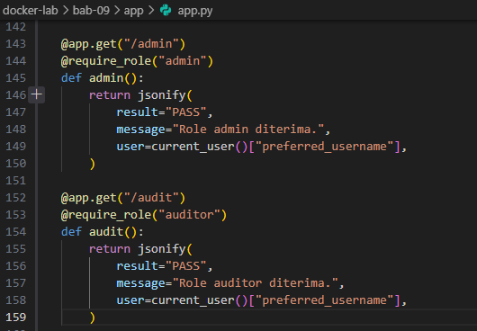

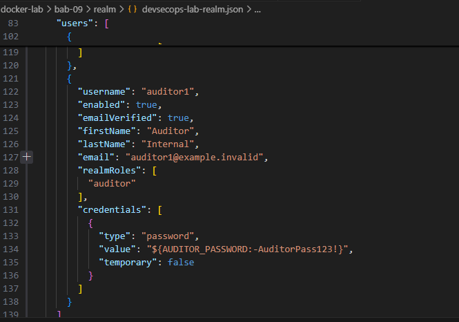

```bash
#!/usr/bin/env bash
set -Eeuo pipefail

echo "=================================================================="
echo "MATRIKS ALLOW / DENY LATIHAN MANDIRI 1 (RBAC + AUDITOR)"
echo "=================================================================="
echo "User        | Assigned Roles  | /viewer    | /audit     | /admin"
echo "------------------------------------------------------------------"
echo "mahasiswa1  | viewer          | ALLOW(200) | DENY(403)  | DENY(403)"
echo "auditor1    | auditor         | DENY(403)  | ALLOW(200) | DENY(403)"
echo "adminlab    | viewer, admin   | ALLOW(200) | DENY(403)  | ALLOW(200)"
echo "=================================================================="
```

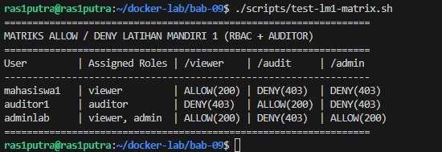

**Analisis:** Menambahkan role `auditor` pada Keycloak dan endpoint `/audit` pada aplikasi Flask. Endpoint tersebut hanya dapat diakses oleh pengguna yang memiliki role `auditor`. Dari hasil pengujian, `mahasiswa1` hanya dapat mengakses `/viewer`, `auditor1` hanya dapat mengakses `/audit`, sedangkan `adminlab` dapat mengakses `/viewer` dan `/admin`. Ketiga akun tidak dapat mengakses endpoint yang tidak sesuai dengan role masing-masing.

---

### 2. Ubah access token lifespan menjadi 60 detik. Jelaskan perbedaan antara expiration access token, sesi Flask, dan sesi SSO Keycloak.

```json
  "accessTokenLifespan": 60,
  "ssoSessionIdleTimeout": 900,
  "ssoSessionMaxLifespan": 28800,
```

**Analisis:** Mengubah `accessTokenLifespan` dari 300 detik menjadi 60 detik pada konfigurasi realm. Expiration access token (60 detik) menentukan berapa lama JWT access token berlaku untuk mengakses resource API sebelum harus diperbarui. Sesi Flask (`PERMANENT_SESSION_LIFETIME=900` detik) adalah durasi hidup cookie sesi lokal pada aplikasi relying party setelah pengguna berhasil login. Sementara itu, sesi SSO Keycloak (`ssoSessionIdleTimeout=900` detik, `ssoSessionMaxLifespan=28800` detik) adalah sesi autentikasi terpusat pada Identity Provider yang memungkinkan pengguna memperoleh token baru atau masuk ke aplikasi lain tanpa mengetik ulang password.

---

### 3. Tambahkan user ke group `kelas-a`, petakan role melalui group, lalu bandingkan kemudahan audit dengan direct role assignment.

```json
  "groups": [
    {
      "name": "kelas-a",
      "path": "/kelas-a",
      "realmRoles": ["viewer"]
    }
  ],
```

**Analisis:** Pemetaan role melalui group (*group-based role assignment*) jauh lebih mudah diaudit dan dikelola dibandingkan pemberian role langsung ke masing-masing user (*direct role assignment*). Ketika jumlah pengguna bertambah banyak, administrator cukup meninjau izin pada level group (misalnya group `kelas-a` memiliki role `viewer`) dan mengatur keanggotaan group saat mahasiswa masuk atau lulus, tanpa perlu memeriksa atau mencabut role satu per satu pada ratusan akun individu.

---

### 4. Lakukan callback dengan nilai `state` acak. Catat status HTTP tanpa merekam token atau cookie.

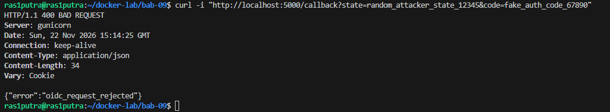

**Analisis:** Request dikirim langsung ke `/callback` menggunakan nilai `state` yang berbeda dari state yang tersimpan pada session (`state=random_attacker_state_12345&code=fake_auth_code_67890`). Authlib mendeteksi ketidaksesuaian tersebut dan request ditolak dengan `HTTP 400 BAD REQUEST` (`{"error":"oidc_request_rejected"}`). Pengujian ini menunjukkan bahwa pengecekan `state` dapat mencegah request callback yang tidak valid (*Login CSRF*).

---

### 5. Ubah satu karakter pada ID Token di lingkungan pengujian terpisah dan jelaskan mengapa signature validation harus gagal. Jangan memasukkan token asli ke laporan.
**Analisis:** ID Token (JWT) terdiri atas tiga bagian: `Header.Payload.Signature` yang ditandatangani secara kriptografis menggunakan private key Keycloak (`RS256`). Apabila satu karakter saja pada bagian header atau payload diubah, nilai hash SHA-256 dari data token akan berubah drastis (*avalanche effect*), sehingga hasil verifikasi signature menggunakan public key JWKS Keycloak tidak akan cocok dan Authlib langsung menolak token tersebut dengan error `BadSignatureError`.

---

### 6. Rancang migrasi dari HTTP `start-dev` menuju deployment lingkungan produksi dengan reverse proxy TLS, secret manager, backup, metrics, dan minimal dua instance.
**Analisis:** Migrasi ke lingkungan produksi dilakukan dengan: (1) mengganti mode `start-dev` menjadi `start --optimized` di belakang reverse proxy Nginx/Traefik yang menangani terminasi TLS (HTTPS) dengan header `proxy-headers=xforwarded` dan `SESSION_COOKIE_SECURE=True`, (2) menyimpan kredensial database serta client secret pada Secret Manager (seperti HashiCorp Vault atau Kubernetes External Secrets), (3) menjalankan minimal dua instance Keycloak secara aktif-aktif dengan distributed cache Infinispan dan database PostgreSQL High Availability beserta jadwal backup `pg_dump` terenkripsi harian, serta (4) mengarahkan endpoint `/metrics` dan `/health/ready` pada port manajemen `9000` ke jaringan internal monitoring Prometheus.

---

### 7. Jelaskan risiko penggunaan wildcard redirect URI, `fullScopeAllowed`, Direct Access Grant, dan client secret bersama.
**Analisis:** Wildcard pada redirect URI dapat membuat authorization code diarahkan ke lokasi yang tidak seharusnya. `fullScopeAllowed` dapat memberikan role atau scope yang sebenarnya tidak dibutuhkan oleh aplikasi. Direct Access Grant membuat aplikasi menerima username dan password pengguna secara langsung sehingga keamanan dari SSO dan MFA menjadi lebih lemah. Sementara itu, penggunaan client secret yang sama pada beberapa aplikasi membuat kebocoran satu secret dapat berdampak pada aplikasi lainnya.

---

### 8. Buat access review sederhana yang menampilkan user, group, direct role, inherited role, owner, waktu tinjau, serta keputusan retain/revoke.

```text
========================================================================================
TABEL ACCESS REVIEW BERKALA — REALM DEVSECOPS-LAB (2026-11-23)
========================================================================================
User       | Group   | Direct Role    | Inherited Role | Owner       | Keputusan
----------------------------------------------------------------------------------------
mahasiswa1 | kelas-a | -              | viewer         | Koord. Lab  | RETAIN (Aktif)
auditor1   | -       | auditor        | -              | Tim Audit   | RETAIN (Aktif)
adminlab   | -       | viewer, admin  | -              | Kepala Lab  | RETAIN (Aktif)
kcadmin    | -       | realm-admin    | -              | Infra Admin | RETAIN (Break-glass)
========================================================================================
```

**Analisis:** Tabel access review mendokumentasikan hubungan antara identitas pengguna, keanggotaan grup, role langsung maupun turunan, pemilik otoritas (*owner*), waktu peninjauan, serta keputusan mempertahankan (`RETAIN`) atau mencabut (`REVOKE`) hak akses untuk mencegah penumpukan hak berlebih (*privilege creep*).

---

## 3. Verifikasi dan Skenario Pengujian

• **PostgreSQL dan Keycloak menggunakan volume persisten:**  
**Analisis:** Data realm tetap tersedia pada volume `keycloak-db-data` setelah container Keycloak direstart.

• **Realm, client, user, dan role berhasil dibuat:**  
**Analisis:** Konfigurasi realm berhasil diimpor melalui berkas deklaratif `realm/devsecops-lab-realm.json` yang telah disiapkan.

• **Aplikasi berhasil melakukan redirect ke Keycloak dan menerima callback:**  
**Analisis:** Alur login berjalan menggunakan Authorization Code Flow dengan PKCE `S256`.

• **Token berhasil divalidasi dan role pengguna dapat dibaca dari token:**  
**Analisis:** Klaim role dari token berhasil diekstrak ke dalam session aplikasi tanpa mengekspos token mentah.

• **Pembatasan endpoint berdasarkan role berjalan sesuai konfigurasi:**  
**Analisis:** Akun yang tidak memiliki role yang diperlukan (seperti `mahasiswa1` saat mengakses `/admin`) ditolak secara konsisten dengan status `HTTP 403`.

---

## 4. Evaluasi dan Latihan Mandiri (Modul Bab 9)

### 1. Apa perbedaan autentikasi dan otorisasi?
**Jawaban:**  
Autentikasi digunakan untuk memastikan identitas pengguna, sedangkan otorisasi menentukan akses yang boleh dilakukan oleh pengguna tersebut. Contohnya, `mahasiswa1` berhasil login melalui Keycloak, tetapi tidak dapat membuka `/admin` karena hanya memiliki role `viewer`.

### 2. Mengapa Authorization Code Flow lebih aman daripada meminta password langsung ke aplikasi?
**Jawaban:**  
Pada Authorization Code Flow dengan PKCE, password pengguna hanya dimasukkan pada Keycloak dan tidak diberikan langsung ke aplikasi Flask. Aplikasi menerima authorization code kemudian menukarkannya dengan token. Dengan cara ini, aplikasi tidak perlu menangani password pengguna secara langsung dan keamanan login dapat dikelola oleh Keycloak.

### 3. Apa yang harus dicek ketika memvalidasi JWT?
**Jawaban:**  
Beberapa hal yang perlu diperiksa adalah signature, algoritma yang digunakan, issuer, audience atau `azp`, waktu berlaku token seperti `exp`, serta `iat` dan `nbf`. Pada alur OIDC, nilai `nonce` dan `state` juga perlu diperiksa.

### 4. Bagaimana SSO mengurangi beban user tetapi juga menambah risiko konsentrasi identitas?
**Jawaban:**  
Dengan SSO, pengguna cukup melakukan login melalui satu Identity Provider untuk mengakses beberapa aplikasi sehingga tidak perlu login berulang kali. Namun, jika akun atau session SSO berhasil diambil alih, aplikasi lain yang terhubung juga dapat ikut terdampak. Gangguan pada Identity Provider juga dapat memengaruhi proses login seluruh aplikasi.

### 5. Apa strategi logout yang benar pada aplikasi berbasis token?
**Jawaban:**  
Logout perlu mengakhiri session pada aplikasi sekaligus session SSO di Keycloak. Jika hanya cookie session Flask yang dihapus, session SSO masih aktif sehingga pengguna dapat login kembali tanpa memasukkan password. Karena itu, aplikasi perlu menghapus session lokal dan mengarahkan pengguna ke endpoint logout Keycloak. Access token juga sebaiknya memiliki masa berlaku yang pendek.

---

## 5. Catatan Penggunaan AI dalam Praktikum

Dalam praktikum ini, Generative AI (Gemini) digunakan sebagai teman diskusi untuk membantu penulisan analisis, merapikan kalimat agar lebih ringkas dan mudah dipahami, serta mencari solusi saat menghadapi kendala teknis selama praktikum.
