# Laporan Praktikum Skenario Logging — Skenario Penerimaan Mahasiswa Baru (PMB) DevSecOps Lab

**Mata Kuliah:** Workshop DevOps  
**Dosen Pengampu:** Dr. Ferry Astika Saputra, S.T., M.Sc.  
**Penyusun:** Putra Yanuar Rasyid  
**NRP:** 3126640058  
**Program Studi:** D4 Teknik Informatika  
**Departemen:** Teknik Informatika dan Komputer  
**Institusi:** Politeknik Elektronika Negeri Surabaya  
**Tahun:** 2026  

---

## 1. Tahap Persiapan

### Persiapan environment variable dan izin eksekusi script

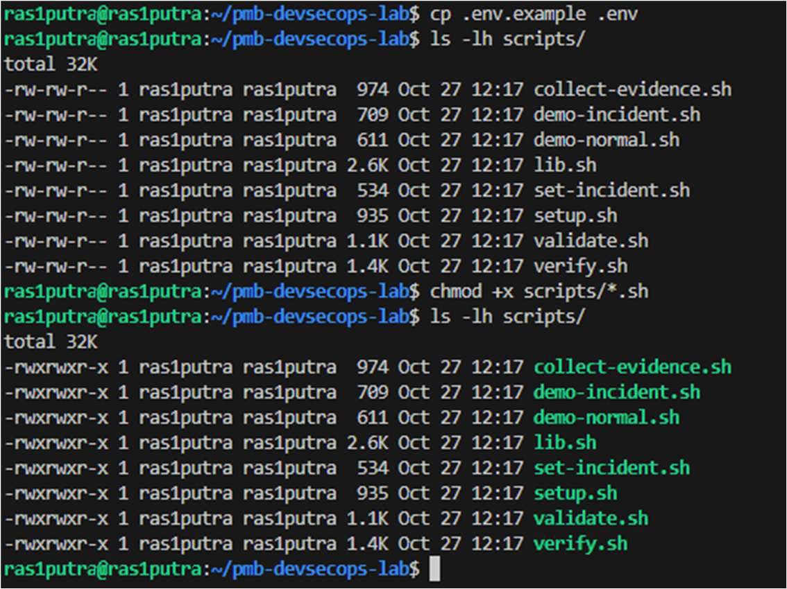

Menjalankan script `setup.sh` untuk otomatis menyalin env contoh dan mengisi variable default serta memberi izin eksekusi file script. Selanjutnya menjalankan `validate.sh` yang berfungsi untuk init app dan log, mengcompile file python, melakukan unit test serta memvalidasi file yaml.

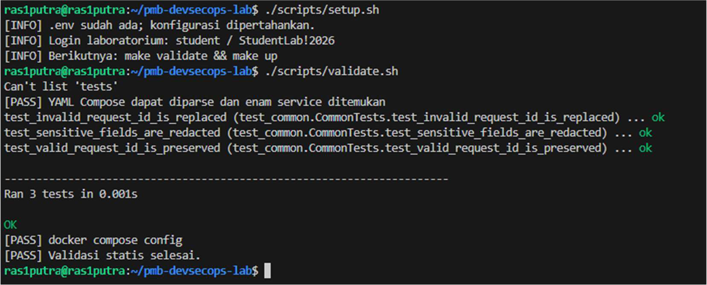

### Menjalankan docker compose dan membuild app

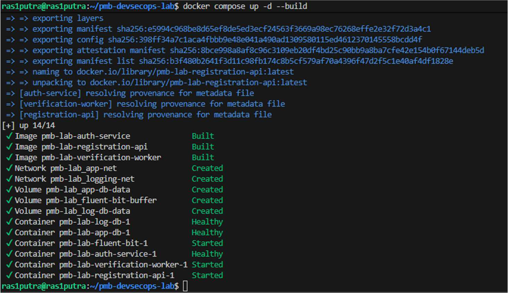

### Test apakah berhasil dengan docker ps untuk memeriksa status dan melakukan curl untuk memeriksa status API

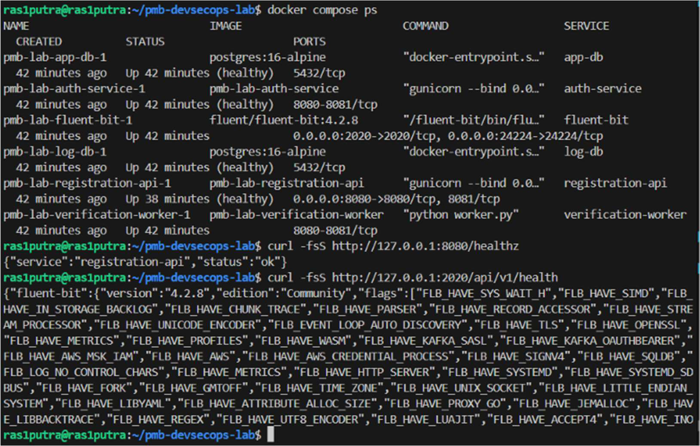

---

## 2. Tahapan A Baseline

Menjalankan `./scripts/set-incident.sh none` untuk memastikan sistem berjalan tanpa injeksi error/delay sintetis pada database.

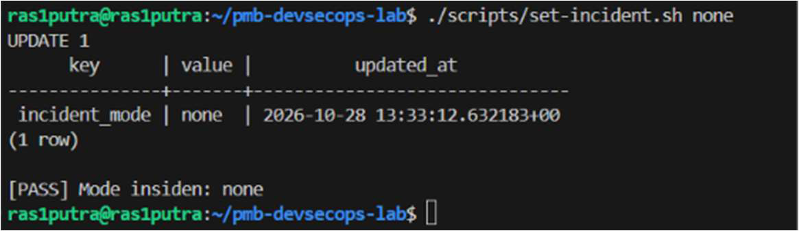

Melakukan submit formulir pendaftaran mahasiswa melalui portal PMB untuk menghasilkan data transaksi baru dan mencatat `request_id`.

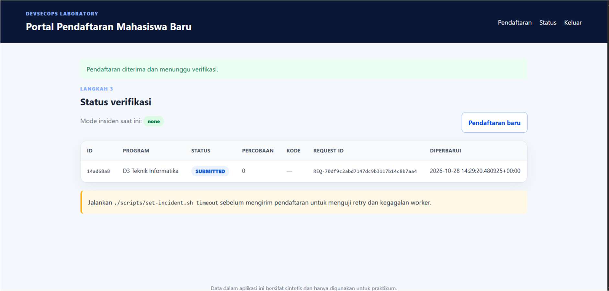

Memverifikasi data pada tabel `registrations` di `app-db`. Transaksi berhasil diselesaikan dengan status akhir `VERIFIED` dan jumlah percobaan `attempt = 1`.

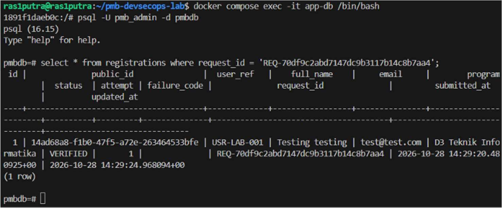

**Baseline transaksi normal (total 4 detik):**  
`14:29:21 registration_submitted (API) → 14:29:21 http_request (API) → 14:29:23 verification_started (Worker) → 14:29:25 verification_completed (Worker) → status akhir VERIFIED (attempt: 1, severity: INFO).`

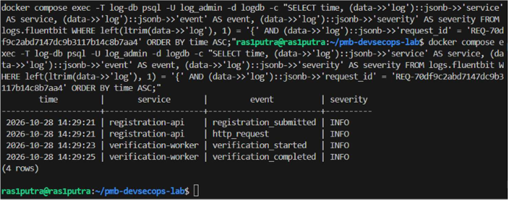

---

## 3. Tahapan B Failure Injection

Menjalankan `./scripts/set-incident.sh timeout` untuk menginjeksi simulasi kegagalan berupa timeout.

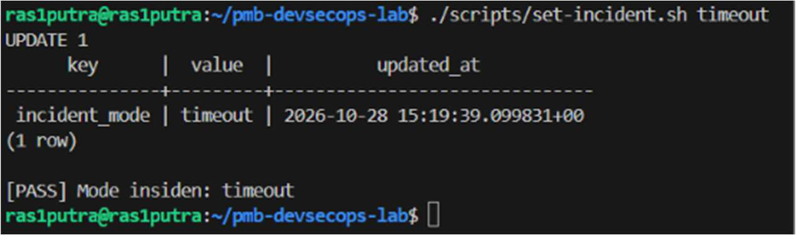

Melakukan pendaftaran formulir baru secara manual melalui portal web PMB dan memperoleh `request_id` dan dicatat.

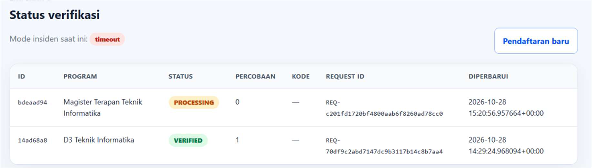

Menjalankan query untuk melihat service yang menghasilkan `Error` atau `Warn`.

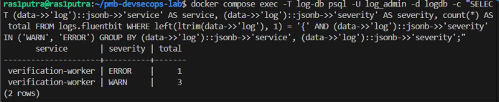

Menjalankan query untuk melihat kronologi urutan `verification_started`, `verification_retry`, dan `dependency_timeout`.

Proses dimulai dari `verification_started` pada `15:20:58` dengan level `INFO`, kemudian sistem mencoba mengulang proses sebanyak tiga kali melalui event `verification_retry` pada `15:20:59`, `15:21:01`, dan `15:21:03` dengan level `WARN`. Karena dependensi eksternal tetap tidak merespons, proses berakhir dengan `dependency_timeout` pada `15:21:04` dengan level `ERROR` dan kode `VERIFY-TIMEOUT`. Dari log tersebut, terlihat bahwa sistem sudah menerapkan transient fault handling melalui mekanisme retry. Namun, setelah mencapai batas percobaan maksimum (`attempt 3`), worker menghentikan proses karena dependensi masih mengalami timeout. Log memberikan analisis tanpa membuka code.

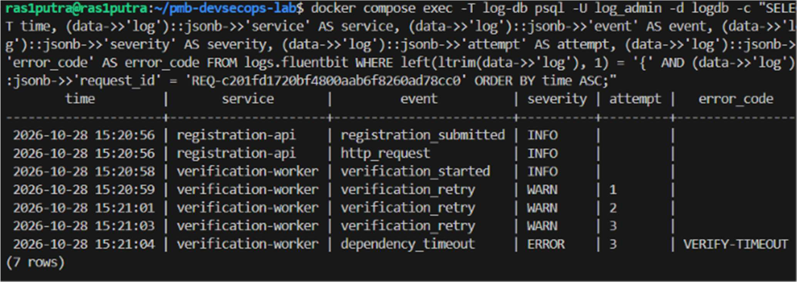

Membuktikan dampaknya pada status transaksi:

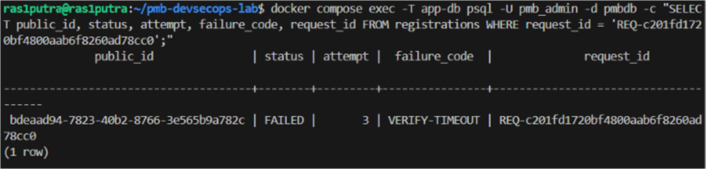

---

## 4. Tahapan C Recovery

Menjalankan `./scripts/set-incident.sh none` untuk simulasi normal tanpa error timeout.

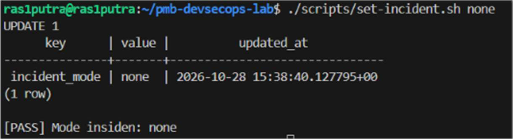

Menjalankan script `demo-normal.sh` yang mana sama seperti melakukan input form di web, hasilnya berupa `request_id` dan status `VERIFIED` dan `attempt = 1`, yang artinya sistem normal.

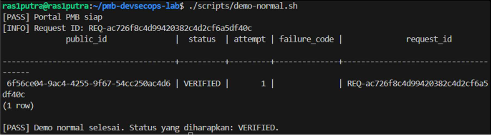

Melakukan query untuk mengambil semua data dari tabel `registrations`, hasilnya status request sebelumnya yang `Failed` tetap failed, dikarenakan itu adalah final data dan memiliki fungsi sebagai pencatatan serta mencegah worker melakukan infinite loop dalam retry.

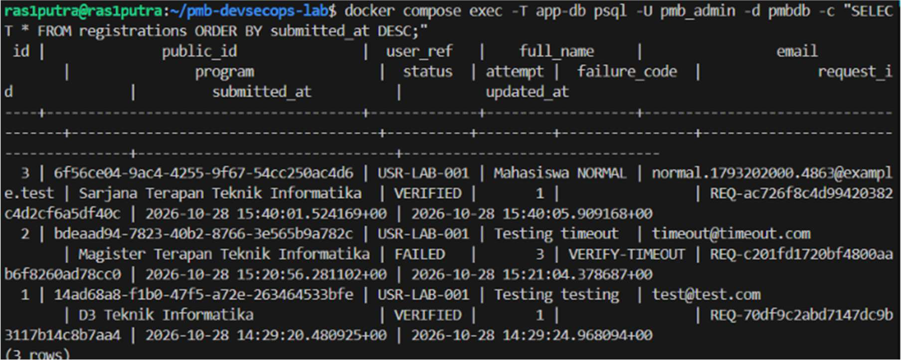

**Usulan strategi retry terkontrol dan dead-letter queue:**  
Untuk menangani kegagalan sementara tanpa kehilangan data transaksi, disarankan menerapkan antrean terpisah berupa Dead-Letter Queue (DLQ) dengan strategi exponential backoff. Transaksi yang gagal dipindahkan ke DLQ untuk dievaluasi ulang secara berkala, menyediakan tombol re-verify manual oleh administrator, atau dijadwalkan lewat background scheduler.

---

## 5. Tahapan D Resilience Logging

Menghentikan service `log-db`:

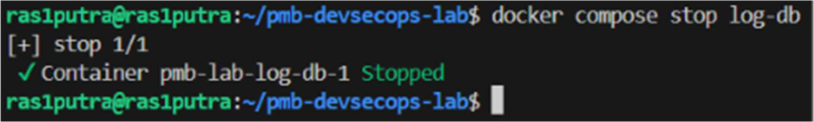

Membuat transaksi baru menggunakan script `demo-normal.sh`:

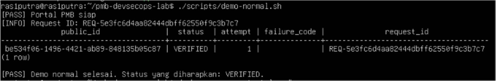

Menganalisa log saat service db log dimatikan:  
Pada log container Fluent Bit, terlihat data log ditampung ke dalam buffer lokal filesystem (`/var/log/flb-storage`) dalam bentuk file fisik berakhiran `.flb` dengan pesan: `failed to flush chunk '...', retry in 9 seconds`. Hal ini membuktikan mekanisme antrean sementara (*temporary storage buffering*) aktif bekerja menahan log saat koneksi ke PostgreSQL terputus.

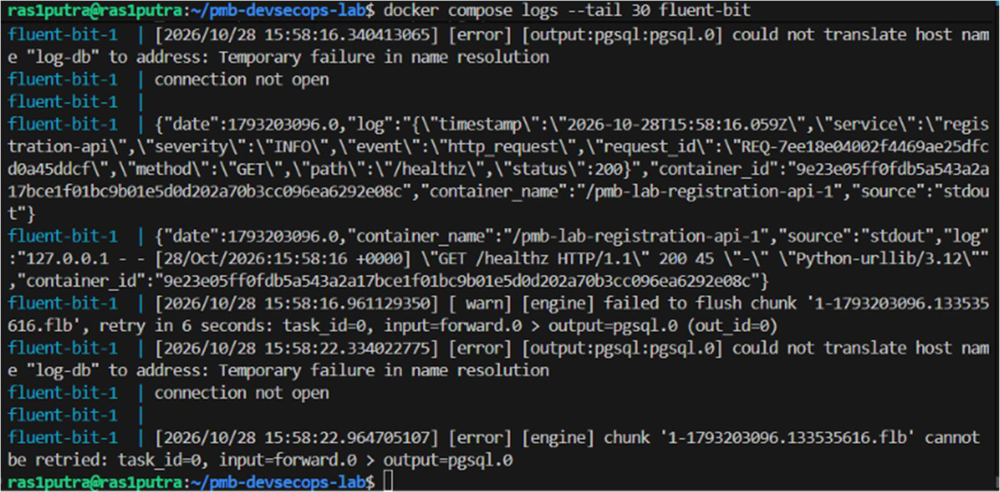

Menyalakan kembali service `log-db`:

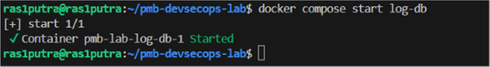

Setelah `log-db` dinyalakan kembali, query pada tabel `logs.fluentbit` menghasilkan `0 rows`. Investigasi log menemukan pesan `chunk cannot be retried: task_id=0` tepat pada detik ke-9 setelah kegagalan pertama. Hal ini terjadi karena file konfigurasi `fluent-bit.conf` tidak menyertakan parameter `Retry_Limit` secara eksplisit, sehingga Fluent Bit menerapkan nilai default internal yaitu hanya mencoba 1 kali retry, dan log yang gagal tadi hangus.

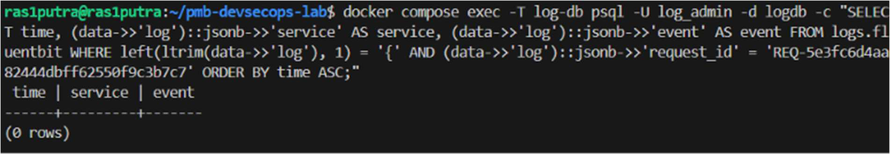

**Jelaskan mengapa hasil ini belum membuktikan exactly-once delivery:**  
Temuan ini membuktikan bahwa keberadaan buffer filesystem 256MB saja tidak cukup menjamin keutuhan log tanpa disertai konfigurasi `Retry_Limit False` (retry tanpa batas) pada blok `[OUTPUT]`. Selain itu, pengujian ini mempertegas bahwa arsitektur pengiriman log mengadopsi prinsip *at-least-once delivery* bukan *exactly-once*, dimana kegagalan jaringan berpotensi memicu kehilangan log jika batas retry terlalu rendah, atau menimbulkan log duplikat jika pengiriman ulang berhasil namun konfirmasi jaringan terputus.

---

## 6. Pertanyaan Analitis

### 1. Mengapa status container Up tidak membuktikan fungsi bisnis sehat?
Status Up hanya membuktikan proses container hidup, bukan aplikasi berjalan normal. Fungsi bisnis tetap bisa gagal akibat deadlock, kegagalan autentikasi, atau timeout dependensi pihak ketiga tanpa membuat container crash, atau silent error.

### 2. Apa perbedaan event time, waktu penerimaan collector, dan waktu penyimpanan database?
Event time adalah waktu saat kejadian dibuat di kode aplikasi, waktu penerimaan collector adalah saat log tiba di Fluent Bit, dan waktu penyimpanan database adalah saat log berhasil diinsert ke PostgreSQL.

### 3. Mengapa nama dan email tidak dimasukkan ke structured log?
Menghilangkannya dari log mencegah kebocoran data sensitif jika file log diakses pihak internal maupun eksternal, menggunakan `entity_id` jauh lebih aman jika tetap membutuhkan informasi email.

### 4. Apa risiko penggunaan request_id dari client tanpa validasi?
Log injection, spam character yang bisa membebani memori, peluang log poisoning.

### 5. Apa yang terjadi bila buffer Fluent Bit mencapai batas 256 MB?
Fluent Bit akan menolak paket log baru dari input forward. Akibatnya, Docker engine akan menahan log di driver atau mulai membuang log terbaru demi melindungi node host agar disk tidak penuh.

### 6. Bagaimana mendeteksi duplikasi record setelah retry?
Dengan melakukan query atau membuat kolom unique agar tidak terjadi duplikasi.

### 7. Kapan PostgreSQL tidak lagi sesuai sebagai backend log utama?
Jika log sudah mencapai jutaan, relational database akan kewalahan di I/O atau di query.

### 8. Kontrol apa yang harus ditambahkan sebelum arsitektur serupa dipakai pada produksi?
Enkripsi jalur log, memisahkan hak akses, mencegah data sensitive bocor ke log, melakukan partisi tabel agar query efisien.

---

## 7. Evidence Minimum

- **screenshot atau keluaran status service;**

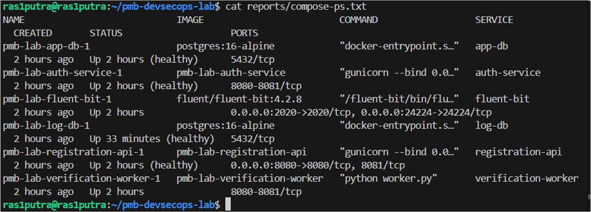

- **request ID baseline dan insiden;**
  - Baseline: `REQ-70df9c2abd7147dc9b3117b14c8b7aa4`
  - Insiden: `REQ-c201fd1720bf4800aab6f8260ad78cc0`
  - Ada di tahapan A dan B di atas

- **query kronologi untuk kedua request ID;**
  - Ada di tahapan B

- **jumlah retry dan kode kegagalan;**
  - Ada di tahapan B di atas

- **bukti recovery transaksi baru;**

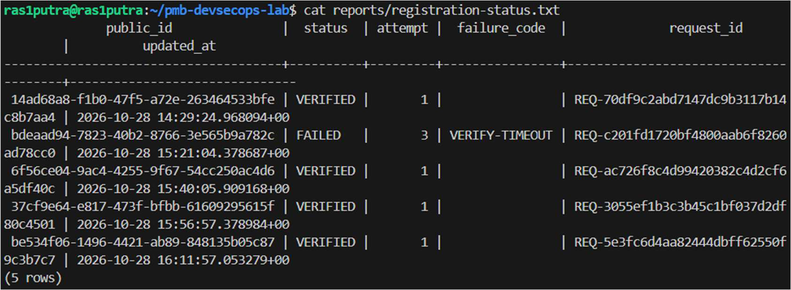

- **hasil pemeriksaan secret;**
  - Tidak ada env atau data sensitif bocor ke log

- **checksum konfigurasi;**

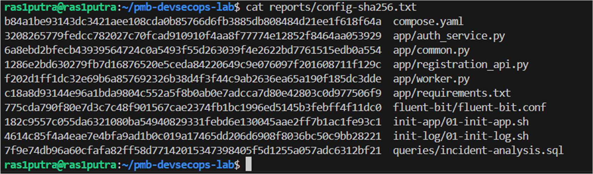

- **pernyataan keterbatasan pengujian.**
  - Pengujian laboratorium ini menggunakan data sintetis dalam lingkungan virtual machine sehingga hasil pengujian ini bertujuan membuktikan konsep logging bukan sebagai tolak ukur produksi

---

## 8. Catatan Penggunaan AI dalam Praktikum

Dalam praktikum ini, Generative AI (Gemini) digunakan sebagai teman diskusi untuk membantu penulisan analisis, merapikan kalimat agar lebih ringkas dan mudah dipahami, serta mencari solusi saat menghadapi kendala teknis selama praktikum.
